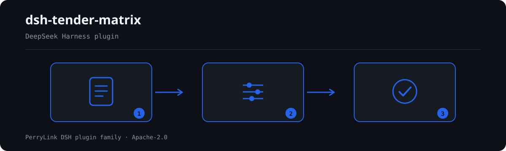

# dsh-tender-matrix — मूल्यांकन कारकों की अंक-मैट्रिक्स की अंकगणितीय जाँच

[English](README.md) · [简体中文](README-zh.md) · [Español](README-es.md) · [Português](README-pt.md) · [हिन्दी](README-hi.md)

[](https://dsh.market/)
[](https://dshfind.com/en/plugins/PerryLink/dsh-tender-matrix?ref=badge)

`dsh-tender-matrix` एक मूल्यांकन-कारक अंक-मैट्रिक्स — शीर्षक पंक्ति और प्रत्येक मूल्यांकन कारक की एक पंक्ति — पढ़ता है और उसी मैट्रिक्स की अपनी अंकगणित और पूर्णता की जाँच करता है: क्या उसमें परियोजना और मूल्यांकन पद्धति लिखी है, क्या कोई अंक उस मद की अधिकतम सीमा से अधिक नहीं है, क्या मदों की अधिकतम सीमाओं का जोड़ आपके द्वारा कॉन्फ़िगर किए गए कुल के बराबर है, क्या किसी एक बोलीदाता के अंकों का जोड़ आपके द्वारा कॉन्फ़िगर किए गए कुल के बराबर है, क्या प्रत्येक अंक का आधार दर्ज है, क्या कारक संख्याएँ अद्वितीय हैं, और क्या आधार कॉलम में कोई अपरिवर्तित प्लेसहोल्डर शेष नहीं है।

## Install

```sh
dsh plugin --profile <name> add dsh-tender-matrix
dsh --profile <name> --dump-config | grep 'dsh-tender-matrix'
```

## आउटपुट कैसा दिखता है



*कार्यप्रवाह: कॉल → प्लगइन → परिणाम। नीचे के उदाहरण वास्तविक कमांड सतह का उपयोग करते हैं।*


इस प्लगइन का अपने ही `TM-001` टेस्ट फ़िक्स्चर पर वास्तविक आउटपुट — कोई नकली चित्र नहीं। नियम-पैक उद्धरण नहीं गढ़ता, इसलिए हर निष्कर्ष लागू किए गए खंड का नाम और यह भी बताता है कि उसका मूल पाठ इस बार प्राप्त नहीं हुआ।

## यह किन सवालों का जवाब देता है

### उदाहरण

नीचे दी गई तालिका उदाहरण-समुच्चय है: पहली पंक्ति विस्तृत केस है, बाकी संक्षिप्त केस हैं।

#### विस्तृत आउटपुट

**उपकरण** `tender_matrix`

**इनपुट**

~~~json
{"rows":[{"评审因素":"施工组织设计","分值":"30","投标人A":"32"}]}
~~~
 
**आउटपुट**

~~~json
{
  "id": "dsh-tender-matrix.TM-002.de09b5a6",
  "ruleId": "TM-002",
  "severity": "warn",
  "locator": {
    "row": 1,
    "field": "bidderA"
  },
  "found": "第 1 行「bidderA」为 32，「maxScore」为 30，不满足不大于关系",
  "expected": "「bidderA」应不大于「maxScore」",
  "fix": "核对评分是否抄错；本条只核对是否超出分值上限，不判断评分是否恰当"
}
~~~

*स्रोत `dsh-tender-matrix/tests/fixtures/TM-002/TM-002-unsafe.json`*

| आपका सवाल | इसका जवाब |
|---|---|
| मैट्रिक्स की हर कोठरी भरी हुई है, फिर भी दोनों कुल-नियम `skipped` क्यों बताते हैं? | क्योंकि दोनों कुल-नियम बिना कॉन्फ़िगर के आते हैं: `TM-003` `maxScore` कॉलम के जोड़ की तुलना उसके `target` से करता है, और `TM-004` किसी एक बोलीदाता के `bidderA` अंकों का जोड़ उसके `target` से करता है; दोनों में `target: 0` है, यानी «कॉन्फ़िगर नहीं», इसलिए जब तक आप निविदा दस्तावेज़ में लिखा आँकड़ा नहीं भरते, हर नियम चुपचाप पास होने के बजाय `skipped` में स्वयं को दर्ज करता है। कॉन्फ़िगर करने के बाद कोई हिट केवल यह बताता है कि जोड़ आपके भरे आँकड़े से भिन्न है, यह नहीं कि अंक-व्यवस्था अनुपयुक्त है; `TM-004` केवल जोड़ है और जानबूझकर किसी «प्रति-बोलीदाता कुल» कॉलम से जोड़ा नहीं गया है। |
| एक मद की अधिकतम सीमा 100 है पर एक कोठरी में 105 लिखा है, और दूसरी पंक्ति के अंक-कॉलम में `优良` लिखा है। | `TM-002` दोनों दर्ज करता है। यह मद-दर-मद `bidderA` की तुलना `maxScore` से करता है और जिस पंक्ति का अंक उस मद की अधिकतम सीमा से अधिक है उसे दर्ज करता है; जब दोनों कोठरियाँ भरी हों पर कोई भी संख्या या तिथि के रूप में पढ़ी न जा सके, तो वह पंक्ति छोड़े जाने के बजाय «तुलना योग्य नहीं» के रूप में दर्ज होती है, जबकि जिस पंक्ति में इन दोनों में से एक ही भरा हो वह तुलना में आती ही नहीं। यह केवल संख्यात्मक तुलना है और कभी नहीं आँकता कि अंक उचित है या नहीं; यह डिफ़ॉल्ट रूप से कॉलम A पढ़ता है, इसलिए B और C के लिए एक अतिरिक्त नियम या `leftField` का ओवरराइड जोड़ें। |
| कुछ पंक्तियों में अंक का आधार कॉलम खाली है। क्या यह दर्ज होता है? | हाँ। `TM-005` माँगता है कि जिन पंक्तियों को सामग्री यह कॉलम देती है उन सब में `basis` कोठरी भरी हो, और हर खाली कोठरी को दर्ज करता है। यह केवल देखता है कि कुछ लिखा है; यह नहीं कि दर्ज आधार टिकता है, उपयुक्त है, या अंक से मेल खाता है। यदि मैट्रिक्स में `basis` कॉलम ही न हो, तो नियम चुपचाप पास होने के बजाय बताता है कि वह लागू नहीं होता। |
| एक ही कारक क्रमांक मैट्रिक्स की दो पंक्तियों में आया है। क्या दर्ज होता है? | `TM-006` दोहराया गया क्रमांक दर्ज करता है, तुलना करते समय खाली स्थान छोड़ देता है। यह केवल अद्वितीयता स्थापित करता है, और यह मायने रखती है क्योंकि दोहराव से अधिकतम-सीमाओं का जोड़ गलत हो जाता है: या तो वही कारक दो बार दर्ज हुआ, या दो कारक गलती से एक ही क्रमांक पा गए। कौन-सी पंक्ति सही है, यह नहीं तय करता। |
| मैट्रिक्स टेम्पलेट से कॉपी हुआ है, आधार कॉलम में अब भी `【】` या `TBD` है। क्या यह पकड़ में आता है? | `TM-007` उस `basis` कोठरी को दर्ज करता है जिसमें अब भी उसके प्लेसहोल्डर शब्दों में से कोई है — `【`, `】`, `{{`, `}}`, `XXX`, `xxx`, `待填`, `待补充`, `TBD`, `todo`, `示例` — यह सूची आपके टेम्पलेट के अनुसार बदली जा सकती है। इसका लक्ष्य यही विफलता है कि प्लेसहोल्डर को पहले से दर्ज कारण समझ लिया जाए। इसका शीर्षक टिप्पणी का भी ज़िक्र करता है, पर जाँच केवल `basis` कॉलम पढ़ती है और आधार की गुणवत्ता नहीं आँकती। |
| शीर्षक में नहीं लिखा कि यह मैट्रिक्स किस परियोजना का है और किस मूल्यांकन पद्धति पर है। | `TM-001` माँगता है कि सामग्री का शीर्षक `project` और `method` दे, और जो न हो उसे दर्ज करता है; यह केवल यह देखता है कि शीर्षक इन्हें घोषित करता है, यह नहीं कि वे निविदा दस्तावेज़ से मेल खाते हैं। यदि आपकी संस्था के प्रपत्र में मूल्यांकन-पद्धति का कॉलम ही नहीं है, तो उस नियम के `fields` को `[project]` कर दें, ताकि वह ऐसा कॉलम माँगना बंद कर दे जो आपके प्रपत्र में कभी नहीं रहता। |

## यह किन मानकों पर आधारित है

| दस्तावेज़ | संख्यांक | इन्हें उद्धृत करने वाले नियम |
|---|---|---|
| 《中华人民共和国招标投标法》 | 1999年8月30日通过，2017年12月27日修正（全国人大常委会《关于修改〈中华人民共和国招标投标法〉、〈中华人民共和国计量法〉的决定》），本法自2000年1月1日起施行 | TM-001, TM-002, TM-003, TM-004, TM-005, TM-006, TM-007 |

**Boundary:** this plugin checks an **评标因素评分矩阵** for arithmetic — that the matrix names its project and
evaluation method, that no single score exceeds its item's maximum, that the maximum scores total what you
configure, that a bidder's scores total what you configure, that each score records its basis, that factor
numbers are unique, and that no placeholder survives. It does **not** decide whether a score is appropriate,
whether the evaluation was fair, or who should win. **Scoring is the evaluation committee's independent
judgement, and the weights and criteria are the tender document's.**

> ### ⚠️ Read this before trusting a citation in the report
>
> **Every `excerpt` in this plugin's rule pack says, in so many words, that the clause text was not
> obtained.** The regime lives in 《中华人民共和国招标投标法》and its implementing regulations, plus **each
> project's evaluation method inside the tender document**. The verification pass could not retrieve verbatim
> clause text, so rather than paraphrase a quotation the pack states the gap in the `excerpt` field itself and
> puts the honest reasoning in `note`. Every rule is therefore `warn` or `info`, and a test asserts that no
> rule claims a quotation it does not have. **When the texts are in hand, two things must be done: replace
> each `excerpt` with the real clause, and raise `kind` to `direct`.**
>
> **The plugin ships no scoring scale.** The two total checks ship with a target of `0`, meaning "not
> configured":
>
> - `TM-003` compares the sum of the items' maximum scores against `target`. 100 is common, but 120-point
>   scales and weighted schemes exist, so the total is your tender document's figure and the rule reports
>   that it could not run until you set it.
> - `TM-004` compares the sum of one bidder's scores against `target`. The check compares the column against
>   the figure **you** state; it is deliberately not wired to a per-bidder total column, so it stays a pure
>   addition check.
>
> `TM-002` checks column A by default (`bidderA` vs `maxScore`). Add a rule each for B and C, or override
> `leftField` per call.

## Compatibility

| सतह | स्थिति |
|---|---|
| Harness | peer रेंज `>=0.1.2-rc.1 <0.2.0 \|\| >=0.2.0-0 <0.3.0` — `0.2.0-rc.2` और `0.2.1-rc.2` दोनों को स्वीकार करने के लिए सत्यापित। **`engines.dsh` `>=0.2.1-0 <0.3.0` के रूप में घोषित है** और 0.2.1 से होस्ट इसे लागू करता है |
| Node | `^22.19.0 || >=24.0.0` |
| प्लेटफ़ॉर्म | सभी (शुद्ध ESM; कोई नेटिव कोड नहीं, कोई नेटवर्क नहीं, कोई मॉडल कॉल नहीं) |
| टूल मोड | `native` और `ptc` में काम करता है; पूरे फ़ोल्डर के लिए `ptc` चुनें |

## What it does

नियम-सूची, फ़ील्ड और विस्तृत व्यवहार [README.md](README.md#what-it-does) (अंग्रेज़ी मुख्य संस्करण) में हैं। यह प्लगइन केवल उद्धृत धाराओं के सामने शाब्दिक अंतर सूचीबद्ध करता है और हर न चल पाई जाँच को `skipped` में बताता है।

## Configuration

सभी समायोज्य पैरामीटर `src/config.ts` की Schemastery स्कीमा में हैं, इसलिए कोड बदले बिना `cordis.yml` से बदले जा सकते हैं; प्रति-नियम सीमाएँ `rules/` के नियम-पैक में हैं।

| कुंजी | प्रकार | डिफ़ॉल्ट | विवरण |
|---|---|---|---|
| `rulesFile` | string | `rules/tender-matrix.yaml` | नियम-पैक का पथ, पैकेज रूट के सापेक्ष |
| `disabledRules` | string[] | `[]` | बंद करने वाले नियम id; प्रत्येक `skipped` में दिखता है |
| `onlyRules` | string[] | `[]` | केवल ये नियम चलाएँ; खाली होने पर सभी नियम चलते हैं |
| `skipNotes` | string | `""` | हर `skipped` कारण के आगे जोड़ी जाने वाली टिप्पणी |
| `timeoutMs` | number | `120000` | उपकरण का सहकारी समय-सीमा बजट |

## Material format

JSON या YAML स्वीकार्य है। पूरा फ़ील्ड उदाहरण [README.md](README.md#material-format) (अंग्रेज़ी मुख्य संस्करण) में है। पढ़ने की परत में फ़ील्ड वैकल्पिक हैं और जाँच इंजन उन्हें सत्यापित करता है, इसलिए आंशिक निर्यात पर क्रैश के बजाय "अनुपस्थित" श्रेणी के निष्कर्ष मिलते हैं।

## Rule sources

नियम-डेटा कोड से अलग है: प्रत्येक नियम में दस्तावेज़, संख्या, स्रोत की अपनी क्रमांकन-प्रणाली के अनुसार धारा, शब्दशः उद्धरण और स्रोत URL होता है। लोडर लागू करता है कि उद्धरण कम से कम आठ अक्षरों का वास्तविक उद्धरण हो, और जिस जाँच का आधार केवल सामान्य सिद्धांत (`kind: derived-from-principle`, अधिकतम `warn`) या स्थानीय नीति (`kind: institutional-configuration`, अधिकतम `info`) हो, उसे कभी `error` घोषित न किया जाए।

सत्यापित सीमाएँ और जान-बूझकर **न** कहे गए निष्कर्ष [README.md](README.md#rule-sources) (अंग्रेज़ी मुख्य संस्करण) और `rules/evidence/` में हैं।

## Troubleshooting

- **प्लगइन इंस्टॉल हो गया पर टूल दिखता नहीं**: जाँचें कि `main` `lib/index.mjs` पर जाता है और `pnpm run build` ने उसे बनाया है।
- **`dsh plugin add` असंगत बताकर मना करता है**: peer range `0.1.x` और `0.2.x` दोनों को कवर करती है; बाहर होने पर स्पष्ट छूट दें: `dsh plugin --profile <name> allow-version <pkg@ver> --dsh-version <runtime> --accept-risk`।
- **कोई नियम नहीं चला**: `skipped` सरणी देखें।
- **`check` में `manifest-peers` विफल दिखता है**: यह `dsh-plugin-dev` की ज्ञात अपस्ट्रीम समस्या है; रनटाइम इंस्टॉल के समय अनुकूलता लागू करता है।
- **समय खिसका हुआ लगता है**: सारी गणना दिए गए स्ट्रिंग पर वॉल-क्लॉक है।

## Development

```sh
pnpm install
pnpm run typecheck
pnpm test
pnpm run build
node ../scripts/sync-shared.mjs dsh-tender-matrix
```

अंतिम कमांड `../_shared` का साझा किट `src/shared/` में कॉपी करता है; हर साझा बदलाव के बाद इसे दोबारा चलाएँ।

## PerryLink DSH Plugin Family

यह प्रोजेक्ट [PerryLink](https://github.com/PerryLink) के DeepSeek Harness प्लगइन परिवार का हिस्सा है। पूरी सूची नीचे संक्षिप्त रखी गई है ताकि हर README की पहली स्क्रीन छोटी रहे; हर पंक्ति और उसकी स्थिति देखने के लिए इसे खोलें।

<details>
<summary>सभी प्लगइन खोलें</summary>

| प्लगइन | स्थिति |
|---|---|
| **[dsh-aqua-input-check](https://github.com/PerryLink/dsh-aqua-input-check)** |  |
| **[dsh-archive-check](https://github.com/PerryLink/dsh-archive-check)** |  |
| **[dsh-auto-review](https://github.com/PerryLink/dsh-auto-review)** |  |
| **[dsh-autotier](https://github.com/PerryLink/dsh-autotier)** |  |
| **[dsh-bid-ca-precheck](https://github.com/PerryLink/dsh-bid-ca-precheck)** |  |
| **[dsh-bid-qual-check](https://github.com/PerryLink/dsh-bid-qual-check)** |  |
| **[dsh-cert-mcp](https://github.com/PerryLink/dsh-cert-mcp)** |  |
| **[dsh-checkpoint-rewind](https://github.com/PerryLink/dsh-checkpoint-rewind)** |  |
| **[dsh-click](https://github.com/PerryLink/dsh-click)** |  |
| **[dsh-composer-history](https://github.com/PerryLink/dsh-composer-history)** |  |
| **[dsh-contract-stance](https://github.com/PerryLink/dsh-contract-stance)** |  |
| **[dsh-customs-doc-check](https://github.com/PerryLink/dsh-customs-doc-check)** |  |
| **[dsh-data-quality](https://github.com/PerryLink/dsh-data-quality)** |  |
| **[dsh-demurrage-ledger](https://github.com/PerryLink/dsh-demurrage-ledger)** |  |
| **[dsh-doublecheck](https://github.com/PerryLink/dsh-doublecheck)** |  |
| **[dsh-drill-script-check](https://github.com/PerryLink/dsh-drill-script-check)** |  |
| **[dsh-eia-guide-check](https://github.com/PerryLink/dsh-eia-guide-check)** |  |
| **[dsh-emergency-plan](https://github.com/PerryLink/dsh-emergency-plan)** |  |
| **[dsh-essay-rubric-check](https://github.com/PerryLink/dsh-essay-rubric-check)** |  |
| **[dsh-evidence-check](https://github.com/PerryLink/dsh-evidence-check)** |  |
| **[dsh-export-ctl-check](https://github.com/PerryLink/dsh-export-ctl-check)** |  |
| **[dsh-fast](https://github.com/PerryLink/dsh-fast)** |  |
| **[dsh-fmea-table-check](https://github.com/PerryLink/dsh-fmea-table-check)** |  |
| **[dsh-forecast-penalty](https://github.com/PerryLink/dsh-forecast-penalty)** |  |
| **[dsh-fund-research](https://github.com/PerryLink/dsh-fund-research)** |  |
| **[dsh-github](https://github.com/PerryLink/dsh-github)** |  |
| **[dsh-gongwen-flow-check](https://github.com/PerryLink/dsh-gongwen-flow-check)** |  |
| **[dsh-gongwen-word-check](https://github.com/PerryLink/dsh-gongwen-word-check)** |  |
| **[dsh-guard-plan-qc](https://github.com/PerryLink/dsh-guard-plan-qc)** |  |
| **[dsh-hazchem-check](https://github.com/PerryLink/dsh-hazchem-check)** |  |
| **[dsh-hazplan-check](https://github.com/PerryLink/dsh-hazplan-check)** |  |
| **[dsh-hidden-risk-map](https://github.com/PerryLink/dsh-hidden-risk-map)** |  |
| **[dsh-hs-classify](https://github.com/PerryLink/dsh-hs-classify)** |  |
| **[dsh-icd-rule-check](https://github.com/PerryLink/dsh-icd-rule-check)** |  |
| **[dsh-industry-research](https://github.com/PerryLink/dsh-industry-research)** |  |
| **[dsh-lawcite-adapter](https://github.com/PerryLink/dsh-lawcite-adapter)** |  |
| **[dsh-laya](https://github.com/PerryLink/dsh-laya)** |  |
| **[dsh-lc-doc-check](https://github.com/PerryLink/dsh-lc-doc-check)** |  |
| **[dsh-learning-gap-check](https://github.com/PerryLink/dsh-learning-gap-check)** |  |
| **[dsh-library](https://github.com/PerryLink/dsh-library)** |  |
| **[dsh-local-ai](https://github.com/PerryLink/dsh-local-ai)** |  |
| **[dsh-lsp-actions](https://github.com/PerryLink/dsh-lsp-actions)** |  |
| **[dsh-mask](https://github.com/PerryLink/dsh-mask)** |  |
| **[dsh-mcp-panel](https://github.com/PerryLink/dsh-mcp-panel)** |  |
| **[dsh-medrec-qc](https://github.com/PerryLink/dsh-medrec-qc)** |  |
| **[dsh-memento](https://github.com/PerryLink/dsh-memento)** |  |
| **[dsh-nsfc-form-check](https://github.com/PerryLink/dsh-nsfc-form-check)** |  |
| **[dsh-nurse-record-check](https://github.com/PerryLink/dsh-nurse-record-check)** |  |
| **[dsh-observe](https://github.com/PerryLink/dsh-observe)** |  |
| **[dsh-origin-rvc-check](https://github.com/PerryLink/dsh-origin-rvc-check)** |  |
| **[dsh-ota-review-check](https://github.com/PerryLink/dsh-ota-review-check)** |  |
| **[dsh-output-styles](https://github.com/PerryLink/dsh-output-styles)** |  |
| **[dsh-paper-doc-adapter](https://github.com/PerryLink/dsh-paper-doc-adapter)** |  |
| **[dsh-permission-rules](https://github.com/PerryLink/dsh-permission-rules)** |  |
| **[dsh-permit-report-check](https://github.com/PerryLink/dsh-permit-report-check)** |  |
| **[dsh-pipeline-check](https://github.com/PerryLink/dsh-pipeline-check)** |  |
| **[dsh-pleading-draft](https://github.com/PerryLink/dsh-pleading-draft)** |  |
| **[dsh-plugin-doctor](https://github.com/PerryLink/dsh-plugin-doctor)** |  |
| **[dsh-plugin-guide](https://github.com/PerryLink/dsh-plugin-guide)** |  |
| **[dsh-plugin-kit](https://github.com/PerryLink/dsh-plugin-kit)** |  |
| **[dsh-plugin-upgrade](https://github.com/PerryLink/dsh-plugin-upgrade)** |  |
| **[dsh-policy-brief-draft](https://github.com/PerryLink/dsh-policy-brief-draft)** |  |
| **[dsh-power-loss-split](https://github.com/PerryLink/dsh-power-loss-split)** |  |
| **[dsh-power-ticket-check](https://github.com/PerryLink/dsh-power-ticket-check)** |  |
| **[dsh-ppap-check](https://github.com/PerryLink/dsh-ppap-check)** |  |
| **[dsh-protest-deadline](https://github.com/PerryLink/dsh-protest-deadline)** |  |
| **[dsh-railway-window](https://github.com/PerryLink/dsh-railway-window)** |  |
| **[dsh-repair-order-qc](https://github.com/PerryLink/dsh-repair-order-qc)** |  |
| **[dsh-research-report](https://github.com/PerryLink/dsh-research-report)** |  |
| **[dsh-review-reply-check](https://github.com/PerryLink/dsh-review-reply-check)** |  |
| **[dsh-rulefile-check](https://github.com/PerryLink/dsh-rulefile-check)** |  |
| **[dsh-safety-brief-check](https://github.com/PerryLink/dsh-safety-brief-check)** |  |
| **[dsh-score](https://github.com/PerryLink/dsh-score)** |  |
| **[dsh-session-sync](https://github.com/PerryLink/dsh-session-sync)** |  |
| **[dsh-site-log-check](https://github.com/PerryLink/dsh-site-log-check)** |  |
| **[dsh-skill-pack-security](https://github.com/PerryLink/dsh-skill-pack-security)** |  |
| **[dsh-soe-decision-check](https://github.com/PerryLink/dsh-soe-decision-check)** |  |
| **[dsh-soilwater-check](https://github.com/PerryLink/dsh-soilwater-check)** |  |
| **[dsh-sop-sync-check](https://github.com/PerryLink/dsh-sop-sync-check)** |  |
| **[dsh-spc-gbt-adapter](https://github.com/PerryLink/dsh-spc-gbt-adapter)** |  |
| **[dsh-talk](https://github.com/PerryLink/dsh-talk)** |  |
| **[dsh-tender-extract](https://github.com/PerryLink/dsh-tender-extract)** |  |
| **[dsh-tender-matrix](https://github.com/PerryLink/dsh-tender-matrix)** |  |
| **[dsh-test-drive](https://github.com/PerryLink/dsh-test-drive)** |  |
| **[dsh-ticktick](https://github.com/PerryLink/dsh-ticktick)** |  |
| **[dsh-translate](https://github.com/PerryLink/dsh-translate)** |  |
| **[dsh-warranty-calc](https://github.com/PerryLink/dsh-warranty-calc)** |  |
| **[dsh-budget](https://github.com/PerryLink/dsh-budget)** | 🧊 फ़्रोज़न — रिपॉज़िटरी README देखें |
| **[dsh-claude-move](https://github.com/PerryLink/dsh-claude-move)** | 🧊 फ़्रोज़न — रिपॉज़िटरी README देखें |
| **[dsh-defend](https://github.com/PerryLink/dsh-defend)** | 🧊 फ़्रोज़न — रिपॉज़िटरी README देखें |
| **[dsh-draw](https://github.com/PerryLink/dsh-draw)** | 🧊 फ़्रोज़न — रिपॉज़िटरी README देखें |
| **[dsh-reach](https://github.com/PerryLink/dsh-reach)** | 🧊 फ़्रोज़न — रिपॉज़िटरी README देखें |
| **[dsh-background-agents](https://github.com/PerryLink/dsh-background-agents)** | 🚫 सेवानिवृत्त — रिपॉज़िटरी README देखें |
| **[dsh-session-pin](https://github.com/PerryLink/dsh-session-pin)** | 🚫 सेवानिवृत्त — रिपॉज़िटरी README देखें |
| **[dsh-team-rooms](https://github.com/PerryLink/dsh-team-rooms)** | 🚫 सेवानिवृत्त — रिपॉज़िटरी README देखें |

</details>

## License

[Apache License 2.0](LICENSE) © 2026 dsh-tender-matrix contributors.
