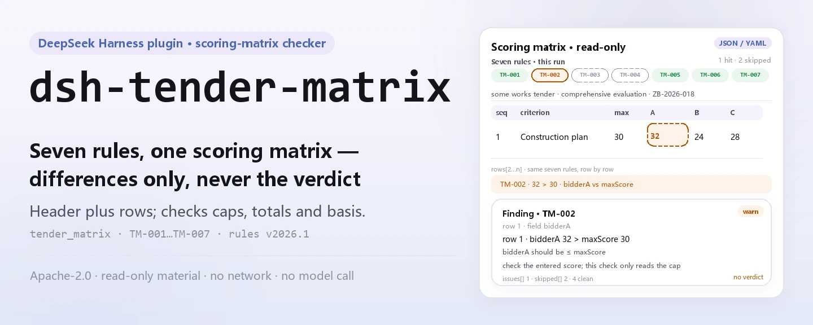
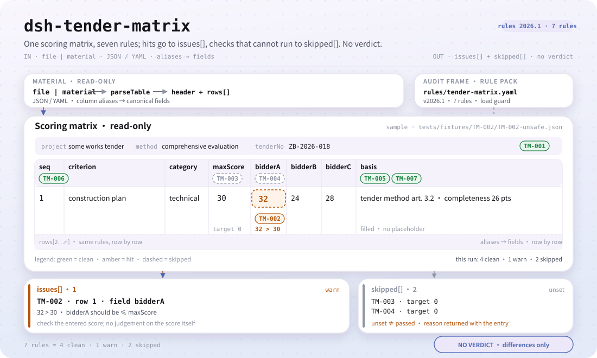

<div align="center">

<picture>
  <source media="(prefers-color-scheme: dark)" srcset="docs/assets/dsh-tender-matrix-hero-en-dark.webp">
  
</picture>

# dsh-tender-matrix

**Point out the arithmetic errors in an evaluation-factor scoring matrix before the review meeting — differences only, never the committee's verdict.**

A DeepSeek Harness checker for tender agencies, bid-evaluation support and internal review: it reads one scoring matrix (a package header plus one row per evaluation factor) and checks the matrix's own arithmetic and completeness with a versioned rule pack.

[Install](#three-step-setup) · [Configuration](#configuration) · [FAQ](#faq) · [简体中文](README.md) · [English](README.en.md)

[](LICENSE)
[](#compatibility)
[](https://www.npmjs.com/package/dsh-tender-matrix)
[](https://github.com/PerryLink/dsh-tender-matrix/actions/workflows/ci.yml)
[](#compatibility)

[](https://github.com/PerryLink/dsh-tender-matrix/stargazers)
[](https://www.npmjs.com/package/dsh-tender-matrix)
[](https://dshfind.com/plugins/PerryLink/dsh-tender-matrix?ref=badge)
[](https://securityscorecards.dev/viewer/?uri=github.com/PerryLink/dsh-tender-matrix)
[](https://dsh.market/)
[](https://gitee.com/perrylink/dsh-tender-matrix)

```sh
dsh plugin --profile <name> add dsh-tender-matrix
```

</div>

<sub>Community plugin, not affiliated with DeepSeek. Canonical repository: <https://github.com/PerryLink/dsh-tender-matrix> (Gitee is a mirror).</sub>

## What it is

`dsh-tender-matrix` reads one **evaluation-factor scoring matrix** — a package header (project, tender number, evaluation method) plus one row per evaluation factor — and checks the matrix's own arithmetic and completeness: that it names its project and evaluation method, that no single score exceeds that item's maximum, that the item maximum scores total the figure you configure, that one bidder's scores total the figure you configure, that every score records its basis, that factor numbers are unique, and that no unreplaced placeholder survives in the basis column.

It returns a list of which row, which column, and what differs, for tender agencies, bid-evaluation support and internal review to verify item by item. It does **not** pass a compliance verdict, assign liability, replace the reviewer, or decide who should win — scoring is the evaluation committee's independent judgement, and the weights and criteria belong to the tender document.

<picture>
  <source media="(prefers-color-scheme: dark)" srcset="docs/assets/dsh-tender-matrix-flow-v5-dark.svg">
   30; TM-003/TM-004 are skipped because target is unset; two exits, issues[] and skipped[], and no compliance verdict.">
</picture>

## Three-step setup

1. **Install** (pick one channel):

   ```sh
   # git channel (latest main; equivalent to git+https://github.com/PerryLink/dsh-tender-matrix.git)
   dsh plugin --profile web add github:PerryLink/dsh-tender-matrix
   # npm channel (published releases)
   dsh plugin --profile web add dsh-tender-matrix
   # tarball channel: pnpm pack in this repo, then
   dsh plugin --profile web add ./dsh-tender-matrix-<version>.tgz
   ```

   `lib/index.mjs` is the shipped artifact; installing from source runs `prepare` (`tsdown`) to produce it, and nothing compiles at runtime.

2. **Minimal config** (defaults work; `cordis.patch.yml` inserts one row, add config only if needed):

   ```yaml
   - insert:
       - id: dsh-tender-matrix
         name: dsh-tender-matrix
   ```

3. **Verify it mounts**:

   ```sh
   dsh --profile web --dump-config | grep 'dsh-tender-matrix'
   node samples/quickstart/run.mjs --check
   ```

   The second command runs the bundled sample and prints 1 `warn` plus 2 `skipped`; the expected result is in `samples/quickstart/expected/result.json`.

You can also search for "Tender Compliance Suite" in WorkBuddy / Coze (this check is one part of it; availability is as listed).

**Uninstall**: `dsh plugin --profile web remove dsh-tender-matrix` (or remove the row from the profile patch).

<details>
<summary>One-minute trial run</summary>

The sample input is `samples/quickstart/input/TM-001-unsafe.json`, the expected output is `samples/quickstart/expected/result.json`, and the screenshot is `docs/assets/quickstart.png`.


</details>

## Core capabilities

`dsh-tender-matrix` registers one tool, `tender_matrix`: it reads a material (JSON or YAML), applies a versioned rule pack, and returns a report. The rule pack is a data file — replace `rules/tender-matrix.yaml` to switch rule sets without touching code.

| Rule | What it checks | Severity | Basis kind |
|---|---|---|---|
| `TM-001` | the matrix names its project and evaluation method | warn | derived from principle |
| `TM-002` | no score exceeds its item's maximum | warn | derived from principle |
| `TM-003` | the item maximum scores total your configured figure (off by default) | info | institutional configuration |
| `TM-004` | a bidder's scores total your configured figure (off by default) | warn | derived from principle |
| `TM-005` | every score records its basis | warn | derived from principle |
| `TM-006` | factor numbers are unique | warn | derived from principle |
| `TM-007` | the basis column holds no unreplaced placeholder | warn | derived from principle |

- **Data separate from code** — the rule pack `rules/tender-matrix.yaml` declares every check and is validated on load; replacing the file replaces the rule set.
- **An empty issue list is not "nothing is wrong"** — every check that could not run is reported in `skipped` with its rule id and reason; a "not applicable" such as a missing `basis` column says so instead of passing silently.
- **Differences only** — the report states which row, which column, what is there, what is expected, and how to verify it; it does not pass a compliance verdict, assign liability, or replace the reviewer.
- **Read-only material** — the tool reads `file` or `material`, never modifies the original or writes back to it.
- **Verifiable rule pack** — every rule carries document, number, clause, verbatim excerpt, and source URL; an excerpt shorter than eight characters or a severity above its basis kind fails at load.

### Examples

These are the plugin's real entry points; install once, then call one.

**Detailed example** — tool `tender_matrix`, input:

```json
{"rows":[{"评审因素":"施工组织设计","分值":"30","投标人A":"32"}]}
```

Output:

```json
{
  "id": "dsh-tender-matrix.TM-002.de09b5a6",
  "ruleId": "TM-002",
  "severity": "warn",
  "locator": {
    "row": 1,
    "field": "bidderA"
  },
  "found": "第 1 行「bidderA」为 32，「maxScore」为 30，不满足不大于关系",
  "expected": "「bidderA」应不大于「maxScore」",
  "fix": "核对评分是否抄错；本条只核对是否超出分值上限，不判断评分是否恰当"
}
```

*Observed from `dsh-tender-matrix/tests/fixtures/TM-002/TM-002-unsafe.json`*

**Brief example**: `tender_matrix` against `samples/quickstart/input/TM-001-unsafe.json` returns `issueCount: 1`, `warn: 1`, `skippedCount: 2` in one call.

## Standards it follows

| Document | Number | Cited by rules |
|---|---|---|
| Tendering and Bidding Law of the People's Republic of China | Adopted 1999-08-30; amended 2017-12-27 (NPC Standing Committee decision amending the Tendering and Bidding Law and the Metrology Law); in force since 2000-01-01 | TM-001, TM-002, TM-003, TM-004, TM-005, TM-006, TM-007 |

**Boundary:** this plugin checks an **evaluation-factor scoring matrix** for arithmetic — that the matrix names its project and evaluation method, that no single score exceeds its item's maximum, that the maximum scores total what you configure, that a bidder's scores total what you configure, that each score records its basis, that factor numbers are unique, and that no placeholder survives. It does **not** decide whether a score is appropriate, whether the evaluation was fair, or who should win. **Scoring is the evaluation committee's independent judgement, and the weights and criteria are the tender document's.**

> ### ⚠️ Read this before trusting a citation in the report
>
> **Every `excerpt` in this plugin's rule pack is a verbatim quotation of the clause it cites, and the citation gate re-checks each segment against the record in `rules/evidence/`.** The pack states a requirement verbatim when the clause states it, and stops at `warn` when the clause only implies it: a check that rests on a general principle is capped below `error` and says so in its own `note`. What the pack will not do is paraphrase a clause and present the paraphrase as a quotation. When the text could not be obtained, the `excerpt` says so plainly and no quotation is invented.
>
> **The plugin ships no scoring scale.** The two total checks ship with a target of `0`, meaning "not configured":
>
> - `TM-003` compares the sum of the items' maximum scores against `target`. 100 is common, but 120-point scales and weighted schemes exist, so the total is your tender document's figure and the rule reports that it could not run until you set it.
> - `TM-004` compares the sum of one bidder's scores against `target`. The check compares the column against the figure **you** state; it is deliberately not wired to a per-bidder total column, so it stays a pure addition check.
>
> `TM-002` checks column A by default (`bidderA` vs `maxScore`). Add a rule each for B and C, or override `leftField` per call.

The load-time guard requires every `excerpt` to be at least eight characters and to be a real quotation, but it cannot tell a quotation from a description; this pack therefore leans on the pack header, each rule's `note`, and a test that makes every excerpt admit the gap.

## Configuration

All tunables live in the Schemastery schema in `src/config.ts`; change `cordis.yml` without touching code. Per-rule thresholds live in the rule pack under `rules/`.

Most-used keys:

| Key | Type | Default | Meaning |
|---|---|---|---|
| `rulesFile` | string | `rules/tender-matrix.yaml` | Rule-pack path, relative to the package root |
| `disabledRules` | string[] | `[]` | Rule ids to stop running; each appears in `skipped` |
| `onlyRules` | string[] | `[]` | Run only these rule ids; empty runs every rule |
| `skipNotes` | string | `""` | Note appended to every `skipped` reason |
| `timeoutMs` | number | `120000` | Cooperative tool timeout budget (milliseconds) |

<details>
<summary>Rule-level parameters (TM-002 / TM-003 / TM-004 / TM-007)</summary>

- `TM-002` `leftField` / `rightField` / `relation` — the two compared columns and the relation, `bidderA <= maxScore` by default.
- `TM-003` `target` — the total the items' maximum scores must reach; `0` means the rule does not run.
- `TM-004` `field` / `target` — the bidder column and the total it must reach; `0` means the rule does not run.
- `TM-007` `terms` — the placeholders to look for.

</details>

Example override in your profile patch:

```yaml
- insert:
    - id: dsh-tender-matrix
      name: dsh-tender-matrix
      config:
        onlyRules: [TM-001, TM-002, TM-005, TM-006, TM-007]
        skipNotes: institutional rule 4 of this buyer
```

### Material format

The tool accepts JSON or YAML:

```yaml
project: 某某工程施工招标
tenderNo: ZB-2026-018
method: 综合评估法
rows:
  - { 序号: '1', 评审因素: 施工组织设计, 分值: '30', 投标人A: '26',
      投标人B: '24', 投标人C: '28', 评分依据: '按招标文件评标办法第 3.2 条' }
```

Column names are matched case-insensitively and ignoring spaces, underscores and hyphens, so a Chinese header for bidder A and `bidderA` resolve to the same field; the matrix's own column names are kept, so a finding names the column it actually read. Fields are optional at the reader layer and validated by the check engine, so a partial export produces "missing" findings instead of a crash. Excel can be converted to JSON/YAML first, in chat if the platform supports it.

## FAQ

<details>
<summary>Every cell of the matrix is filled in, so why do both total checks report `skipped`?</summary>

Because both totals ship unconfigured: `TM-003` compares the sum of the `maxScore` column against its `target`, and `TM-004` adds up one bidder's `bidderA` scores against its `target`; both carry `target: 0`, meaning "not configured", so each reports itself in `skipped` rather than passing quietly until you enter the figure your tender document states. Once configured, a hit means only that the sum differs from the figure you set — not that the score scale is non-compliant; `TM-004` is pure addition and is deliberately not wired to any per-bidder total column.

</details>

<details>
<summary>One item's maximum is 100 but a cell says 105, and another row's score cell holds a grade word.</summary>

`TM-002` reports both. It compares `bidderA` with `maxScore` item by item and reports a row whose score is above that item's maximum; when both cells are filled but neither can be read as a number or a date, that row is reported as uncomparable instead of being passed over, while a row missing one of the two is not compared at all. It is a numeric comparison only and never judges whether a score is appropriate; it reads column A by default — cover B and C with an extra rule or a `leftField` override.

</details>

<details>
<summary>Some rows leave the scoring-basis column empty, or still carry template placeholders such as empty brackets or `TBD`.</summary>

Both are reported. `TM-005` requires the `basis` cell to be filled on every row the material gives that column, and reports each blank one; it checks only that something is written there — not whether the recorded basis holds, is appropriate, or matches the score. `TM-007` reports a `basis` cell that still contains any of its placeholder terms:

```text
【 】 {{ }} XXX xxx 待填 待补充 TBD todo 示例
```

That list is adjustable to your own template. The failure it targets is a placeholder being read as a reason already recorded. If the matrix carries no `basis` column at all, `TM-005` reports that it does not apply rather than passing silently.

</details>

<details>
<summary>The same factor number appears on two rows of the matrix. What is reported?</summary>

`TM-006` reports the repeated number, comparing with whitespace ignored. Uniqueness is all it establishes, and it matters because a repeat makes the maximum-score total come out wrong: either the same factor was registered twice or two factors were mis-numbered as one. It does not decide which of the two rows is the correct one.

</details>

<details>
<summary>The header does not say which project this matrix belongs to, nor which evaluation method it follows.</summary>

`TM-001` requires the material's header to carry `project` and `method` and reports whichever is missing; it checks only that the header declares them, not that they agree with the tender document. If your institution's form has no evaluation-method column, set that rule's `fields` to `[project]` so it stops asking for a column your form never carries.

</details>

<details>
<summary>Where is the data stored? Does it call the network or a model? How big is the overhead?</summary>

Everything happens in the local process: it reads only the `file` or `material` you pass and the rule pack, makes no network requests, calls no model, writes no telemetry, and keeps no second copy beyond the tool result. The host's own session/log storage is controlled by the host; this package adds no copy. Overhead scales linearly with the number of matrix rows and is dominated by parsing and row-by-row comparison; the timeout budget is governed by `timeoutMs`. Removing the package removes code only — it does not delete host session logs or material you already created.

</details>

<details>
<summary>Does it fight other plugins over tool names, service keys, or slots?</summary>

No. It registers exactly one tool, `tender_matrix`, removed through the disposer returned by `ctx.tools.register` on unload or hot reload; it provides no service key, registers no client slot, registers no `webServer` route, listens to no shared event, and mutates no global. The bundle patch only `insert`s its own row and never overrides a built-in row's `config`. See "Interoperability with other DSH plugins" for the point-by-point argument.

</details>

## Security boundaries

- **No qualitative verdict.** The report lists only differences the material itself can identify; it does not decide compliance, liability, whether a score is appropriate, whether the evaluation was fair, or who should win. The report always carries the disclaimer, and a wording guard enforces its phrasing.
- **No fabricated citations.** Every rule must fill `document` / `number` / `clause` / `excerpt` / `kind` / `source`; the `excerpt` is a verbatim quotation, and when the text could not be obtained it says so. `kind: derived-from-principle` is capped at `warn`, `kind: institutional-configuration` at `info`, all enforced at load.
- **An empty result is not "nothing is wrong".** Every check that could not run is reported in `skipped` with its reason; a "not applicable" such as a missing `basis` column says so instead of passing silently.
- **Read-only material.** The tool reads only `file` or `material`; it does not modify the original, write back, or create a second copy.
- **Registrations are effects.** Tool registration returns a disposer; stopping or hot-reloading the plugin removes it, leaving no global state behind.

## Permissions & data

- **Permissions**: the plugin uses only the `tools` service; it reads the material file you explicitly pass and the packaged rule pack, and writes no files, makes no network calls, and reads no credentials.
- **Data**: material content is parsed and compared in-process only; nothing is kept beyond the tool result. The host's own session/log storage is controlled and retained by the host; this package adds no copy.
- **Manifest declaration**: `package.json#dsh.demo` declares `reads` as the user-specified material file, `writes` as empty, `network: false`, and `external: []`.
- **Removal**: removing the package removes code only — it does not delete host session logs or material you already created.

## Known limitations

- **It checks the matrix's own arithmetic and completeness only.** Seven rules cover the project/method declaration, the per-item ceiling, the two totals, the scoring basis, factor-number uniqueness, and placeholders; it does not decide whether a score is appropriate, whether the evaluation was fair, who should win, or whether the matrix matches the tender document — that needs human comparison.
- **The two total checks are off by default.** `TM-003` / `TM-004` ship with `target: 0` and report `skipped` until configured; `TM-004` is pure addition and deliberately not wired to a "bidder total" column. The total is this project's tender-document figure; the plugin does not assume it.
- **`TM-002` checks column A only by default.** It compares `bidderA` with `maxScore`; B and C need an extra rule each, or a per-call `leftField` override. It is a numeric comparison and never judges whether a score is disproportionately high or low.
- **Citations have a generation gap.** Some rules can only be derived from a principle, so their `kind` is `derived-from-principle` and they are capped at `warn`; their `excerpt` plainly states that the clause text was not obtained. The citation gate guarantees that a quotation is a quotation, not that the clause directly governs the check — a boundary this rule pack keeps on purpose.
- **Column names match literally.** Matching is case-insensitive and ignores spaces, underscores and hyphens; two columns with the same meaning but different names are not merged automatically. If a column is absent, the rule reports "not applicable" or `skipped` instead of guessing a result.
- **Time is wall-clock.** Date comparisons operate on the input strings as wall-clock values, with no time-zone conversion.
- **Measured platform scope.** Pure ESM, no native code, no network, no model calls; this repository's tests were run on Linux, and other DSH-capable platforms were not measured one by one.
- **Rule-pack version.** The current rule pack is `2026.1`; replacing `rules/tender-matrix.yaml` changes behaviour, and the replacement is still validated at load.

## Interoperability with other DSH plugins

- **The only global name it occupies is the tool name `tender_matrix`.** It provides no service key, registers no client slot, registers no `webServer` route, and listens to no shared event, so there is no service-key, slot, HTTP-route, or event-chain collision.
- **It depends only on the `tools` service.** `inject: ['tools']`; registration is removed through the disposer returned by `ctx.tools.register`, so stop/hot-reload cleans up.
- **The patch only adds.** `cordis.patch.yml` only `insert`s its own row and never overrides a built-in row's `config`.
- **No global mutation.** It does not patch prototypes, rewrite `process.env`, replace the global fetch dispatcher, or write global objects.
- **Concurrency-safe.** The tool declares `isConcurrencySafe: () => true`; each call reads only its own input and the rule pack, with no shared mutable state.
- **Rule pack loaded on demand.** `rulesFile` resolves relative to the package root, walking ancestors and throwing every attempted path on a miss, so it never silently falls back to the wrong rule pack.

## Compatibility

| Surface | Status |
|---|---|
| Harness | Peer range `>=0.1.2-rc.1 <0.2.0 \|\| >=0.2.0-0 <0.3.0` — verified to accept both `0.2.0-rc.2` and `0.2.1-rc.2`. `engines.dsh` is declared as `>=0.2.1-0 <0.3.0` and is enforced by the host since 0.2.1 |
| Node | `^22.19.0 \|\| >=24.0.0` |
| Platforms | Any DSH host that runs plain ESM (no native code, no network, no model call); this repository's tests were run on Linux |
| Tool mode | Works in `native` and `ptc`; use `ptc` when checking several packages at once, so the schema cost is paid once |

## Ecosystem & quality

- [Gitee mirror](https://gitee.com/perrylink/dsh-tender-matrix) (sync mirror; GitHub is canonical)
- [dshfind plugin page](https://dshfind.com/plugins/PerryLink/dsh-tender-matrix) (installs and ranking)
- [OpenSSF Scorecard report](https://securityscorecards.dev/viewer/?uri=github.com/PerryLink/dsh-tender-matrix) (driven by [.github/workflows/scorecard.yml](.github/workflows/scorecard.yml))
- [DSH Market](https://dsh.market/) (listed)
- [Choose a checker by material](https://perrylink.github.io/zh/checkers/choose/) (family selection index; this repository is one of them)

## Development

```sh
pnpm install
pnpm run typecheck                 # tsc --noEmit
pnpm test                          # vitest: shared table-plugin suite + paired fixtures
pnpm run build                     # tsdown -> lib/index.mjs + lib/index.d.mts
pnpm run verify:self-contained     # dependency specs resolve from the registry
pnpm run check:lockfile            # lockfile drift check
pnpm run check:readmes             # five-language README consistency
pnpm run check:citations           # rule citation gate
pnpm pack                          # the published tarball
node ../scripts/sync-shared.mjs dsh-tender-matrix   # refresh src/shared
```

`prepublishOnly` re-runs the gate, so a release cannot ship a drifted tree. README images are generated programmatically by `scripts/gen-readme-assets.py` (Python + Pillow: four hero WebPs and `docs/assets/dsh-tender-matrix-flow-v5-{light,dark}.svg`) and are safe to re-run.

| Path | Purpose |
|---|---|
| `src/index.ts` | registers the `tender_matrix` tool, resolves the rule pack, reads the material |
| `src/config.ts` | Schemastery config schema; single entry point for every tunable |
| `src/check.ts` | pure check core `(input, ruleset, options) => Report`, with no I/O, clock, or model |
| `src/parse.ts` | JSON / YAML material reader |
| `src/view.ts` | model-facing report projection; `output.schema` mirrors it |
| `src/shared/` | shared kit (ruleset loader, report shape, YAML subset, calendar arithmetic, wording guard), copied in rather than imported |
| `rules/tender-matrix.yaml` | rule pack: data for seven rules |
| `rules/evidence/` | clause-verification record for every citation |
| `tests/` | vitest; every rule has a paired compliant/violating fixture |
| `scripts/gen-readme-assets.py` | README hero + structure diagram generator (Pillow + hand-written SVG) |

### Troubleshooting

- **It installs but the tool never appears**: check that `main` resolves to `lib/index.mjs` and that `pnpm run build` produced it; a wrong `main` makes the loader skip the entry silently.
- **`dsh plugin add` refuses the package as incompatible**: the peer range covers `0.1.x` and `0.2.x`; if your runtime sits outside it, grant an explicit exemption: `dsh plugin --profile <name> allow-version dsh-tender-matrix@0.2.15 --dsh-version <runtime> --accept-risk`.
- **A rule did not run**: read the `skipped` array; it names the rule id and the reason. With no `basis` column, `TM-005` reports "not applicable".
- **`check` reports `manifest-peers` as failed**: the static checker compares against a hard-coded peer range that predates the 0.2 line; the runtime enforces peer compatibility at install time. This is a known upstream issue in `dsh-plugin-dev`.
- **Times look shifted**: all arithmetic is wall-clock on the input strings, with no time-zone conversion.

Topics: `deepseek-harness`, `dsh`, `dsh-plugin`, `cordis`, `tender`, `matrix`

## Family & thanks

This project is part of the DeepSeek Harness plugin family from [PerryLink](https://github.com/PerryLink) (all Apache-2.0). If it is useful, **a star helps the next person find it** — nothing is gated behind it.

- [@PerryLink](https://github.com/PerryLink) — creator and maintainer: the rule pack, the check engine, the `tender_matrix` tool surface, and the five-language docs.

<details>
<summary>Expand all plugins</summary>

| Plugin | Status |
|---|---|
| **[dsh-aqua-input-check](https://github.com/PerryLink/dsh-aqua-input-check)** |  |
| **[dsh-archive-check](https://github.com/PerryLink/dsh-archive-check)** |  |
| **[dsh-auto-review](https://github.com/PerryLink/dsh-auto-review)** |  |
| **[dsh-autotier](https://github.com/PerryLink/dsh-autotier)** | 🧊 FROZEN — see the repo README |
| **[dsh-bid-ca-precheck](https://github.com/PerryLink/dsh-bid-ca-precheck)** |  |
| **[dsh-bid-qual-check](https://github.com/PerryLink/dsh-bid-qual-check)** |  |
| **[dsh-cert-mcp](https://github.com/PerryLink/dsh-cert-mcp)** | 🧊 FROZEN — see the repo README |
| **[dsh-checkpoint-rewind](https://github.com/PerryLink/dsh-checkpoint-rewind)** |  |
| **[dsh-click](https://github.com/PerryLink/dsh-click)** |  |
| **[dsh-composer-history](https://github.com/PerryLink/dsh-composer-history)** |  |
| **[dsh-contract-stance](https://github.com/PerryLink/dsh-contract-stance)** |  |
| **[dsh-customs-doc-check](https://github.com/PerryLink/dsh-customs-doc-check)** |  |
| **[dsh-data-quality](https://github.com/PerryLink/dsh-data-quality)** | 🧊 FROZEN — see the repo README |
| **[dsh-demurrage-ledger](https://github.com/PerryLink/dsh-demurrage-ledger)** |  |
| **[dsh-doublecheck](https://github.com/PerryLink/dsh-doublecheck)** |  |
| **[dsh-drill-script-check](https://github.com/PerryLink/dsh-drill-script-check)** |  |
| **[dsh-eia-guide-check](https://github.com/PerryLink/dsh-eia-guide-check)** |  |
| **[dsh-emergency-plan](https://github.com/PerryLink/dsh-emergency-plan)** |  |
| **[dsh-essay-rubric-check](https://github.com/PerryLink/dsh-essay-rubric-check)** |  |
| **[dsh-evidence-check](https://github.com/PerryLink/dsh-evidence-check)** |  |
| **[dsh-export-ctl-check](https://github.com/PerryLink/dsh-export-ctl-check)** |  |
| **[dsh-fast](https://github.com/PerryLink/dsh-fast)** |  |
| **[dsh-fmea-table-check](https://github.com/PerryLink/dsh-fmea-table-check)** |  |
| **[dsh-forecast-penalty](https://github.com/PerryLink/dsh-forecast-penalty)** |  |
| **[dsh-fund-research](https://github.com/PerryLink/dsh-fund-research)** |  |
| **[dsh-github](https://github.com/PerryLink/dsh-github)** |  |
| **[dsh-gongwen-flow-check](https://github.com/PerryLink/dsh-gongwen-flow-check)** |  |
| **[dsh-gongwen-word-check](https://github.com/PerryLink/dsh-gongwen-word-check)** |  |
| **[dsh-guard-plan-qc](https://github.com/PerryLink/dsh-guard-plan-qc)** |  |
| **[dsh-hazchem-check](https://github.com/PerryLink/dsh-hazchem-check)** |  |
| **[dsh-hazplan-check](https://github.com/PerryLink/dsh-hazplan-check)** |  |
| **[dsh-hidden-risk-map](https://github.com/PerryLink/dsh-hidden-risk-map)** |  |
| **[dsh-hs-classify](https://github.com/PerryLink/dsh-hs-classify)** |  |
| **[dsh-icd-rule-check](https://github.com/PerryLink/dsh-icd-rule-check)** |  |
| **[dsh-industry-research](https://github.com/PerryLink/dsh-industry-research)** |  |
| **[dsh-lawcite-adapter](https://github.com/PerryLink/dsh-lawcite-adapter)** |  |
| **[dsh-laya](https://github.com/PerryLink/dsh-laya)** |  |
| **[dsh-lc-doc-check](https://github.com/PerryLink/dsh-lc-doc-check)** |  |
| **[dsh-learning-gap-check](https://github.com/PerryLink/dsh-learning-gap-check)** |  |
| **[dsh-library](https://github.com/PerryLink/dsh-library)** |  |
| **[dsh-local-ai](https://github.com/PerryLink/dsh-local-ai)** |  |
| **[dsh-lsp-actions](https://github.com/PerryLink/dsh-lsp-actions)** |  |
| **[dsh-mask](https://github.com/PerryLink/dsh-mask)** |  |
| **[dsh-mcp-panel](https://github.com/PerryLink/dsh-mcp-panel)** |  |
| **[dsh-medrec-qc](https://github.com/PerryLink/dsh-medrec-qc)** |  |
| **[dsh-memento](https://github.com/PerryLink/dsh-memento)** | 🧊 FROZEN — see the repo README |
| **[dsh-nsfc-form-check](https://github.com/PerryLink/dsh-nsfc-form-check)** |  |
| **[dsh-nurse-record-check](https://github.com/PerryLink/dsh-nurse-record-check)** |  |
| **[dsh-observe](https://github.com/PerryLink/dsh-observe)** |  |
| **[dsh-origin-rvc-check](https://github.com/PerryLink/dsh-origin-rvc-check)** |  |
| **[dsh-ota-review-check](https://github.com/PerryLink/dsh-ota-review-check)** |  |
| **[dsh-output-styles](https://github.com/PerryLink/dsh-output-styles)** |  |
| **[dsh-paper-doc-adapter](https://github.com/PerryLink/dsh-paper-doc-adapter)** |  |
| **[dsh-permission-rules](https://github.com/PerryLink/dsh-permission-rules)** |  |
| **[dsh-permit-report-check](https://github.com/PerryLink/dsh-permit-report-check)** |  |
| **[dsh-pipeline-check](https://github.com/PerryLink/dsh-pipeline-check)** |  |
| **[dsh-pleading-draft](https://github.com/PerryLink/dsh-pleading-draft)** |  |
| **[dsh-plugin-doctor](https://github.com/PerryLink/dsh-plugin-doctor)** | 🚫 RETIRED (repo archived) |
| **[dsh-plugin-guide](https://github.com/PerryLink/dsh-plugin-guide)** |  |
| **[dsh-plugin-kit](https://github.com/PerryLink/dsh-plugin-kit)** | 🚫 RETIRED (repo archived) |
| **[dsh-plugin-upgrade](https://github.com/PerryLink/dsh-plugin-upgrade)** | 🚫 RETIRED (repo archived) |
| **[dsh-policy-brief-draft](https://github.com/PerryLink/dsh-policy-brief-draft)** |  |
| **[dsh-power-loss-split](https://github.com/PerryLink/dsh-power-loss-split)** |  |
| **[dsh-power-ticket-check](https://github.com/PerryLink/dsh-power-ticket-check)** |  |
| **[dsh-ppap-check](https://github.com/PerryLink/dsh-ppap-check)** |  |
| **[dsh-protest-deadline](https://github.com/PerryLink/dsh-protest-deadline)** |  |
| **[dsh-railway-window](https://github.com/PerryLink/dsh-railway-window)** |  |
| **[dsh-repair-order-qc](https://github.com/PerryLink/dsh-repair-order-qc)** |  |
| **[dsh-research-report](https://github.com/PerryLink/dsh-research-report)** |  |
| **[dsh-review-reply-check](https://github.com/PerryLink/dsh-review-reply-check)** |  |
| **[dsh-rulefile-check](https://github.com/PerryLink/dsh-rulefile-check)** |  |
| **[dsh-safety-brief-check](https://github.com/PerryLink/dsh-safety-brief-check)** |  |
| **[dsh-score](https://github.com/PerryLink/dsh-score)** | 🧊 FROZEN — see the repo README |
| **[dsh-session-sync](https://github.com/PerryLink/dsh-session-sync)** |  |
| **[dsh-site-log-check](https://github.com/PerryLink/dsh-site-log-check)** |  |
| **[dsh-skill-pack-security](https://github.com/PerryLink/dsh-skill-pack-security)** |  |
| **[dsh-soe-decision-check](https://github.com/PerryLink/dsh-soe-decision-check)** |  |
| **[dsh-soilwater-check](https://github.com/PerryLink/dsh-soilwater-check)** |  |
| **[dsh-sop-sync-check](https://github.com/PerryLink/dsh-sop-sync-check)** |  |
| **[dsh-spc-gbt-adapter](https://github.com/PerryLink/dsh-spc-gbt-adapter)** |  |
| **[dsh-talk](https://github.com/PerryLink/dsh-talk)** |  |
| **[dsh-tender-extract](https://github.com/PerryLink/dsh-tender-extract)** |  |
| **[dsh-tender-matrix](https://github.com/PerryLink/dsh-tender-matrix)** |  |
| **[dsh-test-drive](https://github.com/PerryLink/dsh-test-drive)** |  |
| **[dsh-ticktick](https://github.com/PerryLink/dsh-ticktick)** | 🚫 RETIRED (repo archived) |
| **[dsh-translate](https://github.com/PerryLink/dsh-translate)** |  |
| **[dsh-warranty-calc](https://github.com/PerryLink/dsh-warranty-calc)** |  |
| **[dsh-budget](https://github.com/PerryLink/dsh-budget)** |  |
| **[dsh-claude-move](https://github.com/PerryLink/dsh-claude-move)** |  |
| **[dsh-defend](https://github.com/PerryLink/dsh-defend)** |  |
| **[dsh-draw](https://github.com/PerryLink/dsh-draw)** | 🧊 FROZEN — see the repo README |
| **[dsh-reach](https://github.com/PerryLink/dsh-reach)** |  |
| **[dsh-background-agents](https://github.com/PerryLink/dsh-background-agents)** | 🚫 RETIRED (repo archived) |
| **[dsh-session-pin](https://github.com/PerryLink/dsh-session-pin)** | 🚫 RETIRED (repo archived) |
| **[dsh-team-rooms](https://github.com/PerryLink/dsh-team-rooms)** | 🚫 RETIRED (repo archived) |

</details>

## License

[LICENSE](LICENSE) (Apache License 2.0) © 2026 dsh-tender-matrix contributors

<p align="center"><sub>Apache-2.0 · Community plugin, not affiliated with DeepSeek.</sub></p>
