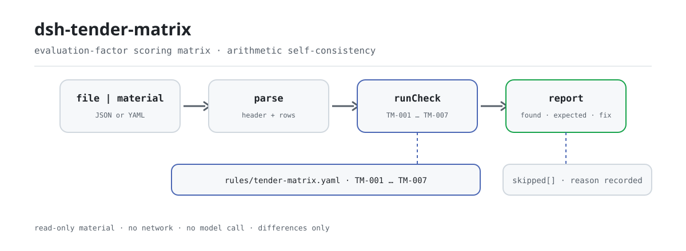

<div align="center">

<picture>
  <source media="(prefers-color-scheme: dark)" srcset="docs/assets/dsh-tender-matrix-flow-dark.svg">
  
</picture>

# dsh-tender-matrix

**Señale los errores aritméticos de una matriz de puntuación de factores de evaluación antes de la reunión de revisión: solo diferencias, nunca el veredicto del comité.**

Un verificador de DeepSeek Harness para agencias de licitación, apoyo a la evaluación y revisión interna: lee una matriz de puntuación (cabecera del expediente más una fila por factor de evaluación) y comprueba la aritmética y la integridad de esa propia matriz con un paquete de reglas versionado.

[Instalación](#instalación-en-tres-pasos) · [Configuración](#configuración) · [FAQ](#faq) · [简体中文](README.md) · [English](README.en.md) · [Español](README.es.md) · [Português](README.pt.md) · [हिन्दी](README.hi.md)

[](LICENSE)
[](#compatibilidad)
[](https://www.npmjs.com/package/dsh-tender-matrix)
[](https://github.com/PerryLink/dsh-tender-matrix/actions/workflows/ci.yml)
[](#compatibilidad)

[](https://github.com/PerryLink/dsh-tender-matrix/stargazers)
[](https://www.npmjs.com/package/dsh-tender-matrix)
[](https://dshfind.com/plugins/PerryLink/dsh-tender-matrix?ref=badge)
[](https://securityscorecards.dev/viewer/?uri=github.com/PerryLink/dsh-tender-matrix)
[](https://dsh.market/)
[](https://gitee.com/perrylink/dsh-tender-matrix)

```sh
dsh plugin --profile <name> add dsh-tender-matrix
```

</div>

<sub>Plugin de la comunidad, no afiliado a DeepSeek. Repositorio canónico: <https://github.com/PerryLink/dsh-tender-matrix> (Gitee es un espejo).</sub>

## Qué es

`dsh-tender-matrix` lee una **matriz de puntuación de factores de evaluación** —la cabecera del expediente (proyecto, número de licitación, método de evaluación) más una fila por factor de evaluación— y comprueba la aritmética y la integridad de esa propia matriz: que declare su proyecto y su método de evaluación, que ninguna puntuación supere el máximo de su partida, que los máximos de las partidas sumen la cifra que usted configure, que las puntuaciones de un licitador sumen la cifra que usted configure, que cada puntuación registre su fundamento, que los números de factor sean únicos y que no quede ningún marcador de plantilla sin sustituir en la columna del fundamento.

Devuelve una lista de qué fila, qué columna y qué difiere, para que la agencia de licitación, el apoyo a la evaluación y la revisión interna lo verifiquen punto por punto. **No** dicta un veredicto de cumplimiento, no atribuye responsabilidad, no sustituye al revisor ni decide quién debe ganar: la puntuación es el juicio independiente del comité de evaluación, y los pesos y criterios pertenecen al pliego.

## Instalación en tres pasos

1. **Instalar** (elija un canal):

   ```sh
   # canal git (última main; equivale a git+https://github.com/PerryLink/dsh-tender-matrix.git)
   dsh plugin --profile web add github:PerryLink/dsh-tender-matrix
   # canal npm (versiones publicadas)
   dsh plugin --profile web add dsh-tender-matrix
   # canal tarball: tras pnpm pack en este repositorio
   dsh plugin --profile web add ./dsh-tender-matrix-<version>.tgz
   ```

   `lib/index.mjs` es el artefacto publicado; al instalar desde el código fuente, `prepare` ejecuta `tsdown` para generarlo, y en tiempo de ejecución no se compila nada.

2. **Configuración mínima** (los valores por defecto funcionan; `cordis.patch.yml` inserta una fila y solo se añade configuración si hace falta):

   ```yaml
   - insert:
       - id: dsh-tender-matrix
         name: dsh-tender-matrix
   ```

3. **Comprobar que se monta**:

   ```sh
   dsh --profile web --dump-config | grep 'dsh-tender-matrix'
   node samples/quickstart/run.mjs --check
   ```

   El segundo comando ejecuta el ejemplo incluido y muestra 1 `warn` y 2 `skipped`; el resultado esperado está en `samples/quickstart/expected/result.json`.

También puede buscar «Tender Compliance Suite» en WorkBuddy / Coze (esta comprobación es una de sus partes; la disponibilidad es la que figure en la tienda).

**Desinstalar**: `dsh plugin --profile web remove dsh-tender-matrix` (o elimine la fila del patch del perfil).

<details>
<summary>Prueba de un minuto</summary>

La entrada del ejemplo está en `samples/quickstart/input/TM-001-unsafe.json`, la salida esperada en `samples/quickstart/expected/result.json` y la captura en `docs/assets/quickstart.png`.


</details>

## Capacidades clave

`dsh-tender-matrix` registra una herramienta, `tender_matrix`: lee un material (JSON o YAML), aplica un paquete de reglas versionado y devuelve un informe. El paquete de reglas es un archivo de datos: sustituya `rules/tender-matrix.yaml` para cambiar de conjunto de reglas sin tocar el código.

| Regla | Qué comprueba | Gravedad | Tipo de fundamento |
|---|---|---|---|
| `TM-001` | la matriz declara su proyecto y método de evaluación | warn | derivado de principio |
| `TM-002` | ninguna puntuación supera el máximo de su partida | warn | derivado de principio |
| `TM-003` | los máximos de las partidas suman la cifra configurada (desactivada por defecto) | info | configuración institucional |
| `TM-004` | las puntuaciones de un licitador suman la cifra configurada (desactivada por defecto) | warn | derivado de principio |
| `TM-005` | cada puntuación registra su fundamento | warn | derivado de principio |
| `TM-006` | los números de factor son únicos | warn | derivado de principio |
| `TM-007` | la columna del fundamento no contiene marcadores sin sustituir | warn | derivado de principio |

- **Datos separados del código** — el paquete `rules/tender-matrix.yaml` declara cada comprobación y se valida al cargar; sustituir el archivo sustituye el conjunto de reglas.
- **Una lista vacía no significa «no hay nada mal»** — toda comprobación que no pudo ejecutarse se informa en `skipped` con su id y su motivo; un «no aplicable», como la ausencia de la columna `basis`, se dice en lugar de pasar en silencio.
- **Solo diferencias** — el informe indica qué fila, qué columna, qué hay, qué se espera y cómo verificarlo; no dicta cumplimiento, no atribuye responsabilidad ni sustituye al revisor.
- **Material de solo lectura** — la herramienta lee `file` o `material`; nunca modifica el original ni escribe de vuelta.
- **Paquete de reglas verificable** — cada regla lleva documento, número, cláusula, extracto literal y URL de origen; un extracto de menos de ocho caracteres o una gravedad superior a su tipo de fundamento falla al cargar.

### Ejemplos

Estos son los puntos de entrada reales del plugin; instálelo una vez y llame a uno.

**Ejemplo detallado** — herramienta `tender_matrix`, entrada:

```json
{"rows":[{"评审因素":"施工组织设计","分值":"30","投标人A":"32"}]}
```

Salida:

```json
{
  "id": "dsh-tender-matrix.TM-002.de09b5a6",
  "ruleId": "TM-002",
  "severity": "warn",
  "locator": {
    "row": 1,
    "field": "bidderA"
  },
  "found": "第 1 行「bidderA」为 32，「maxScore」为 30，不满足不大于关系",
  "expected": "「bidderA」应不大于「maxScore」",
  "fix": "核对评分是否抄错；本条只核对是否超出分值上限，不判断评分是否恰当"
}
```

*Observado en `dsh-tender-matrix/tests/fixtures/TM-002/TM-002-unsafe.json`*

**Ejemplo breve**: `tender_matrix` con `samples/quickstart/input/TM-001-unsafe.json` devuelve `issueCount: 1`, `warn: 1` y `skippedCount: 2` en una llamada.

## Normas que sigue

| Documento | Número | Reglas que lo citan |
|---|---|---|
| Ley de Licitación y Contratación de la República Popular China | Aprobada el 30-08-1999; modificada el 27-12-2017 (decisión del Comité Permanente de la Asamblea Popular Nacional por la que se modifican la Ley de Licitación y Contratación y la Ley de Metrología); en vigor desde el 01-01-2000 | TM-001, TM-002, TM-003, TM-004, TM-005, TM-006, TM-007 |

**Límite:** este plugin comprueba la aritmética de una **matriz de puntuación de factores de evaluación**: que la matriz declare su proyecto y método de evaluación, que ninguna puntuación supere el máximo de su partida, que los máximos sumen lo que usted configure, que las puntuaciones de un licitador sumen lo que usted configure, que cada puntuación registre su fundamento, que los números de factor sean únicos y que no quede ningún marcador. **No** decide si una puntuación es adecuada, si la evaluación fue justa ni quién debería ganar. **La puntuación es el juicio independiente del comité de evaluación, y los pesos y criterios pertenecen al pliego.**

> ### ⚠️ Lea esto antes de fiarse de una cita del informe
>
> **Cada `excerpt` del paquete de reglas es una cita literal de la cláusula que cita, y la puerta de citas vuelve a contrastar cada segmento con el registro de `rules/evidence/`.** El paquete reproduce literalmente un requisito cuando la cláusula lo dice, y se detiene en `warn` cuando la cláusula solo lo implica: una comprobación que descansa en un principio general queda por debajo de `error` y lo dice en su propio `note`. Lo que el paquete no hace es parafrasear una cláusula y presentar la paráfrasis como cita. Cuando el texto no se pudo obtener, el `excerpt` lo dice con claridad y no se inventa ninguna cita.
>
> **El plugin no incluye ninguna escala de puntuación.** Las dos reglas de totales salen con `target: 0`, es decir, «sin configurar»:
>
> - `TM-003` compara la suma de los `maxScore` de las partidas con `target`. 100 es habitual, pero existen escalas de 120 puntos y esquemas ponderados, así que el total lo fija su pliego y la regla informa de que no pudo ejecutarse hasta que usted lo establezca.
> - `TM-004` compara la suma de las puntuaciones de un licitador con `target`. La comprobación contrasta la columna con la cifra **que usted** indica; deliberadamente no está conectada a ninguna columna de total por licitador, para seguir siendo una suma pura.
>
> `TM-002` comprueba la columna A por defecto (`bidderA` frente a `maxScore`). Añada una regla para B y otra para C, o sustituya `leftField` en cada llamada.

La puerta de carga exige que cada `excerpt` tenga al menos ocho caracteres y sea una cita real, pero no distingue una cita de una descripción; por eso este paquete se apoya en la cabecera del paquete, en el `note` de cada regla y en una prueba que obliga a cada extracto a reconocer la laguna.

## Configuración

Todos los parámetros ajustables viven en el esquema Schemastery de `src/config.ts`; se cambian desde `cordis.yml` sin tocar el código. Los umbrales por regla están en el paquete bajo `rules/`.

Claves más usadas:

| Clave | Tipo | Predeterminado | Descripción |
|---|---|---|---|
| `rulesFile` | string | `rules/tender-matrix.yaml` | Ruta del paquete de reglas, relativa a la raíz del paquete |
| `disabledRules` | string[] | `[]` | Ids de reglas que se dejan de ejecutar; cada una aparece en `skipped` |
| `onlyRules` | string[] | `[]` | Ejecutar solo estas reglas; vacío ejecuta todas |
| `skipNotes` | string | `""` | Nota añadida a cada motivo de `skipped` |
| `timeoutMs` | number | `120000` | Presupuesto de tiempo de espera cooperativo de la herramienta (milisegundos) |

<details>
<summary>Parámetros por regla (TM-002 / TM-003 / TM-004 / TM-007)</summary>

- `TM-002` `leftField` / `rightField` / `relation` — las dos columnas comparadas y la relación; por defecto `bidderA <= maxScore`.
- `TM-003` `target` — el total que deben alcanzar los máximos de las partidas; `0` significa que la regla no se ejecuta.
- `TM-004` `field` / `target` — la columna del licitador y el total que debe alcanzar; `0` significa que la regla no se ejecuta.
- `TM-007` `terms` — los marcadores que se buscan.

</details>

Ejemplo de sustitución en el patch del perfil:

```yaml
- insert:
    - id: dsh-tender-matrix
      name: dsh-tender-matrix
      config:
        onlyRules: [TM-001, TM-002, TM-005, TM-006, TM-007]
        skipNotes: regla institucional 4 de este comprador
```

### Formato del material

La herramienta acepta JSON o YAML:

```yaml
project: 某某工程施工招标
tenderNo: ZB-2026-018
method: 综合评估法
rows:
  - { 序号: '1', 评审因素: 施工组织设计, 分值: '30', 投标人A: '26',
      投标人B: '24', 投标人C: '28', 评分依据: '按招标文件评标办法第 3.2 条' }
```

Los nombres de columna se comparan sin distinguir mayúsculas y minúsculas e ignorando espacios, guiones bajos y guiones, de modo que una cabecera china para el licitador A y `bidderA` apuntan al mismo campo; se conservan los nombres propios de la matriz, así que un hallazgo nombra la columna que realmente leyó. Los campos son opcionales en la capa de lectura y los valida el motor, de modo que una exportación parcial produce hallazgos de «falta» en lugar de un fallo. Excel puede convertirse antes a JSON/YAML, incluso en el chat si la plataforma lo permite.

## FAQ

<details>
<summary>Todas las casillas de la matriz están rellenas, ¿por qué las dos reglas de totales devuelven `skipped`?</summary>

Porque las dos vienen sin configurar: `TM-003` compara la suma de la columna `maxScore` con su `target`, y `TM-004` suma las puntuaciones `bidderA` de un licitador contra su `target`; ambas traen `target: 0`, es decir «sin configurar», así que cada una se informa en `skipped` en lugar de pasar en silencio hasta que usted escriba la cifra que indica su pliego. Una vez configurada, una coincidencia solo significa que la suma difiere de la cifra que usted fijó, no que la escala de puntuación sea improcedente; `TM-004` es una suma pura y deliberadamente no está conectada a ninguna columna de total por licitador.

</details>

<details>
<summary>Una partida tiene un máximo de 100 pero una casilla dice 105, y en otra fila la casilla de puntuación contiene una palabra de calificación.</summary>

`TM-002` informa de ambos casos. Compara `bidderA` con `maxScore` partida por partida e informa de la fila cuya puntuación supera el máximo de esa partida; cuando las dos casillas están rellenas pero ninguna se puede leer como número o fecha, esa fila se informa como no comparable en lugar de omitirse, mientras que una fila a la que le falta una de las dos no se compara en absoluto. Es solo una comparación numérica y nunca juzga si la puntuación es adecuada; lee la columna A por defecto, así que cubra B y C con una regla adicional o con una anulación de `leftField`.

</details>

<details>
<summary>Algunas filas dejan vacía la columna del fundamento, o todavía llevan marcadores de plantilla como corchetes vacíos o `TBD`.</summary>

Se informan ambos casos. `TM-005` exige que la casilla `basis` esté rellena en todas las filas a las que el material da esa columna, e informa de cada una que esté en blanco; solo comprueba que haya algo escrito, no si el fundamento registrado se sostiene, es adecuado o corresponde a la puntuación. `TM-007` informa de la casilla `basis` que aún contiene alguno de sus términos de plantilla:

```text
【 】 {{ }} XXX xxx 待填 待补充 TBD todo 示例
```

Esa lista se ajusta a su propia plantilla. El fallo que persigue es que un marcador se lea como un motivo ya registrado. Si la matriz no trae ninguna columna `basis`, `TM-005` informa de que no se aplica en lugar de pasar en silencio.

</details>

<details>
<summary>El mismo número de factor aparece en dos filas de la matriz. ¿Qué se informa?</summary>

`TM-006` informa del número repetido, comparando sin tener en cuenta los espacios. La unicidad es todo lo que establece, y importa porque una repetición hace que el total de máximos salga mal: o el mismo factor se registró dos veces, o dos factores se numeraron por error como uno solo. No decide cuál de las dos filas es la correcta.

</details>

<details>
<summary>La cabecera no dice a qué proyecto pertenece esta matriz ni qué método de evaluación sigue.</summary>

`TM-001` exige que la cabecera del material traiga `project` y `method` e informa del que falte; solo comprueba que la cabecera los declare, no que concuerden con el pliego. Si el formulario de su institución no tiene columna de método de evaluación, ponga los `fields` de esa regla en `[project]` para que deje de pedir una columna que su formulario nunca trae.

</details>

<details>
<summary>¿Dónde se guardan los datos? ¿Se conecta a la red o llama a un modelo? ¿Cuánto cuesta en rendimiento?</summary>

Todo ocurre en el proceso local: solo lee el `file` o el `material` que usted pasa y el paquete de reglas, no hace peticiones de red, no llama a ningún modelo, no escribe telemetría y no guarda una segunda copia más allá del resultado de la herramienta. El almacenamiento de sesión y registros del host lo controla el host; este paquete no añade copia. El coste crece de forma lineal con el número de filas de la matriz y lo dominan el análisis y la comparación fila a fila; el presupuesto de tiempo lo gobierna `timeoutMs`. Eliminar el paquete solo elimina código: no borra los registros de sesión del host ni el material que usted ya creó.

</details>

<details>
<summary>¿Compite con otros plugins por nombres de herramienta, claves de servicio o slots?</summary>

No. Registra exactamente una herramienta, `tender_matrix`, que se retira mediante el disposer que devuelve `ctx.tools.register` al descargar o recargar en caliente; no ofrece clave de servicio, no registra slot de cliente, no registra ruta `webServer`, no escucha eventos compartidos y no modifica objetos globales. El patch del paquete solo inserta su propia fila y nunca sobrescribe el `config` de una fila incorporada. La argumentación punto por punto está en «Interoperabilidad con otros plugins DSH».

</details>

## Límites de seguridad

- **Sin veredicto cualitativo.** El informe solo enumera diferencias que el propio material permite señalar; no decide cumplimiento, responsabilidad, si una puntuación es adecuada, si la evaluación fue justa ni quién debe ganar. El informe siempre lleva el descargo de responsabilidad, y un guardián de redacción vigila su formulación.
- **Sin citas inventadas.** Cada regla debe rellenar `document` / `number` / `clause` / `excerpt` / `kind` / `source`; el `excerpt` es cita literal y, cuando el texto no se pudo obtener, lo dice. `kind: derived-from-principle` queda limitado a `warn` y `kind: institutional-configuration` a `info`, y se valida al cargar.
- **Un resultado vacío no es «no hay nada mal».** Toda comprobación que no pudo ejecutarse se informa en `skipped` con su motivo; un «no aplicable», como la ausencia de la columna `basis`, se dice en lugar de pasar en silencio.
- **Material de solo lectura.** La herramienta solo lee `file` o `material`; no modifica el original, no escribe de vuelta ni crea una segunda copia.
- **Los registros son efectos.** El registro de la herramienta devuelve un disposer; detener o recargar en caliente el plugin lo retira sin dejar estado global.

## Permisos y datos

- **Permisos**: el plugin usa solo el servicio `tools`; lee el archivo de material que usted pasa explícitamente y el paquete de reglas incluido, no escribe archivos, no hace peticiones de red y no lee credenciales.
- **Datos**: el contenido del material se analiza y compara solo en el proceso; no se conserva nada más allá del resultado de la herramienta. El almacenamiento de sesión y registros del host lo controla y conserva el host; este paquete no añade copia.
- **Declaración del manifiesto**: `package.json#dsh.demo` declara `reads` como el archivo de material indicado por el usuario, `writes` vacío, `network: false` y `external: []`.
- **Eliminación**: eliminar el paquete solo elimina código; no borra los registros de sesión del host ni el material que usted ya creó.

## Limitaciones conocidas

- **Solo comprueba la aritmética y la integridad de la propia matriz.** Siete reglas cubren la declaración de proyecto/método, el techo por partida, los dos totales, el fundamento de la puntuación, la unicidad de los números de factor y los marcadores; no decide si una puntuación es adecuada, si la evaluación fue justa, quién debe ganar ni si la matriz coincide con el pliego: eso exige comparación humana.
- **Las dos reglas de totales están desactivadas por defecto.** `TM-003` / `TM-004` salen con `target: 0` e informan `skipped` hasta configurarse; `TM-004` es suma pura y deliberadamente no está conectada a una columna de «total del licitador». El total es la cifra del pliego de este proyecto; el plugin no la supone.
- **`TM-002` solo comprueba la columna A por defecto.** Compara `bidderA` con `maxScore`; B y C necesitan una regla adicional cada una, o una anulación de `leftField` por llamada. Es una comparación numérica y nunca juzga si una puntuación es desproporcionadamente alta o baja.
- **Las citas tienen una brecha generacional.** Algunas reglas solo pueden derivarse de un principio, por lo que su `kind` es `derived-from-principle` y quedan limitadas a `warn`; su `excerpt` dice claramente que el texto de la cláusula no se obtuvo. La puerta de citas garantiza que una cita es una cita, no que la cláusula rija directamente la comprobación: un límite que este paquete conserva a propósito.
- **Los nombres de columna se comparan literalmente.** La comparación ignora mayúsculas, espacios, guiones bajos y guiones; dos columnas con el mismo significado pero nombres distintos no se unifican automáticamente. Si falta una columna, la regla informa «no aplicable» o `skipped` en lugar de adivinar un resultado.
- **El tiempo es de reloj de pared.** Las comparaciones de fechas operan sobre las cadenas de entrada como valores de reloj de pared, sin conversión de zona horaria.
- **Alcance medido de plataformas.** ESM puro, sin código nativo, sin red, sin llamadas a modelos; las pruebas de este repositorio se ejecutaron en Linux, y otras plataformas capaces de ejecutar DSH no se midieron una por una.
- **Versión del paquete de reglas.** El paquete actual es `2026.1`; sustituir `rules/tender-matrix.yaml` cambia el comportamiento, y el archivo sustituto también se valida al cargar.

## Interoperabilidad con otros plugins DSH

- **El único nombre global que ocupa es el de la herramienta `tender_matrix`.** No ofrece clave de servicio, no registra slot de cliente, no registra ruta `webServer` y no escucha ningún evento compartido, así que no hay colisión de clave de servicio, slot, ruta HTTP ni cadena de eventos.
- **Solo depende del servicio `tools`.** `inject: ['tools']`; el registro se retira mediante el disposer que devuelve `ctx.tools.register`, de modo que detener o recargar en caliente limpia todo.
- **El patch solo añade.** `cordis.patch.yml` solo inserta su propia fila y nunca sobrescribe el `config` de una fila incorporada.
- **Sin mutación global.** No parchea prototipos, no reescribe `process.env`, no sustituye el despachador global de fetch ni escribe objetos globales.
- **Seguro en concurrencia.** La herramienta declara `isConcurrencySafe: () => true`; cada llamada lee solo su entrada y el paquete de reglas, sin estado mutable compartido.
- **Paquete de reglas bajo demanda.** `rulesFile` se resuelve respecto a la raíz del paquete, recorriendo los ancestros y lanzando todas las rutas intentadas si no aparece, para no caer en silencio en el paquete equivocado.

## Compatibilidad

| Superficie | Estado |
|---|---|
| Harness | Rango de peers `>=0.1.2-rc.1 <0.2.0 \|\| >=0.2.0-0 <0.3.0` — verificado para aceptar tanto `0.2.0-rc.2` como `0.2.1-rc.2`. `engines.dsh` se declara como `>=0.2.1-0 <0.3.0` y el host lo aplica desde 0.2.1 |
| Node | `^22.19.0 \|\| >=24.0.0` |
| Plataformas | Cualquier host DSH que ejecute ESM puro (sin código nativo, sin red, sin llamadas a modelos); las pruebas de este repositorio se ejecutaron en Linux |
| Modo de herramienta | Funciona en `native` y `ptc`; para comprobar varios paquetes a la vez use `ptc`, así el coste del esquema se paga una sola vez |

## Ecosistema y calidad

- [Espejo de Gitee](https://gitee.com/perrylink/dsh-tender-matrix) (espejo sincronizado; GitHub es el canónico)
- [Página de dshfind](https://dshfind.com/plugins/PerryLink/dsh-tender-matrix) (instalaciones y ranking)
- [Informe de OpenSSF Scorecard](https://securityscorecards.dev/viewer/?uri=github.com/PerryLink/dsh-tender-matrix) (impulsado por [.github/workflows/scorecard.yml](.github/workflows/scorecard.yml))
- [DSH Market](https://dsh.market/) (listado)
- [Elija un verificador por material](https://perrylink.github.io/zh/checkers/choose/) (índice de selección de la familia; este repositorio es uno de ellos)

## Desarrollo

```sh
pnpm install
pnpm run typecheck                 # tsc --noEmit
pnpm test                          # vitest: suite compartida de plugins de tabla + fixtures emparejados
pnpm run build                     # tsdown -> lib/index.mjs + lib/index.d.mts
pnpm run verify:self-contained     # las dependencias se resuelven desde el registry
pnpm run check:lockfile            # comprobación de deriva del lockfile
pnpm run check:readmes             # consistencia de los README en cinco idiomas
pnpm run check:citations           # puerta de citas de las reglas
pnpm pack                          # tarball publicado
node ../scripts/sync-shared.mjs dsh-tender-matrix   # refrescar src/shared
```

`prepublishOnly` vuelve a ejecutar la puerta, así que una publicación no puede salir con el árbol desincronizado. Las imágenes del README las genera `scripts/gen-readme-assets.py` (Python + Pillow, salida `docs/assets/dsh-tender-matrix-flow-{light,dark}.svg`) y se pueden volver a ejecutar sin riesgo.

| Ruta | Función |
|---|---|
| `src/index.ts` | registra la herramienta `tender_matrix`, resuelve el paquete de reglas y lee el material |
| `src/config.ts` | esquema de configuración Schemastery; única entrada de todos los parámetros |
| `src/check.ts` | núcleo de comprobación puro `(input, ruleset, options) => Report`, sin E/S, reloj ni modelo |
| `src/parse.ts` | lector de material JSON / YAML |
| `src/view.ts` | proyección del informe para el modelo; `output.schema` la refleja |
| `src/shared/` | kit compartido (cargador de reglas, forma del informe, subconjunto YAML, aritmética de calendario, guardián de redacción), copiado en lugar de importado |
| `rules/tender-matrix.yaml` | paquete de reglas: datos de siete reglas |
| `rules/evidence/` | registro de verificación de cada cita |
| `tests/` | vitest; cada regla tiene fixtures emparejados conforme/infractor |
| `scripts/gen-readme-assets.py` | generador del hero del README (SVG claro/oscuro) |

### Solución de problemas

- **Se instala pero la herramienta no aparece**: compruebe que `main` resuelve a `lib/index.mjs` y que `pnpm run build` lo generó; un `main` incorrecto hace que el cargador omita la entrada en silencio.
- **`dsh plugin add` rechaza el paquete por incompatibilidad**: el rango de peers cubre `0.1.x` y `0.2.x`; si su runtime queda fuera, conceda una exención explícita: `dsh plugin --profile <name> allow-version dsh-tender-matrix@0.2.15 --dsh-version <runtime> --accept-risk`.
- **Una regla no se ejecutó**: lea el arreglo `skipped`; indica el id de la regla y el motivo. Sin columna `basis`, `TM-005` informa «no aplicable».
- **`check` informa `manifest-peers` como fallo**: el verificador estático compara con un rango de peers codificado que es anterior a la línea 0.2; el runtime impone la compatibilidad de peers al instalar. Es un problema conocido de `dsh-plugin-dev`.
- **Los horarios parecen desplazados**: toda la aritmética es de reloj de pared sobre las cadenas de entrada, sin conversión de zona horaria.

Topics: `deepseek-harness`, `dsh`, `dsh-plugin`, `cordis`, `tender`, `matrix`

## Familia y agradecimientos

Este proyecto forma parte de la familia de plugins de DeepSeek Harness de [PerryLink](https://github.com/PerryLink) (todos Apache-2.0). Si le resulta útil, **una estrella ayuda a que la siguiente persona lo encuentre**: nada queda bloqueado tras ella.

- [@PerryLink](https://github.com/PerryLink) — creador y mantenedor: el paquete de reglas, el motor de comprobación, la superficie de la herramienta `tender_matrix` y la documentación en cinco idiomas.

<details>
<summary>Expandir todos los plugins</summary>

| Plugin | Estado |
|---|---|
| **[dsh-aqua-input-check](https://github.com/PerryLink/dsh-aqua-input-check)** |  |
| **[dsh-archive-check](https://github.com/PerryLink/dsh-archive-check)** |  |
| **[dsh-auto-review](https://github.com/PerryLink/dsh-auto-review)** |  |
| **[dsh-autotier](https://github.com/PerryLink/dsh-autotier)** | 🧊 CONGELADO — ver el README del repo |
| **[dsh-bid-ca-precheck](https://github.com/PerryLink/dsh-bid-ca-precheck)** |  |
| **[dsh-bid-qual-check](https://github.com/PerryLink/dsh-bid-qual-check)** |  |
| **[dsh-cert-mcp](https://github.com/PerryLink/dsh-cert-mcp)** | 🧊 CONGELADO — ver el README del repo |
| **[dsh-checkpoint-rewind](https://github.com/PerryLink/dsh-checkpoint-rewind)** |  |
| **[dsh-click](https://github.com/PerryLink/dsh-click)** |  |
| **[dsh-composer-history](https://github.com/PerryLink/dsh-composer-history)** |  |
| **[dsh-contract-stance](https://github.com/PerryLink/dsh-contract-stance)** |  |
| **[dsh-customs-doc-check](https://github.com/PerryLink/dsh-customs-doc-check)** |  |
| **[dsh-data-quality](https://github.com/PerryLink/dsh-data-quality)** | 🧊 CONGELADO — ver el README del repo |
| **[dsh-demurrage-ledger](https://github.com/PerryLink/dsh-demurrage-ledger)** |  |
| **[dsh-doublecheck](https://github.com/PerryLink/dsh-doublecheck)** |  |
| **[dsh-drill-script-check](https://github.com/PerryLink/dsh-drill-script-check)** |  |
| **[dsh-eia-guide-check](https://github.com/PerryLink/dsh-eia-guide-check)** |  |
| **[dsh-emergency-plan](https://github.com/PerryLink/dsh-emergency-plan)** |  |
| **[dsh-essay-rubric-check](https://github.com/PerryLink/dsh-essay-rubric-check)** |  |
| **[dsh-evidence-check](https://github.com/PerryLink/dsh-evidence-check)** |  |
| **[dsh-export-ctl-check](https://github.com/PerryLink/dsh-export-ctl-check)** |  |
| **[dsh-fast](https://github.com/PerryLink/dsh-fast)** |  |
| **[dsh-fmea-table-check](https://github.com/PerryLink/dsh-fmea-table-check)** |  |
| **[dsh-forecast-penalty](https://github.com/PerryLink/dsh-forecast-penalty)** |  |
| **[dsh-fund-research](https://github.com/PerryLink/dsh-fund-research)** |  |
| **[dsh-github](https://github.com/PerryLink/dsh-github)** |  |
| **[dsh-gongwen-flow-check](https://github.com/PerryLink/dsh-gongwen-flow-check)** |  |
| **[dsh-gongwen-word-check](https://github.com/PerryLink/dsh-gongwen-word-check)** |  |
| **[dsh-guard-plan-qc](https://github.com/PerryLink/dsh-guard-plan-qc)** |  |
| **[dsh-hazchem-check](https://github.com/PerryLink/dsh-hazchem-check)** |  |
| **[dsh-hazplan-check](https://github.com/PerryLink/dsh-hazplan-check)** |  |
| **[dsh-hidden-risk-map](https://github.com/PerryLink/dsh-hidden-risk-map)** |  |
| **[dsh-hs-classify](https://github.com/PerryLink/dsh-hs-classify)** |  |
| **[dsh-icd-rule-check](https://github.com/PerryLink/dsh-icd-rule-check)** |  |
| **[dsh-industry-research](https://github.com/PerryLink/dsh-industry-research)** |  |
| **[dsh-lawcite-adapter](https://github.com/PerryLink/dsh-lawcite-adapter)** |  |
| **[dsh-laya](https://github.com/PerryLink/dsh-laya)** |  |
| **[dsh-lc-doc-check](https://github.com/PerryLink/dsh-lc-doc-check)** |  |
| **[dsh-learning-gap-check](https://github.com/PerryLink/dsh-learning-gap-check)** |  |
| **[dsh-library](https://github.com/PerryLink/dsh-library)** |  |
| **[dsh-local-ai](https://github.com/PerryLink/dsh-local-ai)** |  |
| **[dsh-lsp-actions](https://github.com/PerryLink/dsh-lsp-actions)** |  |
| **[dsh-mask](https://github.com/PerryLink/dsh-mask)** |  |
| **[dsh-mcp-panel](https://github.com/PerryLink/dsh-mcp-panel)** |  |
| **[dsh-medrec-qc](https://github.com/PerryLink/dsh-medrec-qc)** |  |
| **[dsh-memento](https://github.com/PerryLink/dsh-memento)** | 🧊 CONGELADO — ver el README del repo |
| **[dsh-nsfc-form-check](https://github.com/PerryLink/dsh-nsfc-form-check)** |  |
| **[dsh-nurse-record-check](https://github.com/PerryLink/dsh-nurse-record-check)** |  |
| **[dsh-observe](https://github.com/PerryLink/dsh-observe)** |  |
| **[dsh-origin-rvc-check](https://github.com/PerryLink/dsh-origin-rvc-check)** |  |
| **[dsh-ota-review-check](https://github.com/PerryLink/dsh-ota-review-check)** |  |
| **[dsh-output-styles](https://github.com/PerryLink/dsh-output-styles)** |  |
| **[dsh-paper-doc-adapter](https://github.com/PerryLink/dsh-paper-doc-adapter)** |  |
| **[dsh-permission-rules](https://github.com/PerryLink/dsh-permission-rules)** |  |
| **[dsh-permit-report-check](https://github.com/PerryLink/dsh-permit-report-check)** |  |
| **[dsh-pipeline-check](https://github.com/PerryLink/dsh-pipeline-check)** |  |
| **[dsh-pleading-draft](https://github.com/PerryLink/dsh-pleading-draft)** |  |
| **[dsh-plugin-doctor](https://github.com/PerryLink/dsh-plugin-doctor)** | 🚫 RETIRADO (repo archivado) |
| **[dsh-plugin-guide](https://github.com/PerryLink/dsh-plugin-guide)** |  |
| **[dsh-plugin-kit](https://github.com/PerryLink/dsh-plugin-kit)** | 🚫 RETIRADO (repo archivado) |
| **[dsh-plugin-upgrade](https://github.com/PerryLink/dsh-plugin-upgrade)** | 🚫 RETIRADO (repo archivado) |
| **[dsh-policy-brief-draft](https://github.com/PerryLink/dsh-policy-brief-draft)** |  |
| **[dsh-power-loss-split](https://github.com/PerryLink/dsh-power-loss-split)** |  |
| **[dsh-power-ticket-check](https://github.com/PerryLink/dsh-power-ticket-check)** |  |
| **[dsh-ppap-check](https://github.com/PerryLink/dsh-ppap-check)** |  |
| **[dsh-protest-deadline](https://github.com/PerryLink/dsh-protest-deadline)** |  |
| **[dsh-railway-window](https://github.com/PerryLink/dsh-railway-window)** |  |
| **[dsh-repair-order-qc](https://github.com/PerryLink/dsh-repair-order-qc)** |  |
| **[dsh-research-report](https://github.com/PerryLink/dsh-research-report)** |  |
| **[dsh-review-reply-check](https://github.com/PerryLink/dsh-review-reply-check)** |  |
| **[dsh-rulefile-check](https://github.com/PerryLink/dsh-rulefile-check)** |  |
| **[dsh-safety-brief-check](https://github.com/PerryLink/dsh-safety-brief-check)** |  |
| **[dsh-score](https://github.com/PerryLink/dsh-score)** | 🧊 CONGELADO — ver el README del repo |
| **[dsh-session-sync](https://github.com/PerryLink/dsh-session-sync)** |  |
| **[dsh-site-log-check](https://github.com/PerryLink/dsh-site-log-check)** |  |
| **[dsh-skill-pack-security](https://github.com/PerryLink/dsh-skill-pack-security)** |  |
| **[dsh-soe-decision-check](https://github.com/PerryLink/dsh-soe-decision-check)** |  |
| **[dsh-soilwater-check](https://github.com/PerryLink/dsh-soilwater-check)** |  |
| **[dsh-sop-sync-check](https://github.com/PerryLink/dsh-sop-sync-check)** |  |
| **[dsh-spc-gbt-adapter](https://github.com/PerryLink/dsh-spc-gbt-adapter)** |  |
| **[dsh-talk](https://github.com/PerryLink/dsh-talk)** |  |
| **[dsh-tender-extract](https://github.com/PerryLink/dsh-tender-extract)** |  |
| **[dsh-tender-matrix](https://github.com/PerryLink/dsh-tender-matrix)** |  |
| **[dsh-test-drive](https://github.com/PerryLink/dsh-test-drive)** |  |
| **[dsh-ticktick](https://github.com/PerryLink/dsh-ticktick)** | 🚫 RETIRADO (repo archivado) |
| **[dsh-translate](https://github.com/PerryLink/dsh-translate)** |  |
| **[dsh-warranty-calc](https://github.com/PerryLink/dsh-warranty-calc)** |  |
| **[dsh-budget](https://github.com/PerryLink/dsh-budget)** |  |
| **[dsh-claude-move](https://github.com/PerryLink/dsh-claude-move)** |  |
| **[dsh-defend](https://github.com/PerryLink/dsh-defend)** |  |
| **[dsh-draw](https://github.com/PerryLink/dsh-draw)** | 🧊 CONGELADO — ver el README del repo |
| **[dsh-reach](https://github.com/PerryLink/dsh-reach)** |  |
| **[dsh-background-agents](https://github.com/PerryLink/dsh-background-agents)** | 🚫 RETIRADO (repo archivado) |
| **[dsh-session-pin](https://github.com/PerryLink/dsh-session-pin)** | 🚫 RETIRADO (repo archivado) |
| **[dsh-team-rooms](https://github.com/PerryLink/dsh-team-rooms)** | 🚫 RETIRADO (repo archivado) |

</details>

## Licencia

[LICENSE](LICENSE) (Apache License 2.0) © 2026 dsh-tender-matrix contributors

<p align="center"><sub>Apache-2.0 · Plugin de la comunidad, no afiliado a DeepSeek.</sub></p>
