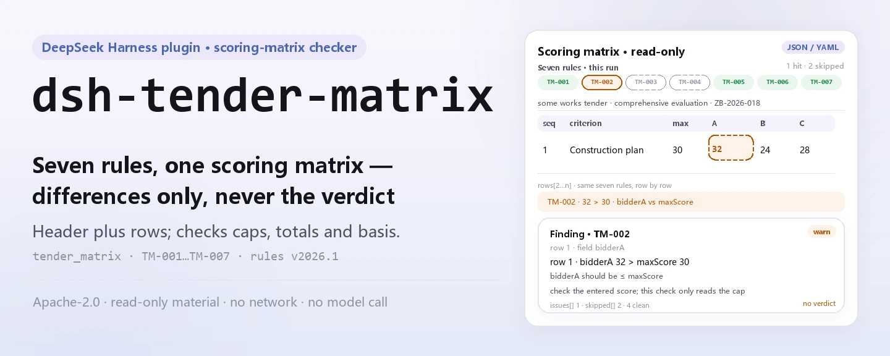
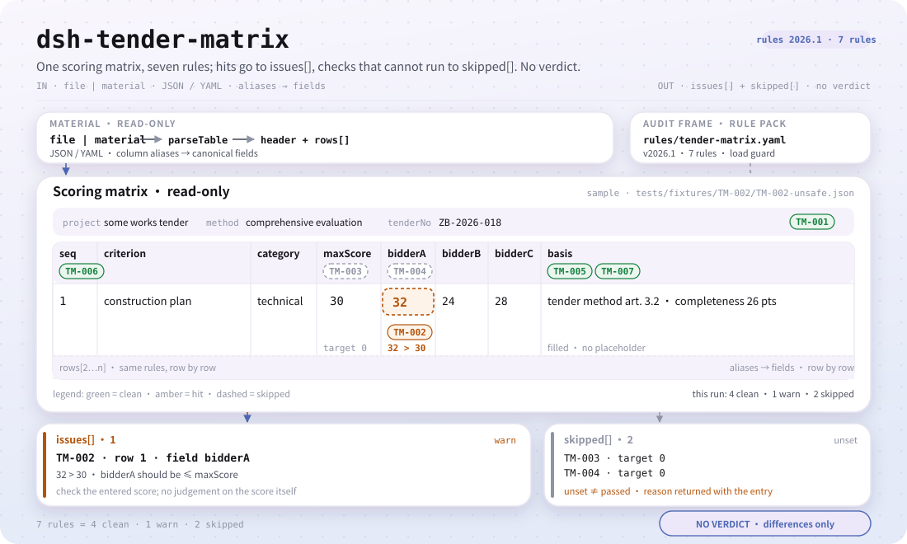

<div align="center">

<picture>
  <source media="(prefers-color-scheme: dark)" srcset="docs/assets/dsh-tender-matrix-hero-en-dark.webp">
  
</picture>

# dsh-tender-matrix

**समीक्षा बैठक से पहले मूल्यांकन-कारक अंक-मैट्रिक्स की अंकगणितीय गलतियाँ पंक्ति-दर-पंक्ति बताएँ — केवल अंतर, समिति का निर्णय नहीं।**

निविदा एजेंसी, मूल्यांकन सहायता और आंतरिक समीक्षा के लिए एक DeepSeek Harness जाँचक: एक अंक-मैट्रिक्स (शीर्षक पंक्ति और प्रत्येक मूल्यांकन कारक की एक पंक्ति) पढ़ता है और संस्करणबद्ध नियम-पैक से उसी मैट्रिक्स की अंकगणित और पूर्णता जाँचता है।

[इंस्टॉल](#तीन-चरणों-में-शुरुआत) · [कॉन्फ़िगरेशन](#कॉन्फ़िगरेशन) · [FAQ](#faq) · [简体中文](README.md) · [English](README.en.md) · [Español](README.es.md) · [Português](README.pt.md) · [हिन्दी](README.hi.md)

[](LICENSE)
[](#संगतता)
[](https://www.npmjs.com/package/dsh-tender-matrix)
[](https://github.com/PerryLink/dsh-tender-matrix/actions/workflows/ci.yml)
[](#संगतता)

[](https://github.com/PerryLink/dsh-tender-matrix/stargazers)
[](https://www.npmjs.com/package/dsh-tender-matrix)
[](https://dshfind.com/plugins/PerryLink/dsh-tender-matrix?ref=badge)
[](https://securityscorecards.dev/viewer/?uri=github.com/PerryLink/dsh-tender-matrix)
[](https://dsh.market/)
[](https://gitee.com/perrylink/dsh-tender-matrix)

```sh
dsh plugin --profile <name> add dsh-tender-matrix
```

</div>

<sub>समुदाय प्लगइन, DeepSeek से संबद्ध नहीं। मानक रेपो: <https://github.com/PerryLink/dsh-tender-matrix> (Gitee दर्पण है)।</sub>

## यह क्या है

`dsh-tender-matrix` एक **मूल्यांकन-कारक अंक-मैट्रिक्स** पढ़ता है — शीर्षक पंक्ति (परियोजना, निविदा संख्या, मूल्यांकन पद्धति) और प्रत्येक मूल्यांकन कारक की एक पंक्ति — और उसी मैट्रिक्स की अंकगणित और पूर्णता जाँचता है: क्या उसमें परियोजना और मूल्यांकन पद्धति लिखी है, क्या कोई अंक उस मद की अधिकतम सीमा से अधिक नहीं है, क्या मदों की अधिकतम सीमाओं का जोड़ आपके द्वारा कॉन्फ़िगर किए गए कुल के बराबर है, क्या किसी एक बोलीदाता के अंकों का जोड़ आपके द्वारा कॉन्फ़िगर किए गए कुल के बराबर है, क्या प्रत्येक अंक का आधार दर्ज है, क्या कारक संख्याएँ अद्वितीय हैं, और क्या आधार कॉलम में कोई अपरिवर्तित प्लेसहोल्डर शेष नहीं है।

यह बताता है कि कौन-सी पंक्ति, कौन-सा कॉलम और क्या अंतर है, ताकि निविदा एजेंसी, मूल्यांकन सहायता और आंतरिक समीक्षा इसे मद-दर-मद जाँच सकें। यह **नहीं** करता: अनुपालन का निर्णय, दायित्व का निर्धारण, समीक्षक का प्रतिस्थापन, या यह तय करना कि किसे जीतना चाहिए — अंक देना मूल्यांकन समिति का स्वतंत्र निर्णय है, और भार व मानदंड निविदा दस्तावेज़ के हैं।

<picture>
  <source media="(prefers-color-scheme: dark)" srcset="docs/assets/dsh-tender-matrix-flow-v5-dark.svg">
   30 की तुलना करता है; TM-003/TM-004 target सेट न होने से skipped हैं; नीचे issues[] और skipped[] के दो निर्गम, कोई अनुपालन निर्णय नहीं।">
</picture>

## तीन चरणों में शुरुआत

1. **इंस्टॉल** (कोई एक माध्यम चुनें):

   ```sh
   # git माध्यम (नवीनतम main; git+https://github.com/PerryLink/dsh-tender-matrix.git के बराबर)
   dsh plugin --profile web add github:PerryLink/dsh-tender-matrix
   # npm माध्यम (प्रकाशित संस्करण)
   dsh plugin --profile web add dsh-tender-matrix
   # tarball माध्यम: इस रेपो में pnpm pack के बाद
   dsh plugin --profile web add ./dsh-tender-matrix-<version>.tgz
   ```

   `lib/index.mjs` प्रकाशित आर्टिफ़ैक्ट है; स्रोत से इंस्टॉल करने पर `prepare` उसे बनाने के लिए `tsdown` चलाता है, और रनटाइम पर कुछ संकलित नहीं होता।

2. **न्यूनतम कॉन्फ़िग** (डिफ़ॉल्ट काम करते हैं; `cordis.patch.yml` एक पंक्ति जोड़ता है, ज़रूरत हो तभी कॉन्फ़िग जोड़ें):

   ```yaml
   - insert:
       - id: dsh-tender-matrix
         name: dsh-tender-matrix
   ```

3. **जाँचें कि माउंट हुआ**:

   ```sh
   dsh --profile web --dump-config | grep 'dsh-tender-matrix'
   node samples/quickstart/run.mjs --check
   ```

   दूसरा कमांड साथ दिया नमूना चलाता है और 1 `warn` तथा 2 `skipped` दिखाता है; अपेक्षित परिणाम `samples/quickstart/expected/result.json` में है।

आप WorkBuddy / Coze में «Tender Compliance Suite» खोज सकते हैं (यह जाँच उसका एक हिस्सा है; उपलब्धता स्टोर में सूचीबद्ध होने के अनुसार है)।

**अनइंस्टॉल**: `dsh plugin --profile web remove dsh-tender-matrix` (या प्रोफ़ाइल पैच से वह पंक्ति हटाएँ)।

<details>
<summary>एक मिनट का परीक्षण</summary>

नमूना इनपुट `samples/quickstart/input/TM-001-unsafe.json` में, अपेक्षित आउटपुट `samples/quickstart/expected/result.json` में और स्क्रीनशॉट `docs/assets/quickstart.png` में है।


</details>

## मुख्य क्षमताएँ

`dsh-tender-matrix` एक उपकरण, `tender_matrix`, पंजीकृत करता है: यह एक सामग्री (JSON या YAML) पढ़ता है, संस्करणबद्ध नियम-पैक लागू करता है और रिपोर्ट लौटाता है। नियम-पैक एक डेटा फ़ाइल है — कोड बदले बिना नियम-समुच्चय बदलने के लिए `rules/tender-matrix.yaml` बदलें।

| नियम | क्या जाँचता है | गंभीरता | आधार प्रकार |
|---|---|---|---|
| `TM-001` | मैट्रिक्स परियोजना और मूल्यांकन पद्धति बताती है | warn | सिद्धांत से व्युत्पन्न |
| `TM-002` | कोई अंक उस मद की अधिकतम सीमा से अधिक नहीं | warn | सिद्धांत से व्युत्पन्न |
| `TM-003` | मदों की अधिकतम सीमाओं का जोड़ आपके कॉन्फ़िगर किए कुल के बराबर (डिफ़ॉल्ट रूप से बंद) | info | संस्थागत कॉन्फ़िगरेशन |
| `TM-004` | एक बोलीदाता के अंकों का जोड़ आपके कॉन्फ़िगर किए कुल के बराबर (डिफ़ॉल्ट रूप से बंद) | warn | सिद्धांत से व्युत्पन्न |
| `TM-005` | प्रत्येक अंक अपना आधार दर्ज करता है | warn | सिद्धांत से व्युत्पन्न |
| `TM-006` | कारक संख्याएँ अद्वितीय हैं | warn | सिद्धांत से व्युत्पन्न |
| `TM-007` | आधार कॉलम में कोई अपरिवर्तित प्लेसहोल्डर नहीं | warn | सिद्धांत से व्युत्पन्न |

- **डेटा कोड से अलग** — नियम-पैक `rules/tender-matrix.yaml` हर जाँच घोषित करता है और लोड पर सत्यापित होता है; फ़ाइल बदलने से नियम-समुच्चय बदल जाता है।
- **खाली सूची का अर्थ «कुछ गलत नहीं» नहीं** — हर जाँच जो नहीं चल सकी, `skipped` में उसके नियम id और कारण के साथ दर्ज होती है; `basis` कॉलम न होना जैसा «लागू नहीं» भी स्पष्ट कहा जाता है, चुपचाप पास नहीं किया जाता।
- **केवल अंतर** — रिपोर्ट बताती है कौन-सी पंक्ति, कौन-सा कॉलम, क्या है, क्या अपेक्षित है और कैसे जाँचें; यह अनुपालन का निर्णय, दायित्व का निर्धारण या समीक्षक का प्रतिस्थापन नहीं करती।
- **सामग्री केवल पढ़ी जाती है** — उपकरण `file` या `material` पढ़ता है; मूल को कभी नहीं बदलता और न ही वापस लिखता है।
- **सत्यापन योग्य नियम-पैक** — हर नियम में दस्तावेज़, संख्या, धारा, शब्दशः उद्धरण और स्रोत URL होता है; आठ अक्षरों से छोटा उद्धरण या आधार-प्रकार से ऊपर की गंभीरता लोड पर विफल होती है।

### उदाहरण

ये प्लगइन के वास्तविक प्रवेश-बिंदु हैं; एक बार इंस्टॉल करें, फिर एक कॉल करें।

**विस्तृत उदाहरण** — उपकरण `tender_matrix`, इनपुट:

```json
{"rows":[{"评审因素":"施工组织设计","分值":"30","投标人A":"32"}]}
```

आउटपुट:

```json
{
  "id": "dsh-tender-matrix.TM-002.de09b5a6",
  "ruleId": "TM-002",
  "severity": "warn",
  "locator": {
    "row": 1,
    "field": "bidderA"
  },
  "found": "第 1 行「bidderA」为 32，「maxScore」为 30，不满足不大于关系",
  "expected": "「bidderA」应不大于「maxScore」",
  "fix": "核对评分是否抄错；本条只核对是否超出分值上限，不判断评分是否恰当"
}
```

*स्रोत `dsh-tender-matrix/tests/fixtures/TM-002/TM-002-unsafe.json`*

**संक्षिप्त उदाहरण**: `samples/quickstart/input/TM-001-unsafe.json` के साथ `tender_matrix` एक कॉल में `issueCount: 1`, `warn: 1` और `skippedCount: 2` लौटाता है।

## यह किन मानकों पर आधारित है

| दस्तावेज़ | संख्यांक | इन्हें उद्धृत करने वाले नियम |
|---|---|---|
| जनवादी गणराज्य चीन का निविदा एवं बोली कानून | 30-08-1999 को पारित; 27-12-2017 को संशोधित (राष्ट्रीय जन कांग्रेस स्थायी समिति का निर्णय, जिससे निविदा एवं बोली कानून तथा माप-विज्ञान कानून संशोधित हुए); 01-01-2000 से प्रभावी | TM-001, TM-002, TM-003, TM-004, TM-005, TM-006, TM-007 |

**सीमा:** यह प्लगइन एक **मूल्यांकन-कारक अंक-मैट्रिक्स** की अंकगणित जाँचता है — कि मैट्रिक्स परियोजना और मूल्यांकन पद्धति बताती है, कोई अंक उस मद की अधिकतम सीमा से अधिक नहीं है, अधिकतम सीमाओं का जोड़ आपके कॉन्फ़िगर किए कुल के बराबर है, किसी बोलीदाता के अंकों का जोड़ आपके कॉन्फ़िगर किए कुल के बराबर है, प्रत्येक अंक अपना आधार दर्ज करता है, कारक संख्याएँ अद्वितीय हैं और कोई प्लेसहोल्डर शेष नहीं है। यह **नहीं** तय करता कि कोई अंक उचित है, मूल्यांकन निष्पक्ष था या किसे जीतना चाहिए। **अंक देना मूल्यांकन समिति का स्वतंत्र निर्णय है, और भार व मानदंड निविदा दस्तावेज़ के हैं।**

> ### ⚠️ रिपोर्ट के किसी उद्धरण पर भरोसा करने से पहले यह पढ़ें
>
> **इस प्लगइन के नियम-पैक में हर `excerpt` उस धारा का शब्दशः उद्धरण है, और उद्धरण-द्वार हर हिस्से को `rules/evidence/` के रिकॉर्ड से दोबारा जाँचता है।** जब धारा स्वयं अपेक्षा कहती है तो पैक उसे शब्दशः कहता है, और जब वह केवल संकेत करती है तो `warn` पर रुक जाता है: सामान्य सिद्धांत पर टिकी जाँच `error` से नीचे रहती है और अपने `note` में यह बताती है। पैक वह नहीं करता जो भरोसा तोड़ता है — किसी धारा की परिभाषा गढ़कर उसे उद्धरण बताना। जब मूल पाठ नहीं मिला, `excerpt` स्पष्ट कहता है और कोई उद्धरण नहीं गढ़ा जाता।
>
> **प्लगइन कोई अंक-प्रणाली नहीं देता।** दोनों कुल-नियम `target: 0` के साथ आते हैं, अर्थात् «कॉन्फ़िगर नहीं»:
>
> - `TM-003` मदों के `maxScore` का जोड़ `target` से तुलना करता है। 100 आम है, पर 120-अंकीय प्रणालियाँ और भारित योजनाएँ भी हैं, इसलिए कुल आपके निविदा दस्तावेज़ का आँकड़ा है और नियम तब तक «नहीं चल सका» बताता है जब तक आप उसे सेट न करें।
> - `TM-004` एक बोलीदाता के अंकों का जोड़ `target` से तुलना करता है। जाँच कॉलम की तुलना **आपके** बताए आँकड़े से करती है; इसे जानबूझकर किसी «प्रति-बोलीदाता कुल» कॉलम से नहीं जोड़ा गया, ताकि यह शुद्ध जोड़-जाँच रहे।
>
> `TM-002` डिफ़ॉल्ट रूप से कॉलम A जाँचता है (`bidderA` बनाम `maxScore`)। B और C के लिए एक-एक नियम जोड़ें, या प्रति कॉल `leftField` बदलें।

लोड-समय द्वार माँगता है कि हर `excerpt` कम से कम आठ अक्षरों का और वास्तविक उद्धरण हो, पर वह उद्धरण और विवरण में भेद नहीं कर सकता; इसलिए यह पैक पैक-शीर्षक, हर नियम के `note` और एक परीक्षण पर टिकता है जो हर excerpt से यह अंतर स्वीकार कराता है।

## कॉन्फ़िगरेशन

सभी समायोज्य पैरामीटर `src/config.ts` की Schemastery स्कीमा में हैं; कोड बदले बिना `cordis.yml` से बदले जा सकते हैं। प्रति-नियम सीमाएँ `rules/` के नियम-पैक में हैं।

सबसे अधिक प्रयुक्त कुंजियाँ:

| कुंजी | प्रकार | डिफ़ॉल्ट | विवरण |
|---|---|---|---|
| `rulesFile` | string | `rules/tender-matrix.yaml` | नियम-पैक का पथ, पैकेज रूट के सापेक्ष |
| `disabledRules` | string[] | `[]` | बंद करने वाले नियम id; प्रत्येक `skipped` में दिखता है |
| `onlyRules` | string[] | `[]` | केवल ये नियम चलाएँ; खाली होने पर सभी नियम चलते हैं |
| `skipNotes` | string | `""` | हर `skipped` कारण के आगे जोड़ी जाने वाली टिप्पणी |
| `timeoutMs` | number | `120000` | उपकरण का सहकारी समय-सीमा बजट (मिलीसेकंड) |

<details>
<summary>प्रति-नियम पैरामीटर (TM-002 / TM-003 / TM-004 / TM-007)</summary>

- `TM-002` `leftField` / `rightField` / `relation` — तुलना के दो कॉलम और संबंध; डिफ़ॉल्ट `bidderA <= maxScore`।
- `TM-003` `target` — मदों की अधिकतम सीमाओं का अपेक्षित कुल; `0` का अर्थ है नियम नहीं चलता।
- `TM-004` `field` / `target` — बोलीदाता कॉलम और उसका अपेक्षित कुल; `0` का अर्थ है नियम नहीं चलता।
- `TM-007` `terms` — खोजे जाने वाले प्लेसहोल्डर।

</details>

प्रोफ़ाइल पैच में ओवरराइड का उदाहरण:

```yaml
- insert:
    - id: dsh-tender-matrix
      name: dsh-tender-matrix
      config:
        onlyRules: [TM-001, TM-002, TM-005, TM-006, TM-007]
        skipNotes: इस क्रेता का संस्थागत नियम 4
```

### सामग्री प्रारूप

उपकरण JSON या YAML स्वीकार करता है:

```yaml
project: 某某工程施工招标
tenderNo: ZB-2026-018
method: 综合评估法
rows:
  - { 序号: '1', 评审因素: 施工组织设计, 分值: '30', 投标人A: '26',
      投标人B: '24', 投标人C: '28', 评分依据: '按招标文件评标办法第 3.2 条' }
```

कॉलम नाम बड़े/छोटे अक्षरों में भेद किए बिना और खाली स्थान, अंडरस्कोर व हाइफ़न छोड़कर मिलाए जाते हैं, इसलिए बोलीदाता A का चीनी शीर्षक और `bidderA` एक ही फ़ील्ड पर जाते हैं; मैट्रिक्स के अपने कॉलम नाम सुरक्षित रहते हैं, इसलिए निष्कर्ष उसी कॉलम का नाम लेता है जिसे वास्तव में पढ़ा गया। पढ़ने की परत में फ़ील्ड वैकल्पिक हैं और जाँच इंजन उन्हें सत्यापित करता है, इसलिए आंशिक निर्यात पर क्रैश के बजाय «अनुपस्थित» श्रेणी के निष्कर्ष मिलते हैं। Excel को पहले JSON/YAML में बदला जा सकता है, ज़रूरत हो तो चैट में भी।

## FAQ

<details>
<summary>मैट्रिक्स की हर कोठरी भरी है, फिर भी दोनों कुल-नियम `skipped` क्यों बताते हैं?</summary>

क्योंकि दोनों कुल-नियम बिना कॉन्फ़िगर के आते हैं: `TM-003` `maxScore` कॉलम के जोड़ की तुलना उसके `target` से करता है, और `TM-004` किसी एक बोलीदाता के `bidderA` अंकों का जोड़ उसके `target` से करता है; दोनों में `target: 0` है, यानी «कॉन्फ़िगर नहीं», इसलिए जब तक आप निविदा दस्तावेज़ में लिखा आँकड़ा नहीं भरते, हर नियम चुपचाप पास होने के बजाय `skipped` में स्वयं को दर्ज करता है। कॉन्फ़िगर करने के बाद कोई हिट केवल यह बताता है कि जोड़ आपके भरे आँकड़े से भिन्न है, यह नहीं कि अंक-व्यवस्था अनुपयुक्त है; `TM-004` केवल जोड़ है और जानबूझकर किसी «प्रति-बोलीदाता कुल» कॉलम से जोड़ा नहीं गया है।

</details>

<details>
<summary>एक मद की अधिकतम सीमा 100 है पर एक कोठरी में 105 लिखा है, और दूसरी पंक्ति के अंक-कॉलम में कोई श्रेणी-शब्द है।</summary>

`TM-002` दोनों दर्ज करता है। यह मद-दर-मद `bidderA` की तुलना `maxScore` से करता है और जिस पंक्ति का अंक उस मद की अधिकतम सीमा से अधिक है उसे दर्ज करता है; जब दोनों कोठरियाँ भरी हों पर कोई भी संख्या या तिथि के रूप में पढ़ी न जा सके, तो वह पंक्ति छोड़े जाने के बजाय «तुलना योग्य नहीं» के रूप में दर्ज होती है, जबकि जिस पंक्ति में इन दोनों में से एक ही भरा हो वह तुलना में आती ही नहीं। यह केवल संख्यात्मक तुलना है और कभी नहीं आँकता कि अंक उचित है या नहीं; यह डिफ़ॉल्ट रूप से कॉलम A पढ़ता है, इसलिए B और C के लिए एक अतिरिक्त नियम या `leftField` का ओवरराइड जोड़ें।

</details>

<details>
<summary>कुछ पंक्तियों में अंक का आधार कॉलम खाली है, या टेम्पलेट प्लेसहोल्डर जैसे खाली कोष्ठक या `TBD` शेष है।</summary>

दोनों दर्ज होते हैं। `TM-005` माँगता है कि जिन पंक्तियों को सामग्री यह कॉलम देती है उन सब में `basis` कोठरी भरी हो, और हर खाली कोठरी को दर्ज करता है; यह केवल देखता है कि कुछ लिखा है; यह नहीं कि दर्ज आधार टिकता है, उपयुक्त है, या अंक से मेल खाता है। `TM-007` उस `basis` कोठरी को दर्ज करता है जिसमें अब भी उसके प्लेसहोल्डर शब्दों में से कोई है:

```text
【 】 {{ }} XXX xxx 待填 待补充 TBD todo 示例
```

यह सूची आपके टेम्पलेट के अनुसार बदली जा सकती है। इसका लक्ष्य यही विफलता है कि प्लेसहोल्डर को पहले से दर्ज कारण समझ लिया जाए। यदि मैट्रिक्स में `basis` कॉलम ही न हो, तो `TM-005` चुपचाप पास होने के बजाय बताता है कि वह लागू नहीं होता।

</details>

<details>
<summary>एक ही कारक क्रमांक मैट्रिक्स की दो पंक्तियों में आया है। क्या दर्ज होता है?</summary>

`TM-006` दोहराया गया क्रमांक दर्ज करता है, तुलना करते समय खाली स्थान छोड़ देता है। यह केवल अद्वितीयता स्थापित करता है, और यह मायने रखती है क्योंकि दोहराव से अधिकतम-सीमाओं का जोड़ गलत हो जाता है: या तो वही कारक दो बार दर्ज हुआ, या दो कारक गलती से एक ही क्रमांक पा गए। कौन-सी पंक्ति सही है, यह नहीं तय करता।

</details>

<details>
<summary>शीर्षक में नहीं लिखा कि यह मैट्रिक्स किस परियोजना का है और किस मूल्यांकन पद्धति पर है।</summary>

`TM-001` माँगता है कि सामग्री का शीर्षक `project` और `method` दे, और जो न हो उसे दर्ज करता है; यह केवल यह देखता है कि शीर्षक इन्हें घोषित करता है, यह नहीं कि वे निविदा दस्तावेज़ से मेल खाते हैं। यदि आपकी संस्था के प्रपत्र में मूल्यांकन-पद्धति का कॉलम ही नहीं है, तो उस नियम के `fields` को `[project]` कर दें, ताकि वह ऐसा कॉलम माँगना बंद कर दे जो आपके प्रपत्र में कभी नहीं रहता।

</details>

<details>
<summary>डेटा कहाँ रहता है? क्या यह नेटवर्क या मॉडल कॉल करता है? प्रदर्शन-लागत कितनी है?</summary>

सब कुछ स्थानीय प्रक्रिया में होता है: केवल आपके दिए `file` या `material` और नियम-पैक पढ़ता है, कोई नेटवर्क अनुरोध नहीं, कोई मॉडल कॉल नहीं, कोई टेलीमेट्री नहीं, और उपकरण-परिणाम से आगे कोई दूसरी प्रति नहीं। होस्ट का अपना सत्र/लॉग भंडारण होस्ट द्वारा नियंत्रित होता है; यह पैकेज कोई प्रति नहीं जोड़ता। लागत मैट्रिक्स की पंक्तियों के साथ रैखिक बढ़ती है और मुख्यतः पार्सिंग तथा पंक्ति-दर-पंक्ति तुलना में लगती है; समय-सीमा बजट `timeoutMs` से नियंत्रित होता है। पैकेज हटाने से केवल कोड हटता है — होस्ट के सत्र लॉग या आपकी बनाई सामग्री नहीं मिटती।

</details>

<details>
<summary>क्या यह दूसरे प्लगइन के साथ उपकरण नाम, सेवा कुंजी या स्लॉट के लिए टकराता है?</summary>

नहीं। यह ठीक एक उपकरण, `tender_matrix`, पंजीकृत करता है, जो अनलोड या हॉट-रीलोड पर `ctx.tools.register` के लौटाए disposer से हट जाता है; कोई सेवा कुंजी नहीं देता, कोई क्लाइंट स्लॉट नहीं, कोई `webServer` रूट नहीं, कोई साझा इवेंट नहीं सुनता और कोई ग्लोबल ऑब्जेक्ट नहीं बदलता। बंडल पैच केवल अपनी पंक्ति `insert` करता है और कभी किसी अंतर्निहित पंक्ति का `config` नहीं लिखता। बिंदु-दर-बिंदु तर्क «अन्य DSH प्लगइन के साथ अंतर-संचालनीयता» में है।

</details>

## सुरक्षा सीमाएँ

- **कोई गुणात्मक निर्णय नहीं।** रिपोर्ट केवल वे अंतर गिनाती है जो सामग्री स्वयं पहचान सकती है; यह अनुपालन, दायित्व, अंक की उपयुक्तता, मूल्यांकन की निष्पक्षता या विजेता तय नहीं करती। रिपोर्ट हमेशा अस्वीकरण रखती है, और शब्द-रक्षक उसकी भाषा पर नज़र रखता है।
- **कोई गढ़ा उद्धरण नहीं।** हर नियम को `document` / `number` / `clause` / `excerpt` / `kind` / `source` भरना होता है; `excerpt` शब्दशः उद्धरण है, और जब पाठ नहीं मिला तो वह ऐसा कहता है। `kind: derived-from-principle` अधिकतम `warn` और `kind: institutional-configuration` अधिकतम `info`, सब लोड पर सत्यापित।
- **खाली परिणाम «कुछ गलत नहीं» नहीं है।** हर जाँच जो नहीं चल सकी, `skipped` में कारण के साथ दर्ज होती है; `basis` कॉलम न होना जैसा «लागू नहीं» भी स्पष्ट कहा जाता है, चुपचाप पास नहीं।
- **सामग्री केवल पढ़ी जाती है।** उपकरण केवल `file` या `material` पढ़ता है; मूल नहीं बदलता, वापस नहीं लिखता और दूसरी प्रति नहीं बनाता।
- **पंजीकरण इफ़ेक्ट हैं।** उपकरण पंजीकरण disposer लौटाता है; प्लगइन रोकने या हॉट-रीलोड करने पर वह हट जाता है, कोई ग्लोबल स्थिति नहीं बचती।

## अनुमतियाँ और डेटा

- **अनुमतियाँ**: प्लगइन केवल `tools` सेवा का उपयोग करता है; आपके स्पष्ट रूप से दिए सामग्री फ़ाइल और पैकेज के नियम-पैक को पढ़ता है, कोई फ़ाइल नहीं लिखता, कोई नेटवर्क कॉल नहीं करता और कोई क्रेडेंशियल नहीं पढ़ता।
- **डेटा**: सामग्री की विषयवस्तु केवल प्रक्रिया में पार्स और तुलना की जाती है; उपकरण-परिणाम से आगे कुछ नहीं रखा जाता। होस्ट का सत्र/लॉग भंडारण होस्ट नियंत्रित और सुरक्षित रखता है; यह पैकेज कोई प्रति नहीं जोड़ता।
- **मैनिफ़ेस्ट घोषणा**: `package.json#dsh.demo` में `reads` उपयोगकर्ता-निर्दिष्ट सामग्री फ़ाइल, `writes` खाली, `network: false` और `external: []` घोषित हैं।
- **हटाना**: पैकेज हटाने से केवल कोड हटता है; होस्ट के सत्र लॉग या आपकी बनाई सामग्री नहीं मिटती।

## ज्ञात सीमाएँ

- **यह केवल मैट्रिक्स की अपनी अंकगणित और पूर्णता जाँचता है।** सात नियम परियोजना/पद्धति घोषणा, प्रति-मद सीमा, दोनों कुल, अंक का आधार, कारक-संख्या की अद्वितीयता और प्लेसहोल्डर कवर करते हैं; यह नहीं तय करता कि अंक उचित है, मूल्यांकन निष्पक्ष था, किसे जीतना चाहिए या मैट्रिक्स निविदा दस्तावेज़ से मेल खाती है — वह मानवीय तुलना माँगता है।
- **दोनों कुल-नियम डिफ़ॉल्ट रूप से बंद हैं।** `TM-003` / `TM-004` `target: 0` के साथ आते हैं और कॉन्फ़िगर होने तक `skipped` बताते हैं; `TM-004` शुद्ध जोड़ है और जानबूझकर «बोलीदाता कुल» कॉलम से नहीं जुड़ा। कुल इस परियोजना के निविदा दस्तावेज़ का आँकड़ा है; प्लगइन उसे मान नहीं लेता।
- **`TM-002` डिफ़ॉल्ट रूप से केवल कॉलम A जाँचता है।** यह `bidderA` की तुलना `maxScore` से करता है; B और C के लिए एक-एक अतिरिक्त नियम, या प्रति कॉल `leftField` ओवरराइड चाहिए। यह संख्यात्मक तुलना है और कभी नहीं आँकता कि अंक अत्यधिक ऊँचा या नीचा है।
- **उद्धरणों में पीढ़ीगत अंतर है।** कुछ नियम केवल सिद्धांत से व्युत्पन्न हो सकते हैं, इसलिए उनका `kind` `derived-from-principle` है और वे `warn` तक सीमित हैं; उनका `excerpt` स्पष्ट कहता है कि धारा का पाठ नहीं मिला। उद्धरण-द्वार गारंटी देता है कि उद्धरण उद्धरण है, यह नहीं कि धारा सीधे उस जाँच को नियंत्रित करती है — यह सीमा यह नियम-पैक जानबूझकर रखता है।
- **कॉलम नाम शाब्दिक रूप से मिलते हैं।** मिलान बड़े/छोटे अक्षरों में भेद नहीं करता और खाली स्थान, अंडरस्कोर व हाइफ़न छोड़ता है; एक ही अर्थ वाले भिन्न नामों वाले दो कॉलम अपने आप एक नहीं होते। यदि कोई कॉलम नहीं है, तो नियम अनुमान लगाने के बजाय «लागू नहीं» या `skipped` बताता है।
- **समय दीवार-घड़ी है।** तिथि तुलनाएँ इनपुट स्ट्रिंग पर दीवार-घड़ी मान के रूप में होती हैं, समय-क्षेत्र रूपांतरण नहीं।
- **मापा गया प्लेटफ़ॉर्म दायरा।** शुद्ध ESM, कोई नेटिव कोड नहीं, कोई नेटवर्क नहीं, कोई मॉडल कॉल नहीं; इस रेपो के परीक्षण Linux पर चले, और DSH चलाने योग्य अन्य प्लेटफ़ॉर्म एक-एक करके नहीं मापे गए।
- **नियम-पैक संस्करण।** वर्तमान नियम-पैक `2026.1` है; `rules/tender-matrix.yaml` बदलने से व्यवहार बदलता है, और बदला हुआ फ़ाइल भी लोड पर सत्यापित होता है।

## अन्य DSH प्लगइन के साथ अंतर-संचालनीयता

- **यह केवल एक ग्लोबल नाम रखता है: उपकरण नाम `tender_matrix`।** कोई सेवा कुंजी नहीं देता, कोई क्लाइंट स्लॉट नहीं, कोई `webServer` रूट नहीं और कोई साझा इवेंट नहीं सुनता, इसलिए सेवा-कुंजी, स्लॉट, HTTP-रूट या इवेंट-श्रृंखला का कोई टकराव नहीं।
- **यह केवल `tools` सेवा पर निर्भर है।** `inject: ['tools']`; पंजीकरण `ctx.tools.register` के लौटाए disposer से हटता है, इसलिए रोकना/हॉट-रीलोड साफ़ कर देता है।
- **पैच केवल जोड़ता है।** `cordis.patch.yml` केवल अपनी पंक्ति `insert` करता है और कभी किसी अंतर्निहित पंक्ति का `config` नहीं लिखता।
- **कोई ग्लोबल बदलाव नहीं।** प्रोटोटाइप पैच नहीं करता, `process.env` नहीं लिखता, ग्लोबल fetch dispatcher नहीं बदलता और ग्लोबल ऑब्जेक्ट नहीं लिखता।
- **समवर्ती-सुरक्षित।** उपकरण `isConcurrencySafe: () => true` घोषित करता है; हर कॉल केवल अपना इनपुट और नियम-पैक पढ़ता है, कोई साझा परिवर्तनीय स्थिति नहीं।
- **नियम-पैक माँग पर लोड।** `rulesFile` पैकेज रूट के सापेक्ष हल होता है, पूर्वजों में खोजता है और न मिलने पर सभी आज़माए पथ फेंकता है, ताकि चुपचाप गलत नियम-पैक पर न गिरे।

## संगतता

| सतह | स्थिति |
|---|---|
| Harness | peer रेंज `>=0.1.2-rc.1 <0.2.0 \|\| >=0.2.0-0 <0.3.0` — `0.2.0-rc.2` और `0.2.1-rc.2` दोनों को स्वीकार करने के लिए सत्यापित। `engines.dsh` `>=0.2.1-0 <0.3.0` के रूप में घोषित है और 0.2.1 से होस्ट इसे लागू करता है |
| Node | `^22.19.0 \|\| >=24.0.0` |
| प्लेटफ़ॉर्म | कोई भी DSH होस्ट जो शुद्ध ESM चलाता है (कोई नेटिव कोड नहीं, कोई नेटवर्क नहीं, कोई मॉडल कॉल नहीं); इस रेपो के परीक्षण Linux पर चले |
| टूल मोड | `native` और `ptc` में काम करता है; एक साथ कई पैकेज जाँचने के लिए `ptc` चुनें, ताकि schema लागत एक बार दी जाए |

## पारिस्थितिकी और गुणवत्ता

- [Gitee दर्पण](https://gitee.com/perrylink/dsh-tender-matrix) (समन्वित दर्पण; मानक GitHub है)
- [dshfind प्लगइन पृष्ठ](https://dshfind.com/plugins/PerryLink/dsh-tender-matrix) (इंस्टॉल और रैंकिंग)
- [OpenSSF Scorecard रिपोर्ट](https://securityscorecards.dev/viewer/?uri=github.com/PerryLink/dsh-tender-matrix) ([.github/workflows/scorecard.yml](.github/workflows/scorecard.yml) द्वारा संचालित)
- [DSH Market](https://dsh.market/) (सूचीबद्ध)
- [सामग्री के अनुसार जाँचक चुनें](https://perrylink.github.io/zh/checkers/choose/) (परिवार चयन सूचकांक; यह रेपो उनमें से एक है)

## विकास

```sh
pnpm install
pnpm run typecheck                 # tsc --noEmit
pnpm test                          # vitest: साझा टेबल-प्लगइन सूट + युग्मित फ़िक्स्चर
pnpm run build                     # tsdown -> lib/index.mjs + lib/index.d.mts
pnpm run verify:self-contained     # निर्भरताएँ registry से हल होती हैं
pnpm run check:lockfile            # lockfile विचलन जाँच
pnpm run check:readmes             # पाँच भाषाओं के README की संगति
pnpm run check:citations           # नियम उद्धरण-द्वार
pnpm pack                          # प्रकाशित tarball
node ../scripts/sync-shared.mjs dsh-tender-matrix   # src/shared ताज़ा करें
```

`prepublishOnly` द्वार को दोबारा चलाता है, इसलिए बिगड़ा हुआ ट्री प्रकाशित नहीं हो सकता। README की तस्वीरें `scripts/gen-readme-assets.py` बनाता है (Python + Pillow: चार hero WebP और `docs/assets/dsh-tender-matrix-flow-v5-{light,dark}.svg`) और इसे दोबारा चलाया जा सकता है।

| पथ | कार्य |
|---|---|
| `src/index.ts` | `tender_matrix` उपकरण पंजीकृत करता है, नियम-पैक हल करता है, सामग्री पढ़ता है |
| `src/config.ts` | Schemastery कॉन्फ़िग स्कीमा; सभी समायोज्य का एकमात्र प्रवेश |
| `src/check.ts` | शुद्ध जाँच-कोर `(input, ruleset, options) => Report`, कोई I/O, घड़ी या मॉडल नहीं |
| `src/parse.ts` | JSON / YAML सामग्री पाठक |
| `src/view.ts` | मॉडल-उन्मुख रिपोर्ट प्रोजेक्शन; `output.schema` इसका प्रतिबिंब है |
| `src/shared/` | साझा किट (नियम-लोडर, रिपोर्ट आकार, YAML उपसमुच्चय, कैलेंडर अंकगणित, शब्द-रक्षक), आयात नहीं बल्कि प्रतिलिपि |
| `rules/tender-matrix.yaml` | नियम-पैक: सात नियमों का डेटा |
| `rules/evidence/` | हर उद्धरण का धारा-सत्यापन रिकॉर्ड |
| `tests/` | vitest; हर नियम के युग्मित अनुपालक/उल्लंघनकारी फ़िक्स्चर |
| `scripts/gen-readme-assets.py` | README हीरो और संरचना आरेख जनरेटर (Pillow + हस्तलिखित SVG) |

### समस्या-निवारण

- **इंस्टॉल हो गया पर उपकरण दिखता नहीं**: जाँचें कि `main` `lib/index.mjs` पर जाता है और `pnpm run build` ने उसे बनाया है; गलत `main` से लोडर प्रविष्टि चुपचाप छोड़ देता है।
- **`dsh plugin add` असंगत बताकर मना करता है**: peer रेंज `0.1.x` और `0.2.x` को कवर करती है; यदि आपका रनटाइम उससे बाहर है, तो स्पष्ट छूट दें: `dsh plugin --profile <name> allow-version dsh-tender-matrix@0.2.15 --dsh-version <runtime> --accept-risk`।
- **कोई नियम नहीं चला**: `skipped` सरणी देखें; वह नियम id और कारण बताती है। `basis` कॉलम न हो तो `TM-005` «लागू नहीं» बताता है।
- **`check` में `manifest-peers` विफल दिखता है**: स्थिर जाँचक 0.2 पंक्ति से पुरानी हार्ड-कोडेड peer रेंज से तुलना करता है; रनटाइम इंस्टॉल के समय peer संगतता लागू करता है। यह `dsh-plugin-dev` की ज्ञात अपस्ट्रीम समस्या है।
- **समय खिसका हुआ लगता है**: सारी गणना दिए गए स्ट्रिंग पर दीवार-घड़ी है, समय-क्षेत्र रूपांतरण नहीं।

Topics: `deepseek-harness`, `dsh`, `dsh-plugin`, `cordis`, `tender`, `matrix`

## परिवार और आभार

यह परियोजना [PerryLink](https://github.com/PerryLink) की DeepSeek Harness प्लगइन परिवार का हिस्सा है (सभी Apache-2.0)। अगर यह उपयोगी हो, तो **एक स्टार अगले व्यक्ति को इसे खोजने में मदद करता है** — इसके पीछे कोई सुविधा नहीं रोकी गई है।

- [@PerryLink](https://github.com/PerryLink) — निर्माता और अनुरक्षक: नियम-पैक, जाँच-इंजन, `tender_matrix` उपकरण-सतह और पाँच-भाषा दस्तावेज़।

<details>
<summary>सभी प्लगइन विस्तृत करें</summary>

| प्लगइन | स्थिति |
|---|---|
| **[dsh-aqua-input-check](https://github.com/PerryLink/dsh-aqua-input-check)** |  |
| **[dsh-archive-check](https://github.com/PerryLink/dsh-archive-check)** |  |
| **[dsh-auto-review](https://github.com/PerryLink/dsh-auto-review)** |  |
| **[dsh-autotier](https://github.com/PerryLink/dsh-autotier)** | 🧊 फ़्रोज़न — रेपो README देखें |
| **[dsh-bid-ca-precheck](https://github.com/PerryLink/dsh-bid-ca-precheck)** |  |
| **[dsh-bid-qual-check](https://github.com/PerryLink/dsh-bid-qual-check)** |  |
| **[dsh-cert-mcp](https://github.com/PerryLink/dsh-cert-mcp)** | 🧊 फ़्रोज़न — रेपो README देखें |
| **[dsh-checkpoint-rewind](https://github.com/PerryLink/dsh-checkpoint-rewind)** |  |
| **[dsh-click](https://github.com/PerryLink/dsh-click)** |  |
| **[dsh-composer-history](https://github.com/PerryLink/dsh-composer-history)** |  |
| **[dsh-contract-stance](https://github.com/PerryLink/dsh-contract-stance)** |  |
| **[dsh-customs-doc-check](https://github.com/PerryLink/dsh-customs-doc-check)** |  |
| **[dsh-data-quality](https://github.com/PerryLink/dsh-data-quality)** | 🧊 फ़्रोज़न — रेपो README देखें |
| **[dsh-demurrage-ledger](https://github.com/PerryLink/dsh-demurrage-ledger)** |  |
| **[dsh-doublecheck](https://github.com/PerryLink/dsh-doublecheck)** |  |
| **[dsh-drill-script-check](https://github.com/PerryLink/dsh-drill-script-check)** |  |
| **[dsh-eia-guide-check](https://github.com/PerryLink/dsh-eia-guide-check)** |  |
| **[dsh-emergency-plan](https://github.com/PerryLink/dsh-emergency-plan)** |  |
| **[dsh-essay-rubric-check](https://github.com/PerryLink/dsh-essay-rubric-check)** |  |
| **[dsh-evidence-check](https://github.com/PerryLink/dsh-evidence-check)** |  |
| **[dsh-export-ctl-check](https://github.com/PerryLink/dsh-export-ctl-check)** |  |
| **[dsh-fast](https://github.com/PerryLink/dsh-fast)** |  |
| **[dsh-fmea-table-check](https://github.com/PerryLink/dsh-fmea-table-check)** |  |
| **[dsh-forecast-penalty](https://github.com/PerryLink/dsh-forecast-penalty)** |  |
| **[dsh-fund-research](https://github.com/PerryLink/dsh-fund-research)** |  |
| **[dsh-github](https://github.com/PerryLink/dsh-github)** |  |
| **[dsh-gongwen-flow-check](https://github.com/PerryLink/dsh-gongwen-flow-check)** |  |
| **[dsh-gongwen-word-check](https://github.com/PerryLink/dsh-gongwen-word-check)** |  |
| **[dsh-guard-plan-qc](https://github.com/PerryLink/dsh-guard-plan-qc)** |  |
| **[dsh-hazchem-check](https://github.com/PerryLink/dsh-hazchem-check)** |  |
| **[dsh-hazplan-check](https://github.com/PerryLink/dsh-hazplan-check)** |  |
| **[dsh-hidden-risk-map](https://github.com/PerryLink/dsh-hidden-risk-map)** |  |
| **[dsh-hs-classify](https://github.com/PerryLink/dsh-hs-classify)** |  |
| **[dsh-icd-rule-check](https://github.com/PerryLink/dsh-icd-rule-check)** |  |
| **[dsh-industry-research](https://github.com/PerryLink/dsh-industry-research)** |  |
| **[dsh-lawcite-adapter](https://github.com/PerryLink/dsh-lawcite-adapter)** |  |
| **[dsh-laya](https://github.com/PerryLink/dsh-laya)** |  |
| **[dsh-lc-doc-check](https://github.com/PerryLink/dsh-lc-doc-check)** |  |
| **[dsh-learning-gap-check](https://github.com/PerryLink/dsh-learning-gap-check)** |  |
| **[dsh-library](https://github.com/PerryLink/dsh-library)** |  |
| **[dsh-local-ai](https://github.com/PerryLink/dsh-local-ai)** |  |
| **[dsh-lsp-actions](https://github.com/PerryLink/dsh-lsp-actions)** |  |
| **[dsh-mask](https://github.com/PerryLink/dsh-mask)** |  |
| **[dsh-mcp-panel](https://github.com/PerryLink/dsh-mcp-panel)** |  |
| **[dsh-medrec-qc](https://github.com/PerryLink/dsh-medrec-qc)** |  |
| **[dsh-memento](https://github.com/PerryLink/dsh-memento)** | 🧊 फ़्रोज़न — रेपो README देखें |
| **[dsh-nsfc-form-check](https://github.com/PerryLink/dsh-nsfc-form-check)** |  |
| **[dsh-nurse-record-check](https://github.com/PerryLink/dsh-nurse-record-check)** |  |
| **[dsh-observe](https://github.com/PerryLink/dsh-observe)** |  |
| **[dsh-origin-rvc-check](https://github.com/PerryLink/dsh-origin-rvc-check)** |  |
| **[dsh-ota-review-check](https://github.com/PerryLink/dsh-ota-review-check)** |  |
| **[dsh-output-styles](https://github.com/PerryLink/dsh-output-styles)** |  |
| **[dsh-paper-doc-adapter](https://github.com/PerryLink/dsh-paper-doc-adapter)** |  |
| **[dsh-permission-rules](https://github.com/PerryLink/dsh-permission-rules)** |  |
| **[dsh-permit-report-check](https://github.com/PerryLink/dsh-permit-report-check)** |  |
| **[dsh-pipeline-check](https://github.com/PerryLink/dsh-pipeline-check)** |  |
| **[dsh-pleading-draft](https://github.com/PerryLink/dsh-pleading-draft)** |  |
| **[dsh-plugin-doctor](https://github.com/PerryLink/dsh-plugin-doctor)** | 🚫 रिटायर्ड (रेपो संग्रहीत) |
| **[dsh-plugin-guide](https://github.com/PerryLink/dsh-plugin-guide)** |  |
| **[dsh-plugin-kit](https://github.com/PerryLink/dsh-plugin-kit)** | 🚫 रिटायर्ड (रेपो संग्रहीत) |
| **[dsh-plugin-upgrade](https://github.com/PerryLink/dsh-plugin-upgrade)** | 🚫 रिटायर्ड (रेपो संग्रहीत) |
| **[dsh-policy-brief-draft](https://github.com/PerryLink/dsh-policy-brief-draft)** |  |
| **[dsh-power-loss-split](https://github.com/PerryLink/dsh-power-loss-split)** |  |
| **[dsh-power-ticket-check](https://github.com/PerryLink/dsh-power-ticket-check)** |  |
| **[dsh-ppap-check](https://github.com/PerryLink/dsh-ppap-check)** |  |
| **[dsh-protest-deadline](https://github.com/PerryLink/dsh-protest-deadline)** |  |
| **[dsh-railway-window](https://github.com/PerryLink/dsh-railway-window)** |  |
| **[dsh-repair-order-qc](https://github.com/PerryLink/dsh-repair-order-qc)** |  |
| **[dsh-research-report](https://github.com/PerryLink/dsh-research-report)** |  |
| **[dsh-review-reply-check](https://github.com/PerryLink/dsh-review-reply-check)** |  |
| **[dsh-rulefile-check](https://github.com/PerryLink/dsh-rulefile-check)** |  |
| **[dsh-safety-brief-check](https://github.com/PerryLink/dsh-safety-brief-check)** |  |
| **[dsh-score](https://github.com/PerryLink/dsh-score)** | 🧊 फ़्रोज़न — रेपो README देखें |
| **[dsh-session-sync](https://github.com/PerryLink/dsh-session-sync)** |  |
| **[dsh-site-log-check](https://github.com/PerryLink/dsh-site-log-check)** |  |
| **[dsh-skill-pack-security](https://github.com/PerryLink/dsh-skill-pack-security)** |  |
| **[dsh-soe-decision-check](https://github.com/PerryLink/dsh-soe-decision-check)** |  |
| **[dsh-soilwater-check](https://github.com/PerryLink/dsh-soilwater-check)** |  |
| **[dsh-sop-sync-check](https://github.com/PerryLink/dsh-sop-sync-check)** |  |
| **[dsh-spc-gbt-adapter](https://github.com/PerryLink/dsh-spc-gbt-adapter)** |  |
| **[dsh-talk](https://github.com/PerryLink/dsh-talk)** |  |
| **[dsh-tender-extract](https://github.com/PerryLink/dsh-tender-extract)** |  |
| **[dsh-tender-matrix](https://github.com/PerryLink/dsh-tender-matrix)** |  |
| **[dsh-test-drive](https://github.com/PerryLink/dsh-test-drive)** |  |
| **[dsh-ticktick](https://github.com/PerryLink/dsh-ticktick)** | 🚫 रिटायर्ड (रेपो संग्रहीत) |
| **[dsh-translate](https://github.com/PerryLink/dsh-translate)** |  |
| **[dsh-warranty-calc](https://github.com/PerryLink/dsh-warranty-calc)** |  |
| **[dsh-budget](https://github.com/PerryLink/dsh-budget)** |  |
| **[dsh-claude-move](https://github.com/PerryLink/dsh-claude-move)** |  |
| **[dsh-defend](https://github.com/PerryLink/dsh-defend)** |  |
| **[dsh-draw](https://github.com/PerryLink/dsh-draw)** | 🧊 फ़्रोज़न — रेपो README देखें |
| **[dsh-reach](https://github.com/PerryLink/dsh-reach)** |  |
| **[dsh-background-agents](https://github.com/PerryLink/dsh-background-agents)** | 🚫 रिटायर्ड (रेपो संग्रहीत) |
| **[dsh-session-pin](https://github.com/PerryLink/dsh-session-pin)** | 🚫 रिटायर्ड (रेपो संग्रहीत) |
| **[dsh-team-rooms](https://github.com/PerryLink/dsh-team-rooms)** | 🚫 रिटायर्ड (रेपो संग्रहीत) |

</details>

## लाइसेंस

[LICENSE](LICENSE) (Apache License 2.0) © 2026 dsh-tender-matrix contributors

<p align="center"><sub>Apache-2.0 · समुदाय प्लगइन, DeepSeek से संबद्ध नहीं।</sub></p>
