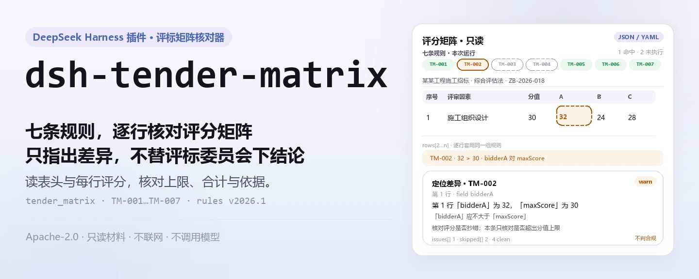
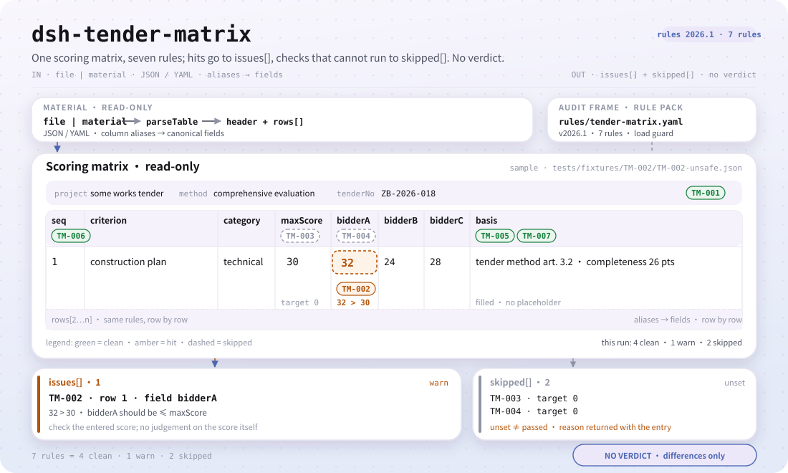

<div align="center">

<picture>
  <source media="(prefers-color-scheme: dark)" srcset="docs/assets/dsh-tender-matrix-hero-zh-dark.webp">
  
</picture>

# dsh-tender-matrix

**在评审会之前，把评标因素评分矩阵里的算术错误逐行指出来——只列差异，不替评标委员会下结论。**

面向招标代理、评标辅助与内审的 DeepSeek Harness 核对插件：读取一份评分矩阵（表头加每个评审因素一行），用版本化规则库核对分值上限、合计、评分依据、序号唯一性与模板占位符。

[安装](#三步上手) · [配置](#配置) · [FAQ](#faq) · [简体中文](README.md) · [English](README.en.md) · [Español](README.es.md) · [Português](README.pt.md) · [हिन्दी](README.hi.md)

[](LICENSE)
[](#兼容性)
[](https://www.npmjs.com/package/dsh-tender-matrix)
[](https://github.com/PerryLink/dsh-tender-matrix/actions/workflows/ci.yml)
[](#兼容性)

[](https://github.com/PerryLink/dsh-tender-matrix/stargazers)
[](https://www.npmjs.com/package/dsh-tender-matrix)
[](https://dshfind.com/plugins/PerryLink/dsh-tender-matrix?ref=badge)
[](https://securityscorecards.dev/viewer/?uri=github.com/PerryLink/dsh-tender-matrix)
[](https://dsh.market/)
[](https://gitee.com/perrylink/dsh-tender-matrix)

```sh
dsh plugin --profile <name> add dsh-tender-matrix
```

</div>

<sub>社区插件，与 DeepSeek 官方无关。唯一仓库：<https://github.com/PerryLink/dsh-tender-matrix>（Gitee 为镜像）。</sub>

## 它是什么

`dsh-tender-matrix` 读取一份**评标因素评分矩阵**——表头（项目、招标编号、评标办法）加每个评审因素一行——核对这份矩阵自身的算术与齐备：是否写明项目与评标办法、单项得分是否超过该项分值上限、各项分值上限合计是否等于你配置的总分、某个投标人的各项得分合计是否等于你配置的合计、每条评分是否填写评分依据、评审因素序号是否唯一、评分依据栏是否残留未替换的占位符。

它输出一份「哪一行、哪一栏、差什么」的清单，供招标代理、评标辅助与内审逐条复核。它**不**判合规、不认定责任、不替代审核人，也不判断谁应当中标——评分是评标委员会的独立判断，权重与评审标准属于招标文件。

<picture>
  <source media="(prefers-color-scheme: dark)" srcset="docs/assets/dsh-tender-matrix-flow-v5-dark.svg">
   30；TM-003/TM-004 因 target 未配置进入 skipped；底部是 issues[] 与 skipped[] 两个出口，报告不判合规。">
</picture>

## 三步上手

1. **安装**（三选一）：

   ```sh
   # git 通道（最新 main；等价于 git+https://github.com/PerryLink/dsh-tender-matrix.git）
   dsh plugin --profile web add github:PerryLink/dsh-tender-matrix
   # npm 通道（已发布版本）
   dsh plugin --profile web add dsh-tender-matrix
   # tarball 通道：本仓库 pnpm pack 后
   dsh plugin --profile web add ./dsh-tender-matrix-<version>.tgz
   ```

   `lib/index.mjs` 是发布产物；从源码安装时 `prepare` 会跑 `tsdown` 生成它，运行时不编译。

2. **最小配置**（默认即可用；`cordis.patch.yml` 只插入一行，按需加配置）：

   ```yaml
   - insert:
       - id: dsh-tender-matrix
         name: dsh-tender-matrix
   ```

3. **验证已生效**：

   ```sh
   dsh --profile web --dump-config | grep 'dsh-tender-matrix'
   node samples/quickstart/run.mjs --check
   ```

   第二条命令跑自带样例，输出 1 条 `warn`、2 条 `skipped`；期望结果在 `samples/quickstart/expected/result.json`。

也可以在 WorkBuddy / 扣子搜索「投标合规核对包」（本检查是其中一项；上架以商城为准）。

**卸载**：`dsh plugin --profile web remove dsh-tender-matrix`（或从 profile patch 删掉该行）。

<details>
<summary>1 分钟试跑</summary>

样例输入在 `samples/quickstart/input/TM-001-unsafe.json`，期望输出在 `samples/quickstart/expected/result.json`；截图见 `docs/assets/quickstart.png`。


</details>

## 核心能力

`dsh-tender-matrix` 注册一个工具 `tender_matrix`：读取一份材料（JSON 或 YAML），套用版本化规则库，返回报告。规则库是数据文件，替换 `rules/tender-matrix.yaml` 即可切换规则集，不必改代码。

| 规则 | 核对什么 | 严重级 | 依据类型 |
|---|---|---|---|
| `TM-001` | 矩阵写明项目与评标办法 | warn | 原则性条款推论 |
| `TM-002` | 单项得分不超过该项分值上限 | warn | 原则性条款推论 |
| `TM-003` | 各项分值上限合计等于你配置的数字（默认不跑） | info | 本机构配置 |
| `TM-004` | 某投标人的各项得分合计等于你配置的数字（默认不跑） | warn | 原则性条款推论 |
| `TM-005` | 每条评分记录评分依据 | warn | 原则性条款推论 |
| `TM-006` | 评审因素序号唯一 | warn | 原则性条款推论 |
| `TM-007` | 评分依据栏没有未替换的占位符 | warn | 原则性条款推论 |

- **数据与代码分离** —— 规则包 `rules/tender-matrix.yaml` 声明每条检查，加载时校验；替换文件就能换规则集。
- **空结果不等于没问题** —— 每条跑不了的检查都进 `skipped`，写明规则 id 与原因；没有 `basis` 栏这类「不适用」也明说，不静默通过。
- **只列差异** —— 报告只写「哪一行、哪一栏、当前是什么、期望是什么、怎么核对」，不判合规、不认定责任、不替代审核人。
- **只读材料** —— 工具读 `file` 或 `material`，不修改原件，不写回材料。
- **规则库可核验** —— 每条规则带文件名、文号、条款号、逐字摘录与来源 URL；摘录不足八个字符或依据强度与严重级不符时加载期报错。

### 示例

以下为插件真实入口；安装后调用一次即可。

**详细示例** —— 工具 `tender_matrix`，输入：

```json
{"rows":[{"评审因素":"施工组织设计","分值":"30","投标人A":"32"}]}
```

输出：

```json
{
  "id": "dsh-tender-matrix.TM-002.de09b5a6",
  "ruleId": "TM-002",
  "severity": "warn",
  "locator": {
    "row": 1,
    "field": "bidderA"
  },
  "found": "第 1 行「bidderA」为 32，「maxScore」为 30，不满足不大于关系",
  "expected": "「bidderA」应不大于「maxScore」",
  "fix": "核对评分是否抄错；本条只核对是否超出分值上限，不判断评分是否恰当"
}
```

*Observed from `dsh-tender-matrix/tests/fixtures/TM-002/TM-002-unsafe.json`*

**简短示例**：`tender_matrix` 配合 `samples/quickstart/input/TM-001-unsafe.json`，一次调用返回 `issueCount: 1`、`warn: 1`、`skippedCount: 2`。

## 依据的标准

| 文件 | 文号 | 引用它的规则 |
|---|---|---|
| 《中华人民共和国招标投标法》 | 1999年8月30日通过，2017年12月27日修正（全国人大常委会《关于修改〈中华人民共和国招标投标法〉、〈中华人民共和国计量法〉的决定》），本法自2000年1月1日起施行 | TM-001, TM-002, TM-003, TM-004, TM-005, TM-006, TM-007 |

**边界：** 本插件核对一份**评标因素评分矩阵**的算术——矩阵是否写明项目与评标办法，单项得分是否不超过该项分值上限，各分值上限合计是否等于你配置的数字，某投标人的得分合计是否等于你配置的数字，每项得分是否记录评分依据，评审因素序号是否唯一，以及是否残留占位符。它**不**判定评分是否恰当、评标是否公平，也不判定谁应当中标。**评分是评标委员会的独立判断，权重与评审标准属于招标文件。**

> ### ⚠️ 在相信报告中的引文之前，请先读这一节
>
> **本插件规则库中的每一个 `excerpt` 都是它所引条款的逐字引文，且引文门会逐段回到 `rules/evidence/` 的记录里复核。** 条款怎么写，规则就怎么引；条款只是隐含，规则就停在 `warn`：由原则性条款推出的检查封顶在 `error` 之下，并在自己的 `note` 里说明。规则库不会做的事是——转述一段条款，然后把转述当成引文。未取得条文时，`excerpt` 如实写「本次未取得」，不伪造任何原文。
>
> **本插件不内置任何分值体系。** 两条合计规则出厂 `target: 0`，即「未配置」：
>
> - `TM-003` 把各项 `maxScore` 之和与你配置的 `target` 比较。100 分很常见，但也有 120 分制与分项加权制，所以这个总数由招标文件规定，规则在未配置时报「无法执行」。
> - `TM-004` 把某个投标人的得分之和与你配置的 `target` 比较。它**刻意没有**接到任何「投标人合计」栏上，只做纯加法核对。
>
> `TM-002` 默认核对 A 列（`bidderA` 对 `maxScore`）。B、C 列请各加一条规则，或在一次调用里覆盖 `leftField`。

加载期门禁要求每条 `excerpt` 至少八个字符且必须是真实引文，但它无法区分「引文」与「描述」；因此本规则库依赖规则库头部说明、每条规则的 `note` 与一条测试，逐条承认引文缺口。

## 配置

所有可调参数都在 `src/config.ts` 的 Schemastery schema 中，只改 `cordis.yml` 即可生效，无需改代码；逐条阈值在 `rules/` 下的规则库里。

最常用键：

| 键 | 类型 | 默认值 | 说明 |
|---|---|---|---|
| `rulesFile` | string | `rules/tender-matrix.yaml` | 规则库文件路径，相对插件包根目录 |
| `disabledRules` | string[] | `[]` | 要停用的规则 id；每条都会出现在 `skipped` 中 |
| `onlyRules` | string[] | `[]` | 只执行这些规则 id；留空表示执行全部规则 |
| `skipNotes` | string | `""` | 附加到每条 `skipped` 说明后的备注 |
| `timeoutMs` | number | `120000` | 工具协作式超时预算（毫秒） |

<details>
<summary>规则级参数（TM-002 / TM-003 / TM-004 / TM-007）</summary>

- `TM-002` `leftField` / `rightField` / `relation` —— 比较的两栏与关系，默认 `bidderA <= maxScore`。
- `TM-003` `target` —— 各项分值上限应达到的合计；`0` 表示本条不运行。
- `TM-004` `field` / `target` —— 投标人栏与它应达到的合计；`0` 表示本条不运行。
- `TM-007` `terms` —— 要查找的占位符词表。

</details>

profile patch 覆盖示例：

```yaml
- insert:
    - id: dsh-tender-matrix
      name: dsh-tender-matrix
      config:
        onlyRules: [TM-001, TM-002, TM-005, TM-006, TM-007]
        skipNotes: 本机构实施细则第 4 条
```

### 材料格式

工具接受 JSON 或 YAML：

```yaml
project: 某某工程施工招标
tenderNo: ZB-2026-018
method: 综合评估法
rows:
  - { 序号: '1', 评审因素: 施工组织设计, 分值: '30', 投标人A: '26',
      投标人B: '24', 投标人C: '28', 评分依据: '按招标文件评标办法第 3.2 条' }
```

列名按大小写不敏感、忽略空格/下划线/连字符匹配，所以 `投标人A` 与 `bidderA` 指向同一字段；报告保留矩阵自己的列名，命中的是它实际读的那一栏。字段在读取层是可选的，由检查引擎校验，因此部分导出的材料会产生「缺项」类差异，而不是让程序崩溃。Excel 可先转成 JSON/YAML，对话里也能代转。

## FAQ

<details>
<summary>矩阵每一格都填了，为什么两条合计规则都报 `skipped`？</summary>

因为两条合计规则出厂都未配置：`TM-003` 把 `maxScore` 一列之和与它的 `target` 相比，`TM-004` 把某个投标人 `bidderA` 一列之和与它的 `target` 相比，两者的 `target` 出厂都是 `0`，即「未配置」，所以在你填入招标文件规定的数字之前，它们各自报 `skipped`，而不是静默通过。配置之后命中只表示「合计与你配置的数字不等」，不代表分值设置不合规；`TM-004` 只做加法核对，刻意没有接到任何「投标人合计」栏上。

</details>

<details>
<summary>某项分值上限是 100，有一格写了 105；另一行的得分栏写的是「优良」。</summary>

两种都会报出。`TM-002` 逐项比较 `bidderA` 与 `maxScore`：得分超过该项分值上限的行会被报出；两栏都填了、却都读不出数字或日期时，该行报「无法比较」，不会被放过；两栏缺其一的行则根本不参与比较。它只做数值比较，不判断评分是否恰当；默认核对 A 列，B、C 列请各加一条规则，或覆盖 `leftField`。

</details>

<details>
<summary>有几行的评分依据栏是空的，或者还留着 `【】`、`TBD` 这类模板占位符。</summary>

会分别报出。`TM-005` 要求凡是携带 `basis` 栏的行都填写该栏，空的逐行报出；它只核对是否写了内容，不判断所记依据是否成立、是否恰当、是否与得分相称。`TM-007` 报出 `basis` 栏仍含占位符的行，术语清单为 `【`、`】`、`{{`、`}}`、`XXX`、`xxx`、`待填`、`待补充`、`TBD`、`todo`、`示例`，可按本机构模板调整；它针对的失效方式是占位符被当成已经记录的理由。矩阵若根本没有 `basis` 栏，`TM-005` 报「不适用」，而不是静默通过。

</details>

<details>
<summary>同一个评审因素序号在矩阵里出现了两次，会报什么？</summary>

`TM-006` 会报出重复的序号，比较时忽略空白字符。它只核实「唯一」这一件事，而重复会让分值上限合计算错：要么同一个评分项被登记了两次，要么两个评分项被错编成同一号。哪一行才是对的，它不作判断。

</details>

<details>
<summary>表头没有写明这是哪个项目的矩阵、依据哪份评标办法。</summary>

`TM-001` 要求材料表头提供 `project` 与 `method`，缺哪个报哪个；它只核对表头是否声明这两项，不判断是否与招标文件一致。若本机构表式不含「评标办法」栏，把本条的 `fields` 改为 `[project]`，就不会再去要一栏你的表式本来就没有的字段。

</details>

<details>
<summary>数据存在哪？会联网或调用模型吗？性能开销多大？</summary>

全部在本地进程内完成：只读你传入的 `file` 或 `material` 与规则库，不发起网络请求、不调用模型、不写遥测，也不在工具结果之外保存第二份数据。宿主自己的会话/日志存储由宿主控制，本包不追加副本。开销与矩阵行数线性相关，主要是解析与逐行比较；超时预算由 `timeoutMs` 控制。删除本包只会移除代码，不会删除宿主已有的会话日志或你已创建的材料。

</details>

<details>
<summary>会和其他插件抢工具名、服务键或 slot 吗？</summary>

不会。它只注册一个工具 `tender_matrix`，通过 `ctx.tools.register` 返回的 disposer 在卸载/热重载时撤销；不提供服务键、不注册客户端 slot、不注册 `webServer` 路由、不监听共享事件、不改全局对象。组合包 patch 只 `insert` 自己那一行，从不覆写内置行的 `config`。逐条说明见「与其他 DSH 插件的互操作性」。

</details>

## 安全边界

- **不作出定性结论。** 报告只列材料内部能逐条指认的差异；不判合规、不认定责任、不判断评分是否恰当、不判断评标是否公平、不判断谁应当中标。报告始终携带免责声明，措辞由词面守卫约束。
- **不伪造引文。** 每条规则必须写全 `document` / `number` / `clause` / `excerpt` / `kind` / `source`；`excerpt` 是逐字引文，未取得时写「本次未取得」。`kind: derived-from-principle` 封顶 `warn`，`kind: institutional-configuration` 封顶 `info`，加载期校验。
- **空结果不是「没问题」。** 每条无法执行的检查都进 `skipped` 并写明原因；没有 `basis` 栏这类「不适用」也明说，不静默通过。
- **只读材料。** 工具只读取 `file` 或 `material`，不修改原件，不写回材料，不产生第二份副本。
- **注册即 effect。** 工具注册返回 disposer；停止或热重载插件即撤销，不残留全局状态。

## 权限与数据

- **权限**：本插件只使用 `tools` 服务；读取你显式传入的材料文件与包内规则库，不写文件、不联网、不读取凭据。
- **数据**：材料内容只在本进程内解析与比较；工具结果之外不保存。宿主自己的会话/日志存储由宿主控制与保留，本包不追加副本。
- **manifest 声明**：`package.json#dsh.demo` 声明 `reads` 为用户指定的材料文件、`writes` 为空、`network: false`、`external: []`。
- **移除**：删除本包只会移除代码，不会删除宿主已有的会话日志或你已创建的材料。

## 已知限制

- **只核对矩阵自身的算术与齐备。** 共 7 条规则，覆盖项目/评标办法声明、单项上限、两条合计、评分依据、序号唯一性与占位符；它不判断评分是否恰当、评标是否公平、谁应中标，也不判断矩阵是否与招标文件一致——那需要人工比对。
- **两条合计默认不跑。** `TM-003` / `TM-004` 的 `target` 出厂为 `0`，未配置即进 `skipped`；`TM-004` 只做加法，刻意不接「投标人合计」栏。合计数字由本项目招标文件规定，本插件不替使用方假定。
- **`TM-002` 默认只核对 A 列。** 它比较 `bidderA` 与 `maxScore`；B、C 列需各加一条规则，或在调用时覆盖 `leftField`。它只做数值比较，不判断评分是否畸高畸低。
- **引文有代际差。** 部分规则只能由原则性条款推出，`kind` 标为 `derived-from-principle` 并封顶 `warn`；其 `excerpt` 中如实写明「本次未取得」条文。引文门保证「引文是引文」，不保证条款恰好直接规范该检查——这是本规则库刻意保留的边界。
- **列名按字面匹配。** 大小写不敏感，忽略空格、下划线、连字符；列名不同但语义相同的两栏不会被自动识别为同一栏。矩阵若根本没有某栏，对应规则报「不适用」或进 `skipped`，而不是猜一个结果。
- **时间按墙上时钟。** 涉及日期的比较对输入字符串做墙上时钟运算，不做时区换算。
- **平台实测范围。** 纯 ESM、无原生代码、无联网、不调用模型；本仓测试在 Linux 上完成，其他 DSH 可运行平台未逐一实测。
- **规则库版本。** 当前规则库版本为 `2026.1`；替换 `rules/tender-matrix.yaml` 会改变行为，替换后的文件仍会在加载期校验。

## 与其他 DSH 插件的互操作性

- **唯一占用的全局名字是工具名 `tender_matrix`。** 不提供服务键、不注册客户端 slot、不注册 `webServer` 路由、不监听任何共享事件，因此不存在服务键、slot、HTTP 路由或事件链冲突。
- **只依赖 `tools` 服务。** `inject: ['tools']`；工具注册通过 `ctx.tools.register` 返回的 disposer 撤销，停止/热重载即清理。
- **patch 只增不改。** `cordis.patch.yml` 只 `insert` 自己那一行，从不覆写内置行的 `config`。
- **不改全局。** 不改原型、不改写 `process.env`、不替换全局 fetch dispatcher、不写全局对象。
- **并发安全。** 工具声明 `isConcurrencySafe: () => true`；每次调用只读自己的输入与规则库，不共享可变状态。
- **按需加载规则库。** `rulesFile` 相对插件包根解析，逐级向上查找并在找不到时抛出全部尝试路径，不会静默退回错误规则库。

## 兼容性

| 维度 | 状态 |
|---|---|
| Harness | 对等版本范围 `>=0.1.2-rc.1 <0.2.0 \|\| >=0.2.0-0 <0.3.0`——已实测同时接受 `0.2.0-rc.2` 与 `0.2.1-rc.2`。`engines.dsh` 声明为 `>=0.2.1-0 <0.3.0`，0.2.1 起由宿主单独裁决 |
| Node | `^22.19.0 \|\| >=24.0.0` |
| 平台 | 任何能跑纯 ESM 的 DSH 宿主（无原生代码、无联网、不调用模型）；本仓实测在 Linux 上完成 |
| 工具模式 | `native` / `ptc` 均可；一次核对多个包时建议 `ptc`，schema 成本只付一次 |

## 生态与质量

- [Gitee 镜像](https://gitee.com/perrylink/dsh-tender-matrix)（同步镜像，以 GitHub 为准）
- [dshfind 插件页](https://dshfind.com/plugins/PerryLink/dsh-tender-matrix)（安装量与排名）
- [OpenSSF Scorecard 报告](https://securityscorecards.dev/viewer/?uri=github.com/PerryLink/dsh-tender-matrix)（由 [.github/workflows/scorecard.yml](.github/workflows/scorecard.yml) 驱动）
- [DSH Market](https://dsh.market/)（已上架）
- [按材料选核查器](https://perrylink.github.io/zh/checkers/choose/)（家族选型索引；本仓只是其中一个）

## 开发

```sh
pnpm install
pnpm run typecheck                 # tsc --noEmit
pnpm test                          # vitest，共享表格插件套件 + 成对夹具
pnpm run build                     # tsdown -> lib/index.mjs + lib/index.d.mts
pnpm run verify:self-contained     # 依赖 spec 均来自 registry
pnpm run check:lockfile            # lockfile 漂移检查
pnpm run check:readmes             # 五语 README 一致性
pnpm run check:citations           # 规则引文门
pnpm pack                          # 发布 tarball
node ../scripts/sync-shared.mjs dsh-tender-matrix   # 刷新 src/shared
```

`prepublishOnly` 会重跑门禁，因此带病的工作树无法发布。配图由 `scripts/gen-readme-assets.py` 程序化生成（Python + Pillow：四张 hero WebP 与 `docs/assets/dsh-tender-matrix-flow-v5-{light,dark}.svg`），可重复执行。

| 路径 | 作用 |
|---|---|
| `src/index.ts` | 注册 `tender_matrix` 工具、解析规则库路径、读取材料 |
| `src/config.ts` | Schemastery 配置 schema；全部阈值入口 |
| `src/check.ts` | 纯核对核心 `(input, ruleset, options) => Report`，无 I/O、无时钟、无模型 |
| `src/parse.ts` | JSON / YAML 材料读取 |
| `src/view.ts` | 模型面报告投影；`output.schema` 与它对齐 |
| `src/shared/` | 共享件（规则库加载、报表形状、YAML 子集、日历运算、措辞守卫），复制进来而非外部依赖 |
| `rules/tender-matrix.yaml` | 规则库：7 条规则的数据包 |
| `rules/evidence/` | 每条引文的条款核验记录 |
| `tests/` | vitest；每条规则有成对的合规/违规夹具 |
| `scripts/gen-readme-assets.py` | README hero 与结构图生成（Pillow + 手写 SVG） |

### 故障排查

- **插件装上了但工具不出现**：确认 `main` 指向 `lib/index.mjs` 且 `pnpm run build` 已生成；`main` 写错会让加载器静默跳过该条目。
- **`dsh plugin add` 报版本不兼容**：peer 范围覆盖 `0.1.x` 与 `0.2.x`；若运行时在其之外，可显式豁免：`dsh plugin --profile <name> allow-version dsh-tender-matrix@0.2.15 --dsh-version <runtime> --accept-risk`。
- **某条规则没有执行**：查看 `skipped` 数组，其中写明了规则 id 与原因；没有 `basis` 栏时 `TM-005` 报「不适用」。
- **`check` 报 `manifest-peers` 失败**：静态检查器比对的是一份早于 0.2 世代的硬编码 peer 范围；安装期的 peer 校验以运行时为准。这是 `dsh-plugin-dev` 的已知上游问题。
- **时间看起来偏移**：全部计算都是对输入字符串做墙上时钟运算，不做时区换算。

Topics：`deepseek-harness`, `dsh`, `dsh-plugin`, `cordis`, `tender`, `matrix`

## 家族与致谢

本项目是 [PerryLink](https://github.com/PerryLink) 维护的 DeepSeek Harness 插件家族成员（全部 Apache-2.0）。如果这个插件帮到了你，**给个 star**——它不解锁任何功能，但会让下一个人更容易找到它。

- [@PerryLink](https://github.com/PerryLink) —— 创建者与维护者：规则库、核对引擎、`tender_matrix` 工具面与五语文档。

<details>
<summary>展开全部插件</summary>

| 插件 | 状态 |
|---|---|
| **[dsh-aqua-input-check](https://github.com/PerryLink/dsh-aqua-input-check)** |  |
| **[dsh-archive-check](https://github.com/PerryLink/dsh-archive-check)** |  |
| **[dsh-auto-review](https://github.com/PerryLink/dsh-auto-review)** |  |
| **[dsh-autotier](https://github.com/PerryLink/dsh-autotier)** | 🧊 已冻结 — 见仓库 README |
| **[dsh-bid-ca-precheck](https://github.com/PerryLink/dsh-bid-ca-precheck)** |  |
| **[dsh-bid-qual-check](https://github.com/PerryLink/dsh-bid-qual-check)** |  |
| **[dsh-cert-mcp](https://github.com/PerryLink/dsh-cert-mcp)** | 🧊 已冻结 — 见仓库 README |
| **[dsh-checkpoint-rewind](https://github.com/PerryLink/dsh-checkpoint-rewind)** |  |
| **[dsh-click](https://github.com/PerryLink/dsh-click)** |  |
| **[dsh-composer-history](https://github.com/PerryLink/dsh-composer-history)** |  |
| **[dsh-contract-stance](https://github.com/PerryLink/dsh-contract-stance)** |  |
| **[dsh-customs-doc-check](https://github.com/PerryLink/dsh-customs-doc-check)** |  |
| **[dsh-data-quality](https://github.com/PerryLink/dsh-data-quality)** | 🧊 已冻结 — 见仓库 README |
| **[dsh-demurrage-ledger](https://github.com/PerryLink/dsh-demurrage-ledger)** |  |
| **[dsh-doublecheck](https://github.com/PerryLink/dsh-doublecheck)** |  |
| **[dsh-drill-script-check](https://github.com/PerryLink/dsh-drill-script-check)** |  |
| **[dsh-eia-guide-check](https://github.com/PerryLink/dsh-eia-guide-check)** |  |
| **[dsh-emergency-plan](https://github.com/PerryLink/dsh-emergency-plan)** |  |
| **[dsh-essay-rubric-check](https://github.com/PerryLink/dsh-essay-rubric-check)** |  |
| **[dsh-evidence-check](https://github.com/PerryLink/dsh-evidence-check)** |  |
| **[dsh-export-ctl-check](https://github.com/PerryLink/dsh-export-ctl-check)** |  |
| **[dsh-fast](https://github.com/PerryLink/dsh-fast)** |  |
| **[dsh-fmea-table-check](https://github.com/PerryLink/dsh-fmea-table-check)** |  |
| **[dsh-forecast-penalty](https://github.com/PerryLink/dsh-forecast-penalty)** |  |
| **[dsh-fund-research](https://github.com/PerryLink/dsh-fund-research)** |  |
| **[dsh-github](https://github.com/PerryLink/dsh-github)** |  |
| **[dsh-gongwen-flow-check](https://github.com/PerryLink/dsh-gongwen-flow-check)** |  |
| **[dsh-gongwen-word-check](https://github.com/PerryLink/dsh-gongwen-word-check)** |  |
| **[dsh-guard-plan-qc](https://github.com/PerryLink/dsh-guard-plan-qc)** |  |
| **[dsh-hazchem-check](https://github.com/PerryLink/dsh-hazchem-check)** |  |
| **[dsh-hazplan-check](https://github.com/PerryLink/dsh-hazplan-check)** |  |
| **[dsh-hidden-risk-map](https://github.com/PerryLink/dsh-hidden-risk-map)** |  |
| **[dsh-hs-classify](https://github.com/PerryLink/dsh-hs-classify)** |  |
| **[dsh-icd-rule-check](https://github.com/PerryLink/dsh-icd-rule-check)** |  |
| **[dsh-industry-research](https://github.com/PerryLink/dsh-industry-research)** |  |
| **[dsh-lawcite-adapter](https://github.com/PerryLink/dsh-lawcite-adapter)** |  |
| **[dsh-laya](https://github.com/PerryLink/dsh-laya)** |  |
| **[dsh-lc-doc-check](https://github.com/PerryLink/dsh-lc-doc-check)** |  |
| **[dsh-learning-gap-check](https://github.com/PerryLink/dsh-learning-gap-check)** |  |
| **[dsh-library](https://github.com/PerryLink/dsh-library)** |  |
| **[dsh-local-ai](https://github.com/PerryLink/dsh-local-ai)** |  |
| **[dsh-lsp-actions](https://github.com/PerryLink/dsh-lsp-actions)** |  |
| **[dsh-mask](https://github.com/PerryLink/dsh-mask)** |  |
| **[dsh-mcp-panel](https://github.com/PerryLink/dsh-mcp-panel)** |  |
| **[dsh-medrec-qc](https://github.com/PerryLink/dsh-medrec-qc)** |  |
| **[dsh-memento](https://github.com/PerryLink/dsh-memento)** | 🧊 已冻结 — 见仓库 README |
| **[dsh-nsfc-form-check](https://github.com/PerryLink/dsh-nsfc-form-check)** |  |
| **[dsh-nurse-record-check](https://github.com/PerryLink/dsh-nurse-record-check)** |  |
| **[dsh-observe](https://github.com/PerryLink/dsh-observe)** |  |
| **[dsh-origin-rvc-check](https://github.com/PerryLink/dsh-origin-rvc-check)** |  |
| **[dsh-ota-review-check](https://github.com/PerryLink/dsh-ota-review-check)** |  |
| **[dsh-output-styles](https://github.com/PerryLink/dsh-output-styles)** |  |
| **[dsh-paper-doc-adapter](https://github.com/PerryLink/dsh-paper-doc-adapter)** |  |
| **[dsh-permission-rules](https://github.com/PerryLink/dsh-permission-rules)** |  |
| **[dsh-permit-report-check](https://github.com/PerryLink/dsh-permit-report-check)** |  |
| **[dsh-pipeline-check](https://github.com/PerryLink/dsh-pipeline-check)** |  |
| **[dsh-pleading-draft](https://github.com/PerryLink/dsh-pleading-draft)** |  |
| **[dsh-plugin-doctor](https://github.com/PerryLink/dsh-plugin-doctor)** | 🚫 已退役（仓库已归档） |
| **[dsh-plugin-guide](https://github.com/PerryLink/dsh-plugin-guide)** |  |
| **[dsh-plugin-kit](https://github.com/PerryLink/dsh-plugin-kit)** | 🚫 已退役（仓库已归档） |
| **[dsh-plugin-upgrade](https://github.com/PerryLink/dsh-plugin-upgrade)** | 🚫 已退役（仓库已归档） |
| **[dsh-policy-brief-draft](https://github.com/PerryLink/dsh-policy-brief-draft)** |  |
| **[dsh-power-loss-split](https://github.com/PerryLink/dsh-power-loss-split)** |  |
| **[dsh-power-ticket-check](https://github.com/PerryLink/dsh-power-ticket-check)** |  |
| **[dsh-ppap-check](https://github.com/PerryLink/dsh-ppap-check)** |  |
| **[dsh-protest-deadline](https://github.com/PerryLink/dsh-protest-deadline)** |  |
| **[dsh-railway-window](https://github.com/PerryLink/dsh-railway-window)** |  |
| **[dsh-repair-order-qc](https://github.com/PerryLink/dsh-repair-order-qc)** |  |
| **[dsh-research-report](https://github.com/PerryLink/dsh-research-report)** |  |
| **[dsh-review-reply-check](https://github.com/PerryLink/dsh-review-reply-check)** |  |
| **[dsh-rulefile-check](https://github.com/PerryLink/dsh-rulefile-check)** |  |
| **[dsh-safety-brief-check](https://github.com/PerryLink/dsh-safety-brief-check)** |  |
| **[dsh-score](https://github.com/PerryLink/dsh-score)** | 🧊 已冻结 — 见仓库 README |
| **[dsh-session-sync](https://github.com/PerryLink/dsh-session-sync)** |  |
| **[dsh-site-log-check](https://github.com/PerryLink/dsh-site-log-check)** |  |
| **[dsh-skill-pack-security](https://github.com/PerryLink/dsh-skill-pack-security)** |  |
| **[dsh-soe-decision-check](https://github.com/PerryLink/dsh-soe-decision-check)** |  |
| **[dsh-soilwater-check](https://github.com/PerryLink/dsh-soilwater-check)** |  |
| **[dsh-sop-sync-check](https://github.com/PerryLink/dsh-sop-sync-check)** |  |
| **[dsh-spc-gbt-adapter](https://github.com/PerryLink/dsh-spc-gbt-adapter)** |  |
| **[dsh-talk](https://github.com/PerryLink/dsh-talk)** |  |
| **[dsh-tender-extract](https://github.com/PerryLink/dsh-tender-extract)** |  |
| **[dsh-tender-matrix](https://github.com/PerryLink/dsh-tender-matrix)** |  |
| **[dsh-test-drive](https://github.com/PerryLink/dsh-test-drive)** |  |
| **[dsh-ticktick](https://github.com/PerryLink/dsh-ticktick)** | 🚫 已退役（仓库已归档） |
| **[dsh-translate](https://github.com/PerryLink/dsh-translate)** |  |
| **[dsh-warranty-calc](https://github.com/PerryLink/dsh-warranty-calc)** |  |
| **[dsh-budget](https://github.com/PerryLink/dsh-budget)** |  |
| **[dsh-claude-move](https://github.com/PerryLink/dsh-claude-move)** |  |
| **[dsh-defend](https://github.com/PerryLink/dsh-defend)** |  |
| **[dsh-draw](https://github.com/PerryLink/dsh-draw)** | 🧊 已冻结 — 见仓库 README |
| **[dsh-reach](https://github.com/PerryLink/dsh-reach)** |  |
| **[dsh-background-agents](https://github.com/PerryLink/dsh-background-agents)** | 🚫 已退役（仓库已归档） |
| **[dsh-session-pin](https://github.com/PerryLink/dsh-session-pin)** | 🚫 已退役（仓库已归档） |
| **[dsh-team-rooms](https://github.com/PerryLink/dsh-team-rooms)** | 🚫 已退役（仓库已归档） |

</details>

## License

[LICENSE](LICENSE)（Apache License 2.0）© 2026 dsh-tender-matrix contributors

<p align="center"><sub>Apache-2.0 · 社区插件，与 DeepSeek 无关。</sub></p>
