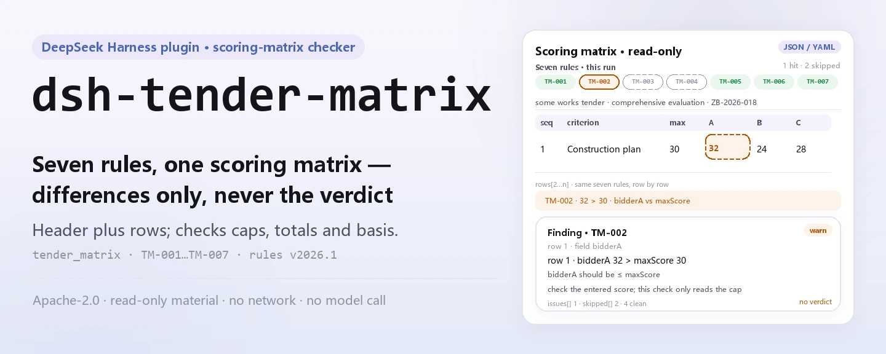
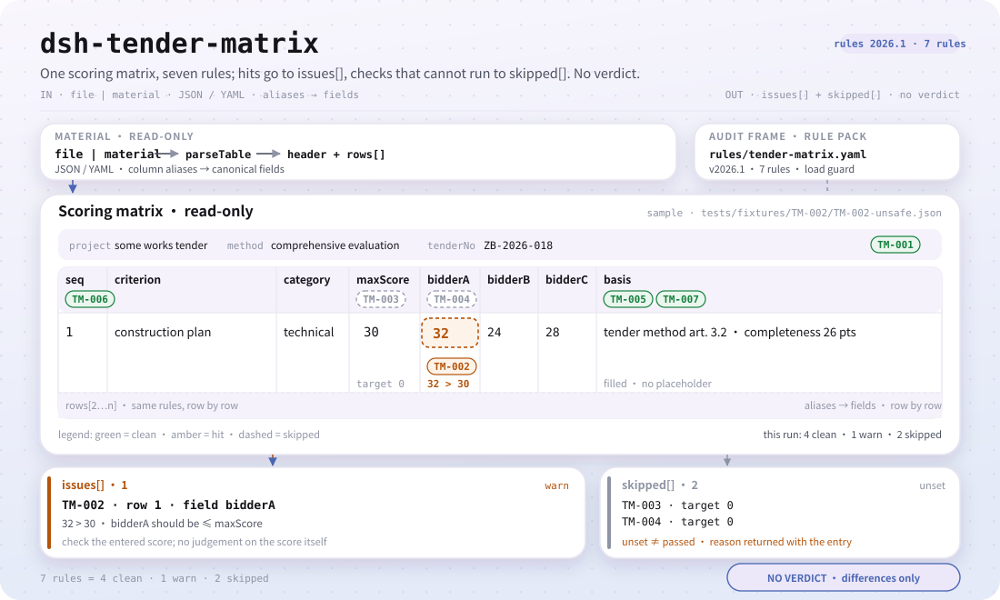

<div align="center">

<picture>
  <source media="(prefers-color-scheme: dark)" srcset="docs/assets/dsh-tender-matrix-hero-en-dark.webp">
  
</picture>

# dsh-tender-matrix

**Aponte os erros aritméticos de uma matriz de pontuação de fatores de avaliação antes da reunião de revisão — apenas diferenças, nunca o veredicto do comitê.**

Um verificador do DeepSeek Harness para agências de licitação, apoio à avaliação e revisão interna: lê uma matriz de pontuação (cabeçalho do processo mais uma linha por fator de avaliação) e confere a aritmética e a completude dessa própria matriz com um pacote de regras versionado.

[Instalação](#instalação-em-três-passos) · [Configuração](#configuração) · [FAQ](#faq) · [简体中文](README.md) · [English](README.en.md) · [Español](README.es.md) · [Português](README.pt.md) · [हिन्दी](README.hi.md)

[](LICENSE)
[](#compatibilidade)
[](https://www.npmjs.com/package/dsh-tender-matrix)
[](https://github.com/PerryLink/dsh-tender-matrix/actions/workflows/ci.yml)
[](#compatibilidade)

[](https://github.com/PerryLink/dsh-tender-matrix/stargazers)
[](https://www.npmjs.com/package/dsh-tender-matrix)
[](https://dshfind.com/plugins/PerryLink/dsh-tender-matrix?ref=badge)
[](https://securityscorecards.dev/viewer/?uri=github.com/PerryLink/dsh-tender-matrix)
[](https://dsh.market/)
[](https://gitee.com/perrylink/dsh-tender-matrix)

```sh
dsh plugin --profile <name> add dsh-tender-matrix
```

</div>

<sub>Plugin da comunidade, sem vínculo com a DeepSeek. Repositório canônico: <https://github.com/PerryLink/dsh-tender-matrix> (o Gitee é um espelho).</sub>

## O que é

`dsh-tender-matrix` lê uma **matriz de pontuação de fatores de avaliação** — o cabeçalho do processo (projeto, número da licitação, método de avaliação) mais uma linha por fator de avaliação — e confere a aritmética e a completude dessa própria matriz: se declara o seu projeto e o seu método de avaliação, se nenhuma pontuação excede o máximo da sua rubrica, se os máximos das rubricas somam o valor que você configurar, se as pontuações de um concorrente somam o valor que você configurar, se cada pontuação registra o seu fundamento, se os números de fator são únicos e se não resta nenhum marcador de modelo por substituir na coluna do fundamento.

Devolve uma lista de qual linha, qual coluna e o que difere, para a agência de licitação, o apoio à avaliação e a revisão interna conferirem ponto a ponto. **Não** emite veredicto de conformidade, não atribui responsabilidade, não substitui o revisor nem decide quem deve ganhar: a pontuação é o julgamento independente do comitê de avaliação, e os pesos e critérios pertencem ao documento do concurso.

<picture>
  <source media="(prefers-color-scheme: dark)" srcset="docs/assets/dsh-tender-matrix-flow-v5-dark.svg">
   30; TM-003/TM-004 são puladas porque target não está configurado; duas saídas, issues[] e skipped[], sem veredicto de conformidade.">
</picture>

## Instalação em três passos

1. **Instalar** (escolha um canal):

   ```sh
   # canal git (main mais recente; equivale a git+https://github.com/PerryLink/dsh-tender-matrix.git)
   dsh plugin --profile web add github:PerryLink/dsh-tender-matrix
   # canal npm (versões publicadas)
   dsh plugin --profile web add dsh-tender-matrix
   # canal tarball: após pnpm pack neste repositório
   dsh plugin --profile web add ./dsh-tender-matrix-<version>.tgz
   ```

   `lib/index.mjs` é o artefato publicado; ao instalar a partir do código-fonte, o `prepare` executa o `tsdown` para gerá-lo, e nada é compilado em tempo de execução.

2. **Configuração mínima** (os padrões funcionam; o `cordis.patch.yml` insere uma linha e só se acrescenta configuração quando necessário):

   ```yaml
   - insert:
       - id: dsh-tender-matrix
         name: dsh-tender-matrix
   ```

3. **Verificar que monta**:

   ```sh
   dsh --profile web --dump-config | grep 'dsh-tender-matrix'
   node samples/quickstart/run.mjs --check
   ```

   O segundo comando executa o exemplo incluído e mostra 1 `warn` e 2 `skipped`; o resultado esperado está em `samples/quickstart/expected/result.json`.

Também pode procurar «Tender Compliance Suite» no WorkBuddy / Coze (esta verificação é uma das suas partes; a disponibilidade é a indicada na loja).

**Desinstalar**: `dsh plugin --profile web remove dsh-tender-matrix` (ou remova a linha do patch do perfil).

<details>
<summary>Teste de um minuto</summary>

A entrada do exemplo está em `samples/quickstart/input/TM-001-unsafe.json`, a saída esperada em `samples/quickstart/expected/result.json` e a captura em `docs/assets/quickstart.png`.


</details>

## Capacidades principais

`dsh-tender-matrix` registra uma ferramenta, `tender_matrix`: lê um material (JSON ou YAML), aplica um pacote de regras versionado e devolve um relatório. O pacote de regras é um arquivo de dados: substitua `rules/tender-matrix.yaml` para trocar o conjunto de regras sem tocar no código.

| Regra | O que verifica | Gravidade | Tipo de fundamento |
|---|---|---|---|
| `TM-001` | a matriz declara o projeto e o método de avaliação | warn | derivado de princípio |
| `TM-002` | nenhuma pontuação excede o máximo da sua rubrica | warn | derivado de princípio |
| `TM-003` | os máximos das rubricas somam o valor configurado (desativada por padrão) | info | configuração institucional |
| `TM-004` | as pontuações de um concorrente somam o valor configurado (desativada por padrão) | warn | derivado de princípio |
| `TM-005` | cada pontuação registra o seu fundamento | warn | derivado de princípio |
| `TM-006` | os números de fator são únicos | warn | derivado de princípio |
| `TM-007` | a coluna do fundamento não contém marcadores por substituir | warn | derivado de princípio |

- **Dados separados do código** — o pacote `rules/tender-matrix.yaml` declara cada verificação e é validado ao carregar; substituir o arquivo substitui o conjunto de regras.
- **Uma lista vazia não significa «nada está errado»** — toda verificação que não pôde ser executada é informada em `skipped` com o seu id e motivo; um «não se aplica», como a ausência da coluna `basis`, é dito em vez de passar em silêncio.
- **Apenas diferenças** — o relatório indica qual linha, qual coluna, o que há, o que se espera e como conferir; não emite veredicto de conformidade, não atribui responsabilidade nem substitui o revisor.
- **Material somente leitura** — a ferramenta lê `file` ou `material`; nunca modifica o original nem grava de volta.
- **Pacote de regras verificável** — cada regra traz documento, número, cláusula, trecho literal e URL de origem; um trecho com menos de oito caracteres ou uma gravidade acima do seu tipo de fundamento falha ao carregar.

### Exemplos

Estes são os pontos de entrada reais do plugin; instale uma vez e chame um.

**Exemplo detalhado** — ferramenta `tender_matrix`, entrada:

```json
{"rows":[{"评审因素":"施工组织设计","分值":"30","投标人A":"32"}]}
```

Saída:

```json
{
  "id": "dsh-tender-matrix.TM-002.de09b5a6",
  "ruleId": "TM-002",
  "severity": "warn",
  "locator": {
    "row": 1,
    "field": "bidderA"
  },
  "found": "第 1 行「bidderA」为 32，「maxScore」为 30，不满足不大于关系",
  "expected": "「bidderA」应不大于「maxScore」",
  "fix": "核对评分是否抄错；本条只核对是否超出分值上限，不判断评分是否恰当"
}
```

*Observado em `dsh-tender-matrix/tests/fixtures/TM-002/TM-002-unsafe.json`*

**Exemplo breve**: `tender_matrix` com `samples/quickstart/input/TM-001-unsafe.json` devolve `issueCount: 1`, `warn: 1` e `skippedCount: 2` numa chamada.

## Normas que segue

| Documento | Número | Regras que o citam |
|---|---|---|
| Lei de Licitação e Contratação da República Popular da China | Aprovada em 30-08-1999; alterada em 27-12-2017 (decisão do Comitê Permanente da Assembleia Popular Nacional que altera a Lei de Licitação e Contratação e a Lei de Metrologia); em vigor desde 01-01-2000 | TM-001, TM-002, TM-003, TM-004, TM-005, TM-006, TM-007 |

**Limite:** este plugin confere a aritmética de uma **matriz de pontuação de fatores de avaliação** — se a matriz declara o projeto e o método de avaliação, se nenhuma pontuação excede o máximo da sua rubrica, se os máximos somam o que você configurar, se as pontuações de um concorrente somam o que você configurar, se cada pontuação registra o seu fundamento, se os números de fator são únicos e se não resta nenhum marcador. **Não** decide se uma pontuação é adequada, se a avaliação foi justa nem quem deveria ganhar. **A pontuação é o julgamento independente do comitê de avaliação, e os pesos e critérios pertencem ao documento do concurso.**

> ### ⚠️ Leia isto antes de confiar numa citação do relatório
>
> **Cada `excerpt` do pacote de regras é uma citação literal da cláusula que cita, e o portão de citações reconfere cada segmento contra o registro em `rules/evidence/`.** O pacote reproduz literalmente um requisito quando a cláusula o diz, e para em `warn` quando a cláusula apenas o implica: uma verificação que repousa num princípio geral fica abaixo de `error` e diz isso no seu próprio `note`. O que o pacote não faz é parafrasear uma cláusula e apresentar a paráfrase como citação. Quando o texto não pôde ser obtido, o `excerpt` diz isso com clareza e nenhuma citação é inventada.
>
> **O plugin não inclui nenhuma escala de pontuação.** As duas regras de totais saem com `target: 0`, isto é, «não configurado»:
>
> - `TM-003` compara a soma dos `maxScore` das rubricas com `target`. 100 é comum, mas existem escalas de 120 pontos e esquemas ponderados, então o total é o número do seu documento do concurso e a regra informa que não pôde rodar até você defini-lo.
> - `TM-004` compara a soma das pontuações de um concorrente com `target`. A verificação contrasta a coluna com o número **que você** indica; deliberadamente não está ligada a nenhuma coluna de total por concorrente, para continuar sendo uma soma pura.
>
> `TM-002` verifica a coluna A por padrão (`bidderA` contra `maxScore`). Acrescente uma regra para B e outra para C, ou substitua `leftField` em cada chamada.

O portão de carregamento exige que cada `excerpt` tenha pelo menos oito caracteres e seja uma citação real, mas não distingue uma citação de uma descrição; por isso este pacote se apoia no cabeçalho do pacote, no `note` de cada regra e num teste que obriga cada trecho a reconhecer a lacuna.

## Configuração

Todos os parâmetros ajustáveis vivem no esquema Schemastery de `src/config.ts`; mudam pelo `cordis.yml` sem editar código. Os limites por regra ficam no pacote sob `rules/`.

Chaves mais usadas:

| Chave | Tipo | Padrão | Descrição |
|---|---|---|---|
| `rulesFile` | string | `rules/tender-matrix.yaml` | Caminho do pacote de regras, relativo à raiz do pacote |
| `disabledRules` | string[] | `[]` | Ids de regras a desativar; cada uma aparece em `skipped` |
| `onlyRules` | string[] | `[]` | Executar apenas estas regras; vazio executa todas |
| `skipNotes` | string | `""` | Nota acrescentada a cada motivo de `skipped` |
| `timeoutMs` | number | `120000` | Orçamento de tempo limite cooperativo da ferramenta (milissegundos) |

<details>
<summary>Parâmetros por regra (TM-002 / TM-003 / TM-004 / TM-007)</summary>

- `TM-002` `leftField` / `rightField` / `relation` — as duas colunas comparadas e a relação; por padrão `bidderA <= maxScore`.
- `TM-003` `target` — o total que os máximos das rubricas devem alcançar; `0` significa que a regra não roda.
- `TM-004` `field` / `target` — a coluna do concorrente e o total que ela deve alcançar; `0` significa que a regra não roda.
- `TM-007` `terms` — os marcadores procurados.

</details>

Exemplo de substituição no patch do perfil:

```yaml
- insert:
    - id: dsh-tender-matrix
      name: dsh-tender-matrix
      config:
        onlyRules: [TM-001, TM-002, TM-005, TM-006, TM-007]
        skipNotes: regra institucional 4 deste comprador
```

### Formato do material

A ferramenta aceita JSON ou YAML:

```yaml
project: 某某工程施工招标
tenderNo: ZB-2026-018
method: 综合评估法
rows:
  - { 序号: '1', 评审因素: 施工组织设计, 分值: '30', 投标人A: '26',
      投标人B: '24', 投标人C: '28', 评分依据: '按招标文件评标办法第 3.2 条' }
```

Os nomes de coluna são comparados sem distinguir maiúsculas de minúsculas e ignorando espaços, sublinhados e hífenes, de modo que um cabeçalho chinês para o concorrente A e `bidderA` apontam para o mesmo campo; os nomes próprios da matriz são preservados, então um achado nomeia a coluna que realmente leu. Os campos são opcionais na camada de leitura e validados pelo motor, de modo que uma exportação parcial produz achados de «falta» em vez de falha. O Excel pode ser convertido antes para JSON/YAML, inclusive no chat se a plataforma permitir.

## FAQ

<details>
<summary>Todas as células da matriz estão preenchidas, por que as duas regras de totais retornam `skipped`?</summary>

Porque as duas vêm sem configuração: `TM-003` compara a soma da coluna `maxScore` com o seu `target`, e `TM-004` soma as pontuações `bidderA` de um concorrente contra o seu `target`; ambas trazem `target: 0`, ou seja «não configurado», então cada uma se reporta em `skipped` em vez de passar em silêncio até você inscrever o número indicado no documento do concurso. Depois de configurada, uma ocorrência significa apenas que a soma difere do número que você fixou, não que a escala de pontuação seja irregular; `TM-004` é soma pura e deliberadamente não está ligada a nenhuma coluna de total por concorrente.

</details>

<details>
<summary>Uma rubrica tem o máximo de 100 mas uma célula diz 105, e noutra linha a célula da pontuação contém uma palavra de nota.</summary>

`TM-002` reporta ambos os casos. Compara `bidderA` com `maxScore` rubrica a rubrica e reporta a linha cuja pontuação excede o máximo dessa rubrica; quando as duas células estão preenchidas mas nenhuma pode ser lida como número ou data, essa linha é reportada como não comparável em vez de ser omitida, ao passo que uma linha à qual falte uma das duas não é comparada de todo. É apenas uma comparação numérica e nunca julga se a pontuação é adequada; lê a coluna A por padrão, por isso cubra B e C com uma regra adicional ou com uma substituição de `leftField`.

</details>

<details>
<summary>Algumas linhas deixam vazia a coluna do fundamento, ou ainda trazem marcadores de modelo como colchetes vazios ou `TBD`.</summary>

Ambos são reportados. `TM-005` exige que a célula `basis` esteja preenchida em todas as linhas às quais o material dá essa coluna, e reporta cada uma que esteja em branco; verifica apenas que algo está escrito, não se o fundamento registrado se sustenta, é adequado ou corresponde à pontuação. `TM-007` reporta a célula `basis` que ainda contém algum dos seus termos de modelo:

```text
【 】 {{ }} XXX xxx 待填 待补充 TBD todo 示例
```

Essa lista é ajustável ao seu próprio modelo. A falha que visa é um marcador ser lido como um motivo já registrado. Se a matriz não tiver nenhuma coluna `basis`, `TM-005` reporta que não se aplica em vez de passar em silêncio.

</details>

<details>
<summary>O mesmo número de fator aparece em duas linhas da matriz. O que é reportado?</summary>

`TM-006` reporta o número repetido, comparando sem considerar os espaços. A unicidade é tudo o que estabelece, e importa porque uma repetição faz com que o total dos máximos saia errado: ou o mesmo fator foi registrado duas vezes, ou dois fatores foram numerados por erro como um só. Não decide qual das duas linhas é a correta.

</details>

<details>
<summary>O cabeçalho não diz a que projeto pertence esta matriz nem que método de avaliação segue.</summary>

`TM-001` exige que o cabeçalho do material traga `project` e `method` e reporta o que faltar; verifica apenas que o cabeçalho os declara, não que concordem com o documento do concurso. Se o formulário da sua instituição não tiver coluna de método de avaliação, ponha os `fields` dessa regra em `[project]` para deixar de pedir uma coluna que o seu formulário nunca traz.

</details>

<details>
<summary>Onde os dados ficam? Conecta à rede ou chama um modelo? Qual é o custo de desempenho?</summary>

Tudo acontece no processo local: lê apenas o `file` ou o `material` que você passa e o pacote de regras, não faz pedidos de rede, não chama nenhum modelo, não grava telemetria e não guarda uma segunda cópia além do resultado da ferramenta. O armazenamento de sessão e registros do host é controlado pelo host; este pacote não acrescenta cópia. O custo cresce linearmente com o número de linhas da matriz e é dominado pela análise e pela comparação linha a linha; o orçamento de tempo é governado por `timeoutMs`. Remover o pacote remove apenas código: não apaga os registros de sessão do host nem o material que você já criou.

</details>

<details>
<summary>Disputa nomes de ferramenta, chaves de serviço ou slots com outros plugins?</summary>

Não. Registra exatamente uma ferramenta, `tender_matrix`, removida pelo disposer devolvido por `ctx.tools.register` ao descarregar ou recarregar a quente; não oferece chave de serviço, não registra slot de cliente, não registra rota `webServer`, não escuta eventos compartilhados e não altera objetos globais. O patch do pacote apenas insere a sua própria linha e nunca sobrescreve o `config` de uma linha embutida. A argumentação ponto a ponto está em «Interoperabilidade com outros plugins DSH».

</details>

## Limites de segurança

- **Sem veredicto qualitativo.** O relatório apenas enumera diferenças que o próprio material permite apontar; não decide conformidade, responsabilidade, se uma pontuação é adequada, se a avaliação foi justa nem quem deve ganhar. O relatório sempre leva o aviso de isenção, e um guardião de redação vigia a sua formulação.
- **Sem citações inventadas.** Cada regra deve preencher `document` / `number` / `clause` / `excerpt` / `kind` / `source`; o `excerpt` é citação literal e, quando o texto não pôde ser obtido, diz isso. `kind: derived-from-principle` fica limitado a `warn` e `kind: institutional-configuration` a `info`, tudo validado ao carregar.
- **Um resultado vazio não é «nada está errado».** Toda verificação que não pôde ser executada é informada em `skipped` com o seu motivo; um «não se aplica», como a ausência da coluna `basis`, é dito em vez de passar em silêncio.
- **Material somente leitura.** A ferramenta lê apenas `file` ou `material`; não modifica o original, não grava de volta nem cria uma segunda cópia.
- **Registros são efeitos.** O registro da ferramenta devolve um disposer; parar ou recarregar a quente o plugin remove-o sem deixar estado global.

## Permissões e dados

- **Permissões**: o plugin usa apenas o serviço `tools`; lê o arquivo de material que você passa explicitamente e o pacote de regras incluído, não grava arquivos, não faz pedidos de rede e não lê credenciais.
- **Dados**: o conteúdo do material é analisado e comparado apenas no processo; nada é conservado além do resultado da ferramenta. O armazenamento de sessão e registros do host é controlado e retido pelo host; este pacote não acrescenta cópia.
- **Declaração do manifesto**: `package.json#dsh.demo` declara `reads` como o arquivo de material indicado pelo usuário, `writes` vazio, `network: false` e `external: []`.
- **Remoção**: remover o pacote remove apenas código; não apaga os registros de sessão do host nem o material que você já criou.

## Limitações conhecidas

- **Verifica apenas a aritmética e a completude da própria matriz.** Sete regras cobrem a declaração de projeto/método, o teto por rubrica, os dois totais, o fundamento da pontuação, a unicidade dos números de fator e os marcadores; não decide se uma pontuação é adequada, se a avaliação foi justa, quem deve ganhar nem se a matriz coincide com o documento do concurso: isso exige comparação humana.
- **As duas regras de totais estão desativadas por padrão.** `TM-003` / `TM-004` saem com `target: 0` e reportam `skipped` até serem configuradas; `TM-004` é soma pura e deliberadamente não está ligada a uma coluna de «total do concorrente». O total é o número do documento do concurso deste projeto; o plugin não o presume.
- **`TM-002` verifica apenas a coluna A por padrão.** Compara `bidderA` com `maxScore`; B e C precisam de uma regra adicional cada, ou de uma substituição de `leftField` por chamada. É uma comparação numérica e nunca julga se uma pontuação é desproporcionalmente alta ou baixa.
- **As citações têm uma lacuna geracional.** Algumas regras só podem ser derivadas de um princípio, por isso o seu `kind` é `derived-from-principle` e ficam limitadas a `warn`; o seu `excerpt` diz claramente que o texto da cláusula não foi obtido. O portão de citações garante que uma citação é uma citação, não que a cláusula reja diretamente a verificação: um limite que este pacote mantém de propósito.
- **Nomes de coluna são comparados literalmente.** A comparação ignora maiúsculas, espaços, sublinhados e hífenes; duas colunas com o mesmo significado mas nomes diferentes não são unificadas automaticamente. Se faltar uma coluna, a regra reporta «não se aplica» ou `skipped` em vez de adivinhar um resultado.
- **O tempo é de relógio de parede.** As comparações de datas operam sobre as cadeias de entrada como valores de relógio de parede, sem conversão de fuso horário.
- **Escopo medido de plataformas.** ESM puro, sem código nativo, sem rede, sem chamadas a modelos; os testes deste repositório foram executados no Linux, e outras plataformas capazes de rodar DSH não foram medidas uma a uma.
- **Versão do pacote de regras.** O pacote atual é `2026.1`; substituir `rules/tender-matrix.yaml` muda o comportamento, e o arquivo substituto também é validado ao carregar.

## Interoperabilidade com outros plugins DSH

- **O único nome global que ocupa é o da ferramenta `tender_matrix`.** Não oferece chave de serviço, não registra slot de cliente, não registra rota `webServer` e não escuta nenhum evento compartilhado, então não há colisão de chave de serviço, slot, rota HTTP nem cadeia de eventos.
- **Depende apenas do serviço `tools`.** `inject: ['tools']`; o registro é removido pelo disposer devolvido por `ctx.tools.register`, de modo que parar ou recarregar a quente limpa tudo.
- **O patch apenas acrescenta.** `cordis.patch.yml` apenas insere a sua própria linha e nunca sobrescreve o `config` de uma linha embutida.
- **Sem mutação global.** Não faz patch de protótipos, não reescreve `process.env`, não substitui o despachante global de fetch nem grava objetos globais.
- **Seguro em concorrência.** A ferramenta declara `isConcurrencySafe: () => true`; cada chamada lê apenas a sua entrada e o pacote de regras, sem estado mutável compartilhado.
- **Pacote de regras sob demanda.** `rulesFile` é resolvido em relação à raiz do pacote, percorrendo os ancestrais e lançando todos os caminhos tentados se não aparecer, para não cair em silêncio no pacote errado.

## Compatibilidade

| Superfície | Estado |
|---|---|
| Harness | Faixa de peers `>=0.1.2-rc.1 <0.2.0 \|\| >=0.2.0-0 <0.3.0` — verificada para aceitar tanto `0.2.0-rc.2` quanto `0.2.1-rc.2`. `engines.dsh` é declarado como `>=0.2.1-0 <0.3.0` e o host o aplica desde 0.2.1 |
| Node | `^22.19.0 \|\| >=24.0.0` |
| Plataformas | Qualquer host DSH que execute ESM puro (sem código nativo, sem rede, sem chamadas a modelos); os testes deste repositório foram executados no Linux |
| Modo de ferramenta | Funciona em `native` e `ptc`; para conferir vários pacotes de uma vez use `ptc`, assim o custo do esquema é pago uma só vez |

## Ecossistema e qualidade

- [Espelho no Gitee](https://gitee.com/perrylink/dsh-tender-matrix) (espelho sincronizado; o GitHub é o canônico)
- [Página no dshfind](https://dshfind.com/plugins/PerryLink/dsh-tender-matrix) (instalações e ranking)
- [Relatório do OpenSSF Scorecard](https://securityscorecards.dev/viewer/?uri=github.com/PerryLink/dsh-tender-matrix) (movido por [.github/workflows/scorecard.yml](.github/workflows/scorecard.yml))
- [DSH Market](https://dsh.market/) (listado)
- [Escolha um verificador por material](https://perrylink.github.io/zh/checkers/choose/) (índice de seleção da família; este repositório é um deles)

## Desenvolvimento

```sh
pnpm install
pnpm run typecheck                 # tsc --noEmit
pnpm test                          # vitest: suíte compartilhada de plugins de tabela + fixtures emparelhados
pnpm run build                     # tsdown -> lib/index.mjs + lib/index.d.mts
pnpm run verify:self-contained     # as dependências resolvem pelo registry
pnpm run check:lockfile            # verificação de deriva do lockfile
pnpm run check:readmes             # consistência dos README em cinco idiomas
pnpm run check:citations           # portão de citações das regras
pnpm pack                          # tarball publicado
node ../scripts/sync-shared.mjs dsh-tender-matrix   # atualizar src/shared
```

O `prepublishOnly` volta a rodar o portão, então uma publicação não sai com a árvore fora de sincronia. As imagens do README são geradas por `scripts/gen-readme-assets.py` (Python + Pillow: quatro WebPs de hero e `docs/assets/dsh-tender-matrix-flow-v5-{light,dark}.svg`) e podem ser executadas novamente sem risco.

| Caminho | Função |
|---|---|
| `src/index.ts` | registra a ferramenta `tender_matrix`, resolve o pacote de regras e lê o material |
| `src/config.ts` | esquema de configuração Schemastery; entrada única de todos os parâmetros |
| `src/check.ts` | núcleo de verificação puro `(input, ruleset, options) => Report`, sem E/S, relógio ou modelo |
| `src/parse.ts` | leitor de material JSON / YAML |
| `src/view.ts` | projeção do relatório para o modelo; `output.schema` a espelha |
| `src/shared/` | kit compartilhado (carregador de regras, forma do relatório, subconjunto YAML, aritmética de calendário, guardião de redação), copiado em vez de importado |
| `rules/tender-matrix.yaml` | pacote de regras: dados de sete regras |
| `rules/evidence/` | registro de verificação de cada citação |
| `tests/` | vitest; cada regra tem fixtures emparelhados conforme/infrator |
| `scripts/gen-readme-assets.py` | gerador do hero e do diagrama de estrutura (Pillow + SVG escrito à mão) |

### Solução de problemas

- **Instala mas a ferramenta não aparece**: confirme que `main` resolve para `lib/index.mjs` e que `pnpm run build` o gerou; um `main` errado faz o carregador ignorar a entrada em silêncio.
- **`dsh plugin add` recusa o pacote por incompatibilidade**: a faixa de peers cobre `0.1.x` e `0.2.x`; se o seu runtime estiver fora dela, conceda uma isenção explícita: `dsh plugin --profile <name> allow-version dsh-tender-matrix@0.2.15 --dsh-version <runtime> --accept-risk`.
- **Uma regra não rodou**: leia o arranjo `skipped`; ele indica o id da regra e o motivo. Sem coluna `basis`, `TM-005` reporta «não se aplica».
- **`check` reporta `manifest-peers` como falha**: o verificador estático compara com uma faixa de peers codificada anterior à linha 0.2; o runtime impõe a compatibilidade de peers na instalação. É um problema conhecido do `dsh-plugin-dev`.
- **Os horários parecem deslocados**: toda a aritmética é de relógio de parede sobre as cadeias de entrada, sem conversão de fuso horário.

Topics: `deepseek-harness`, `dsh`, `dsh-plugin`, `cordis`, `tender`, `matrix`

## Família e agradecimentos

Este projeto faz parte da família de plugins do DeepSeek Harness da [PerryLink](https://github.com/PerryLink) (todos Apache-2.0). Se for útil, **uma estrela ajuda a próxima pessoa a encontrá-lo** — nada fica bloqueado por ela.

- [@PerryLink](https://github.com/PerryLink) — criador e mantenedor: o pacote de regras, o motor de verificação, a superfície da ferramenta `tender_matrix` e a documentação em cinco idiomas.

<details>
<summary>Expandir todos os plugins</summary>

| Plugin | Status |
|---|---|
| **[dsh-aqua-input-check](https://github.com/PerryLink/dsh-aqua-input-check)** |  |
| **[dsh-archive-check](https://github.com/PerryLink/dsh-archive-check)** |  |
| **[dsh-auto-review](https://github.com/PerryLink/dsh-auto-review)** |  |
| **[dsh-autotier](https://github.com/PerryLink/dsh-autotier)** | 🧊 CONGELADO — ver o README do repo |
| **[dsh-bid-ca-precheck](https://github.com/PerryLink/dsh-bid-ca-precheck)** |  |
| **[dsh-bid-qual-check](https://github.com/PerryLink/dsh-bid-qual-check)** |  |
| **[dsh-cert-mcp](https://github.com/PerryLink/dsh-cert-mcp)** | 🧊 CONGELADO — ver o README do repo |
| **[dsh-checkpoint-rewind](https://github.com/PerryLink/dsh-checkpoint-rewind)** |  |
| **[dsh-click](https://github.com/PerryLink/dsh-click)** |  |
| **[dsh-composer-history](https://github.com/PerryLink/dsh-composer-history)** |  |
| **[dsh-contract-stance](https://github.com/PerryLink/dsh-contract-stance)** |  |
| **[dsh-customs-doc-check](https://github.com/PerryLink/dsh-customs-doc-check)** |  |
| **[dsh-data-quality](https://github.com/PerryLink/dsh-data-quality)** | 🧊 CONGELADO — ver o README do repo |
| **[dsh-demurrage-ledger](https://github.com/PerryLink/dsh-demurrage-ledger)** |  |
| **[dsh-doublecheck](https://github.com/PerryLink/dsh-doublecheck)** |  |
| **[dsh-drill-script-check](https://github.com/PerryLink/dsh-drill-script-check)** |  |
| **[dsh-eia-guide-check](https://github.com/PerryLink/dsh-eia-guide-check)** |  |
| **[dsh-emergency-plan](https://github.com/PerryLink/dsh-emergency-plan)** |  |
| **[dsh-essay-rubric-check](https://github.com/PerryLink/dsh-essay-rubric-check)** |  |
| **[dsh-evidence-check](https://github.com/PerryLink/dsh-evidence-check)** |  |
| **[dsh-export-ctl-check](https://github.com/PerryLink/dsh-export-ctl-check)** |  |
| **[dsh-fast](https://github.com/PerryLink/dsh-fast)** |  |
| **[dsh-fmea-table-check](https://github.com/PerryLink/dsh-fmea-table-check)** |  |
| **[dsh-forecast-penalty](https://github.com/PerryLink/dsh-forecast-penalty)** |  |
| **[dsh-fund-research](https://github.com/PerryLink/dsh-fund-research)** |  |
| **[dsh-github](https://github.com/PerryLink/dsh-github)** |  |
| **[dsh-gongwen-flow-check](https://github.com/PerryLink/dsh-gongwen-flow-check)** |  |
| **[dsh-gongwen-word-check](https://github.com/PerryLink/dsh-gongwen-word-check)** |  |
| **[dsh-guard-plan-qc](https://github.com/PerryLink/dsh-guard-plan-qc)** |  |
| **[dsh-hazchem-check](https://github.com/PerryLink/dsh-hazchem-check)** |  |
| **[dsh-hazplan-check](https://github.com/PerryLink/dsh-hazplan-check)** |  |
| **[dsh-hidden-risk-map](https://github.com/PerryLink/dsh-hidden-risk-map)** |  |
| **[dsh-hs-classify](https://github.com/PerryLink/dsh-hs-classify)** |  |
| **[dsh-icd-rule-check](https://github.com/PerryLink/dsh-icd-rule-check)** |  |
| **[dsh-industry-research](https://github.com/PerryLink/dsh-industry-research)** |  |
| **[dsh-lawcite-adapter](https://github.com/PerryLink/dsh-lawcite-adapter)** |  |
| **[dsh-laya](https://github.com/PerryLink/dsh-laya)** |  |
| **[dsh-lc-doc-check](https://github.com/PerryLink/dsh-lc-doc-check)** |  |
| **[dsh-learning-gap-check](https://github.com/PerryLink/dsh-learning-gap-check)** |  |
| **[dsh-library](https://github.com/PerryLink/dsh-library)** |  |
| **[dsh-local-ai](https://github.com/PerryLink/dsh-local-ai)** |  |
| **[dsh-lsp-actions](https://github.com/PerryLink/dsh-lsp-actions)** |  |
| **[dsh-mask](https://github.com/PerryLink/dsh-mask)** |  |
| **[dsh-mcp-panel](https://github.com/PerryLink/dsh-mcp-panel)** |  |
| **[dsh-medrec-qc](https://github.com/PerryLink/dsh-medrec-qc)** |  |
| **[dsh-memento](https://github.com/PerryLink/dsh-memento)** | 🧊 CONGELADO — ver o README do repo |
| **[dsh-nsfc-form-check](https://github.com/PerryLink/dsh-nsfc-form-check)** |  |
| **[dsh-nurse-record-check](https://github.com/PerryLink/dsh-nurse-record-check)** |  |
| **[dsh-observe](https://github.com/PerryLink/dsh-observe)** |  |
| **[dsh-origin-rvc-check](https://github.com/PerryLink/dsh-origin-rvc-check)** |  |
| **[dsh-ota-review-check](https://github.com/PerryLink/dsh-ota-review-check)** |  |
| **[dsh-output-styles](https://github.com/PerryLink/dsh-output-styles)** |  |
| **[dsh-paper-doc-adapter](https://github.com/PerryLink/dsh-paper-doc-adapter)** |  |
| **[dsh-permission-rules](https://github.com/PerryLink/dsh-permission-rules)** |  |
| **[dsh-permit-report-check](https://github.com/PerryLink/dsh-permit-report-check)** |  |
| **[dsh-pipeline-check](https://github.com/PerryLink/dsh-pipeline-check)** |  |
| **[dsh-pleading-draft](https://github.com/PerryLink/dsh-pleading-draft)** |  |
| **[dsh-plugin-doctor](https://github.com/PerryLink/dsh-plugin-doctor)** | 🚫 APOSENTADO (repo arquivado) |
| **[dsh-plugin-guide](https://github.com/PerryLink/dsh-plugin-guide)** |  |
| **[dsh-plugin-kit](https://github.com/PerryLink/dsh-plugin-kit)** | 🚫 APOSENTADO (repo arquivado) |
| **[dsh-plugin-upgrade](https://github.com/PerryLink/dsh-plugin-upgrade)** | 🚫 APOSENTADO (repo arquivado) |
| **[dsh-policy-brief-draft](https://github.com/PerryLink/dsh-policy-brief-draft)** |  |
| **[dsh-power-loss-split](https://github.com/PerryLink/dsh-power-loss-split)** |  |
| **[dsh-power-ticket-check](https://github.com/PerryLink/dsh-power-ticket-check)** |  |
| **[dsh-ppap-check](https://github.com/PerryLink/dsh-ppap-check)** |  |
| **[dsh-protest-deadline](https://github.com/PerryLink/dsh-protest-deadline)** |  |
| **[dsh-railway-window](https://github.com/PerryLink/dsh-railway-window)** |  |
| **[dsh-repair-order-qc](https://github.com/PerryLink/dsh-repair-order-qc)** |  |
| **[dsh-research-report](https://github.com/PerryLink/dsh-research-report)** |  |
| **[dsh-review-reply-check](https://github.com/PerryLink/dsh-review-reply-check)** |  |
| **[dsh-rulefile-check](https://github.com/PerryLink/dsh-rulefile-check)** |  |
| **[dsh-safety-brief-check](https://github.com/PerryLink/dsh-safety-brief-check)** |  |
| **[dsh-score](https://github.com/PerryLink/dsh-score)** | 🧊 CONGELADO — ver o README do repo |
| **[dsh-session-sync](https://github.com/PerryLink/dsh-session-sync)** |  |
| **[dsh-site-log-check](https://github.com/PerryLink/dsh-site-log-check)** |  |
| **[dsh-skill-pack-security](https://github.com/PerryLink/dsh-skill-pack-security)** |  |
| **[dsh-soe-decision-check](https://github.com/PerryLink/dsh-soe-decision-check)** |  |
| **[dsh-soilwater-check](https://github.com/PerryLink/dsh-soilwater-check)** |  |
| **[dsh-sop-sync-check](https://github.com/PerryLink/dsh-sop-sync-check)** |  |
| **[dsh-spc-gbt-adapter](https://github.com/PerryLink/dsh-spc-gbt-adapter)** |  |
| **[dsh-talk](https://github.com/PerryLink/dsh-talk)** |  |
| **[dsh-tender-extract](https://github.com/PerryLink/dsh-tender-extract)** |  |
| **[dsh-tender-matrix](https://github.com/PerryLink/dsh-tender-matrix)** |  |
| **[dsh-test-drive](https://github.com/PerryLink/dsh-test-drive)** |  |
| **[dsh-ticktick](https://github.com/PerryLink/dsh-ticktick)** | 🚫 APOSENTADO (repo arquivado) |
| **[dsh-translate](https://github.com/PerryLink/dsh-translate)** |  |
| **[dsh-warranty-calc](https://github.com/PerryLink/dsh-warranty-calc)** |  |
| **[dsh-budget](https://github.com/PerryLink/dsh-budget)** |  |
| **[dsh-claude-move](https://github.com/PerryLink/dsh-claude-move)** |  |
| **[dsh-defend](https://github.com/PerryLink/dsh-defend)** |  |
| **[dsh-draw](https://github.com/PerryLink/dsh-draw)** | 🧊 CONGELADO — ver o README do repo |
| **[dsh-reach](https://github.com/PerryLink/dsh-reach)** |  |
| **[dsh-background-agents](https://github.com/PerryLink/dsh-background-agents)** | 🚫 APOSENTADO (repo arquivado) |
| **[dsh-session-pin](https://github.com/PerryLink/dsh-session-pin)** | 🚫 APOSENTADO (repo arquivado) |
| **[dsh-team-rooms](https://github.com/PerryLink/dsh-team-rooms)** | 🚫 APOSENTADO (repo arquivado) |

</details>

## Licença

[LICENSE](LICENSE) (Apache License 2.0) © 2026 dsh-tender-matrix contributors

<p align="center"><sub>Apache-2.0 · Plugin da comunidade, sem vínculo com a DeepSeek.</sub></p>
